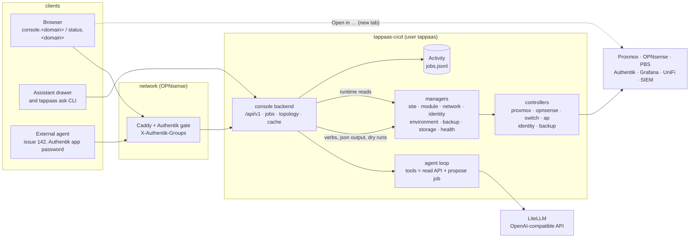
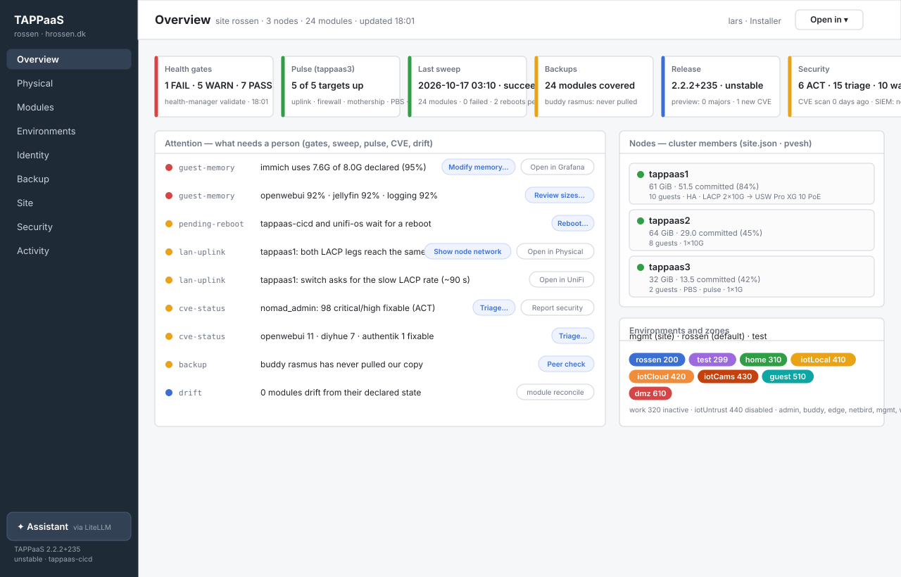
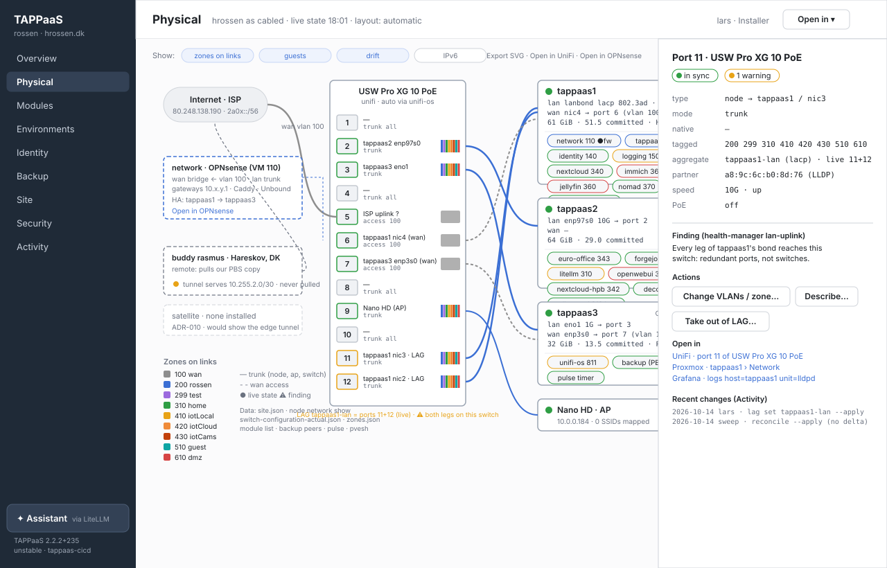
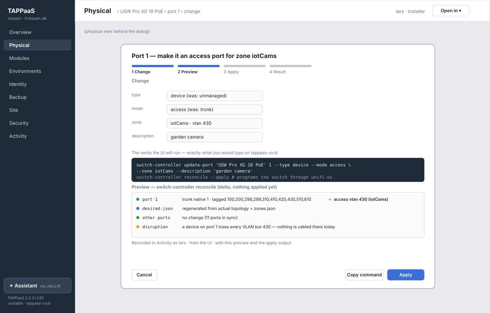
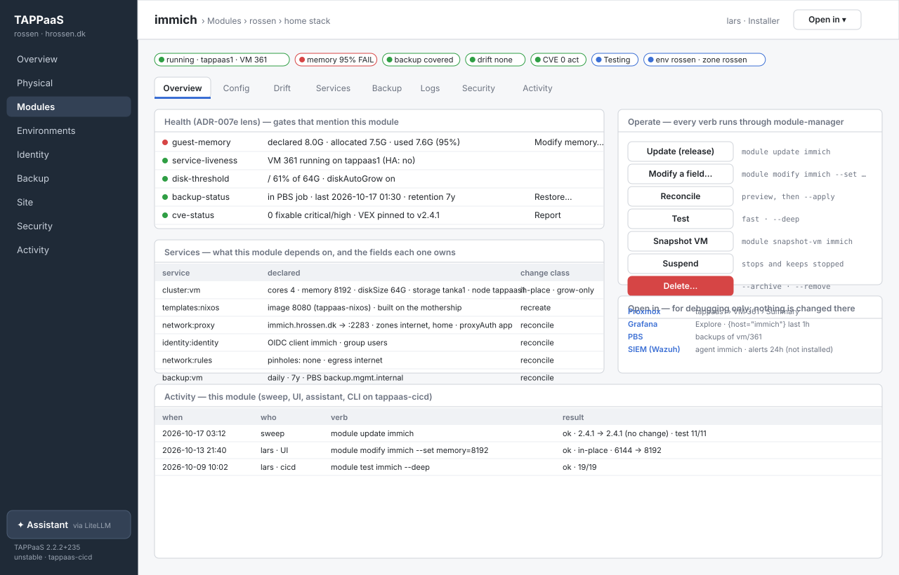
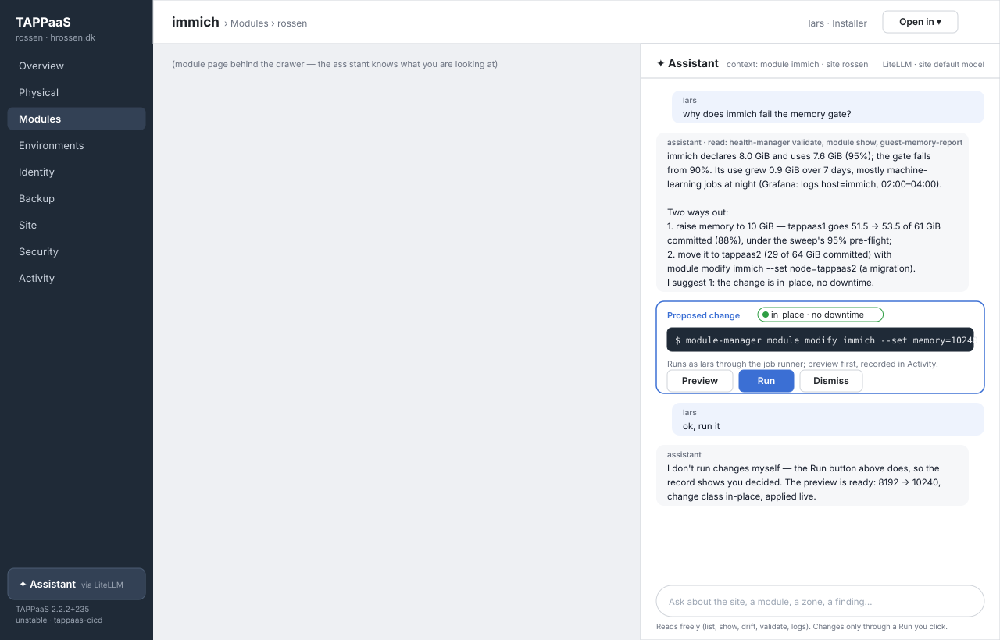
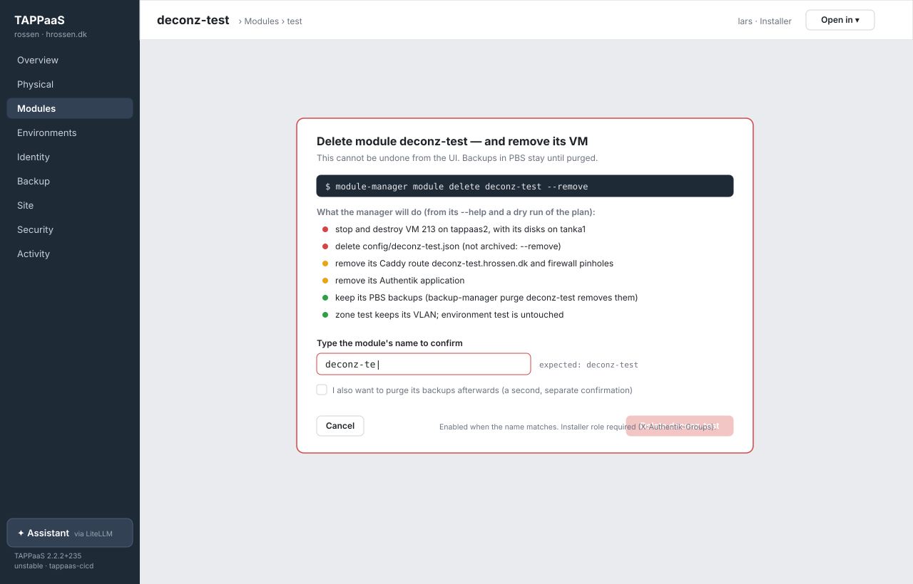
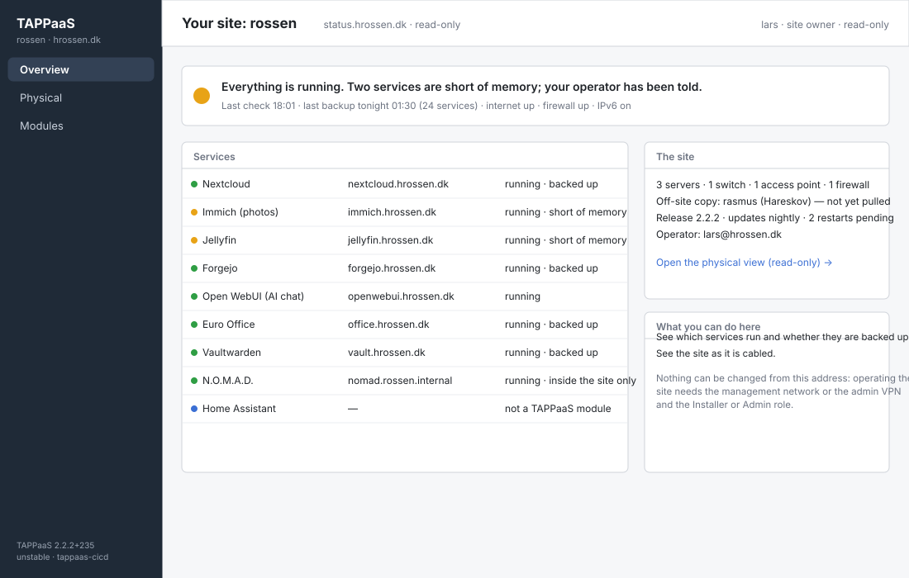

# TAPPaaS user interface — design spike

| | |
|---|---|
| **Status** | Spike result — input to the UI ADR (#844). Nothing here is built. |
| **Date** | 2026-10-17 |
| **Author** | Lars Rossen (drafted with Claude) |
| **Issues** | **#844** (this spike and the ADR), **#839** (the UI, physical view first), **#843** (SIEM), #142 (agent access to tappaas-cicd), #183 (service catalog), #91 (Backstage), #63 (service desk) |
| **Reads** | ADR-007 (taxonomy; 007e Health lens), ADR-007f (managers and controllers), ADR-020 (declared-field changes), ADR-021 / ADR-023 / ADR-032 (reachability, routes, exposure), ADR-031 (pulse), ADR-010 (satellite, admin VPN), `manager/README.md`, `tappaas-cicd/DESIGN.md` |
| **Mockups** | [`ui-spike/`](ui-spike/) — seven SVG wireframes drawn from hrossen's real records (2026-10-17 18:01) |

TAPPaaS is operated from the command line on `tappaas-cicd` and through the web UIs of the parts
it is built from. There is no picture of a site as a whole, no place where its health is read at
a glance, and no way to operate it without a shell. This spike proposes **one TAPPaaS UI** that
shows a running site and its health, draws the site as it is cabled, operates it through the
managers and nothing else, and carries an assistant one can talk to. It records the alternatives
weighed and the decisions the ADR has to take.

The decisions taken with the operator before drafting (2026-10-17):

- **homelable is a library and an inspiration, not the product.** The UI is TAPPaaS's own; the
  physical view borrows homelable's canvas approach.
- **Audience: operators, and the site owner read-only.** End-user badges on the Authentik start
  page and a cross-site view are later.
- **Every manager verb is reachable, destructive ones behind a typed name.**
- **The assistant proposes; the operator runs.** It reads freely and never applies a change itself.

---

## 1. Summary of the recommendation

1. **A native TAPPaaS UI** (working name **`console`**): a TypeScript backend on `tappaas-cicd`,
   running as the `tappaas` user, and a browser front end. The backend is the only thing that
   talks to the managers. It reads runtime state through `lib/ts/src/cluster.ts` like a manager,
   and writes only by running manager verbs — never a controller, never `pvesh` or `ssh`.
2. **One API, three clients.** The browser, the assistant and external agents (#142) all use the
   same `/api/v1`: typed reads over the managers' `--json`, and a **job model** for every change
   that carries the exact command line, its preview and its output.
3. **The physical view is derived, not drawn.** A read-only **topology document** is computed from
   `site.json`, `node network show`, the switch and AP inventories, `zones.json`, the module list,
   the backup peers and the pulse. It is laid out automatically and is the model G6.1 (switching
   fabric) extends. Rendered with React Flow (`@xyflow/react`, MIT), which is also what homelable
   uses.
4. **One operate pattern everywhere:** Change → Preview → Apply → Result. The preview is the
   manager's own dry run (`--check`, `reconcile` without `--apply`, `--dry-run`, the ADR-020
   pre-gate). Destructive verbs need the object's name typed. Everything is recorded in
   **Activity**, with who, the command, the preview and the output.
5. **Reached through Caddy on the firewall** with the Authentik gate (`identity:accessControl`):
   `console.<domain>` for operators from `mgmt` and the admin VPN, `status.<domain>` read-only
   for the site owner from the trusted client zones. The role comes from Authentik's groups.
6. **Jumps, not embeds.** Proxmox, OPNsense, Grafana, PBS, Authentik, UniFi and the SIEM are
   opened in a new tab at the object one is looking at, for debugging. The UI never re-implements
   them.
7. **The assistant runs in the backend**, through LiteLLM's OpenAI-compatible API, with tools that
   are the read API plus *propose a job*. A proposed job is a card with Preview and Run. Without
   the AI stack the assistant is not shown.
8. **Build in four phases**: see (read-only, with jumps) → operate → ask → secure (SIEM, agents).
   Each phase lands on hrossen before the next starts.

---

## 2. What the UI has to do

Collected from #839, #844, #843, #142, #183 and the operator's brief. Numbered so the ADR and
the mockups can point at them.

| | Requirement | From |
|---|---|---|
| **U1** | Show a running site and its health at a glance: the gates, the pulse, the last sweep, backups, the release, CVEs — and what needs a person. | #839, ADR-007e |
| **U2** | Draw the site as it is cabled: nodes and their ports (bonds, `lan`/`wan`), switches and ports, APs and SSIDs, the firewall, the WAN and ISP, the satellite and the buddies. With what runs where (zones and VLANs on each link, guests on each node, HA pairs, the backup node) and live state on it. | #839 |
| **U3** | Operate the site: every manager and every verb, through the managers, never around them. | brief, #844 |
| **U4** | A change is previewed before it is applied, and recorded afterwards. | ADR-020, #844 |
| **U5** | Jump to Proxmox, OPNsense, Grafana, PBS, Authentik, the switch controller and the SIEM — at the object in view — for debugging only. | brief |
| **U6** | An assistant one can ask and converse with about the site, through LiteLLM when the AI stack is installed. | brief |
| **U7** | Runs on `tappaas-cicd` as the `tappaas` user; authenticates through identity; authorizes by role; reachable inside the site through the proxy. | brief, #844 |
| **U8** | A read-only view for the site owner, from the trusted client zones. | operator, 2026-10-17 |
| **U9** | Fed from TAPPaaS's own records, never a hand-drawn diagram. | #839, #844 |
| **U10** | Machine callers (an AI operations agent) use the same API with their own identity. | #142 |
| **U11** | The SIEM's findings are visible where the operator already looks; the SIEM's own dashboard is a jump. | #843 |

What is explicitly **not** in scope: a service desk or ITSM (#63), replacing Grafana, Proxmox or
OPNsense screens, multi-site operation (ADR-024), end-user self-service.

---

## 3. The site it must draw — hrossen as the reference

Everything the physical view needs exists today as manager output. This is what hrossen gave on
2026-10-17, and where each piece comes from:

| What the view shows | Source (read-only verb) | hrossen today |
|---|---|---|
| Cluster members and their pools | `site-manager node list --json` | tappaas1 [tanka1, tankb1] · tappaas2 [tanka1] · tappaas3 [tanka1, tankc1] |
| A node's uplinks: bond mode, legs, speed, LLDP partner, `wan` port | `site-manager node network show <node> --json` | tappaas1: `lanbond` lacp, nic2+nic3 10G → USW-Pro-XG-10-PoE ports 12+11, `wan` nic4; two warnings |
| Switches, controllers, ports, what each port connects to, LAGs, drift | `switch-controller list`, `list-ports`, `lag list` (`switch-configuration-actual.json`) | one UniFi switch, 12 ports: 4 node ports, 3 `wan` access ports (vlan 100), 1 AP port, 4 unmanaged |
| Access points, their uplink port and SSIDs | `ap-controller list` | Nano HD on port 9, 0 SSIDs mapped |
| Zones, VLANs, state, tier | `network-manager list --json` | 8 active VLANs, `work` inactive, `iotUntrust` disabled, 6 manual zones |
| Guests per node, kind, env, zone, VMID, run state | `module-manager module list --json` | 24 modules; the firewall is VM 110 on tappaas1 |
| The WAN | `site.json` `network`, the firewall | `publicIp auto`, IPv6 on; the ISP is cabled to switch port 5 and reaches the nodes' `wan` ports on VLAN 100 |
| Buddies and the satellite | `backup-manager peers`, `backup-manager pulse`, the satellite module | rasmus (remote, Hareskov) pulls over a tunnel, never pulled yet; no satellite |
| Live state | `pvesh /cluster/resources` through `lib/ts/src/cluster.ts`; the pulse | all guests running; pulse 5 of 5 up on tappaas3 |
| Findings on the fabric | `health-manager validate` (`lan-uplink`, `pulse`, `quorum`) | both LACP legs reach the same switch; slow LACP rate |

Two things this makes visible that no single screen shows today: **the WAN path** (ISP → port 5
→ VLAN 100 → ports 6 and 7 → the nodes' `wan` bridges → the firewall VM, and where it can fail
over to) and **where redundancy ends** (both bond legs on one switch).

---

## 4. Alternatives considered

### 4.1 How the UI is made

| | Option | For | Against |
|---|---|---|---|
| **A** | **A native TAPPaaS UI** (recommended) — React front end, TypeScript backend on `tappaas-cicd`, React Flow for the physical view | One UI, one auth, one API; the data model is TAPPaaS's own (modules, zones, services, gates); operate flows fit the managers' verbs and ADR-020's change classes; the backend reuses `lib/ts` and runs where the managers are | Everything is ours to build and keep; the physical canvas is the hardest part and is built from scratch (with a library) |
| **B** | **Fork and extend homelable** — add a TAPPaaS feeder and manager actions | A working canvas, rack view, status checks, docs, REST API, MCP server, OIDC login, Proxmox import on day one; MIT; 4.3k stars | Its model is a hand-placed canvas of devices and links with their own state (positions, canvases, documents, scans); TAPPaaS truth would be *synced into* it — two sources of truth and a reconciliation of our own. No notion of a zone on a port, a bond, a trunk derived from `zones.json`. No operate flows. Python backend (FastAPI, SQLite) beside our TypeScript managers. Seven months old, one maintainer, moving fast — a fork diverges at once |
| **C** | **Embed homelable as a module**, fed by a sync; a thin TAPPaaS console beside it | No fork; its upstream keeps improving; OIDC against Authentik works | Same two-truths problem as B, plus a VM; the operator gets two UIs; the sync is a controller for a visualiser. Homelable's own scanner and documents would show a second, drifting picture of the site |
| **D** | **Backstage** (#91) | The developer-portal standard; a catalog model; plugins | A developer portal, not an operations console; a heavy Node/React monorepo with its own catalog entities and a plugin for everything; nothing of the physical view; its catalog duplicates `module-catalog.json`. Recommend closing #91 with the ADR |
| **E** | **Grafana as the UI** — dashboards, Node Graph panel, buttons via plugins | Already installed, behind Authentik; good at time series and logs; one less thing | A visualisation tool: no forms, no preview/apply, no typed confirmation, no verb manifest; operate would be bolted on with button plugins calling an API we must build anyway. Keep Grafana as the jump target for logs and metrics |
| **F** | **A web terminal** (ttyd/Cockpit) to the CLIs | Cheapest operate surface; the CLIs are the truth | No understanding view; no preview or audit of *intent*; a shell as `tappaas` behind forward-auth is the same power as SSH with a weaker trail. Cockpit's login is PAM, not Authentik. Not recommended, not even as a stop-gap |

**Verdict: A.** B was the issue's first candidate and is worth stating precisely: homelable is
good at what it is — a visualiser one draws and scans into — and TAPPaaS needs a view that is
*derived* from its records and that *acts* through its managers. The canvas library homelable
chose (React Flow) and its visual grammar (status dot on the node, coloured links, a side panel
on click, a rack with ports) are what we borrow. Appendix B has the detail.

### 4.2 How the physical view is drawn

| Option | For | Against |
|---|---|---|
| **React Flow with automatic layout** (dagre or ELK) (recommended) | Interactive: click a port, a guest, a link; pan and zoom; nodes as React components so a node card can hold its guests; auto layout from the derived topology, so nothing is placed by hand and a new node appears where it belongs | Layout of a real site needs rules (WAN top-left, switches centre, nodes right, APs and outside parties on the edges) — the mockup shows them |
| Cytoscape.js | Strong graph layouts | Nodes are not components; richer cards are harder |
| Server-side SVG (d2 or Graphviz, as the docs site uses through kroki) | Trivial to embed in docs and in the failure mail; no front-end state | Not interactive; a port cannot be clicked. Worth having as an **export** (the "Export SVG" button) and later as a site diagram in the documentation |

### 4.3 How the UI talks to the managers

| Option | For | Against |
|---|---|---|
| Generic verb pass-through: `POST /run {argv}` | Nothing to keep in step with the managers | The UI invents nothing, but it also *knows* nothing: no forms, no typed results, and an API that is a shell |
| Typed resource API: `GET /modules`, `POST /modules/immich/modify` | Clean for clients; forms and tables come from types | A second copy of every verb's semantics; drifts from the managers |
| **Hybrid (recommended): typed reads + a job model for writes** | Reads are the managers' `--json`, typed once in the backend. A write is a **job** that carries the exact argv, validated against a **verb manifest** derived from each manager's `--help` (every manager answers `--help` first and refuses an option it does not declare, #644). The UI's forms are built from the manifest; what the UI can do is exactly what the CLI can do | The manifest must be produced from `--help` or declared next to it (§6) |

### 4.4 Backend language

TypeScript, because the F12 rule (`tappaas-cicd/DESIGN.md`) lets a reader of runtime state use
only `lib/ts/src/cluster.ts`, and because the typed reads reuse the managers' own types
(`ClusterInspection`, drift records, resolved desired state). Python would have to shell out for
everything. The front end is React; the preferred-language order of the control plane applies to
the backend.

### 4.5 Where it runs and how it is reached

| Question | Options | Proposal |
|---|---|---|
| A component of `tappaas-cicd`, or a module? | (a) code under `tappaas-cicd/ui/`, unit in `tappaas-cicd.nix`, like the alert receiver; (b) a `console` module of `kind: application` on host `tappaas-cicd` | **Both halves.** The service is (a): the mothership's NixOS config owns what runs on it (#675), so the unit lives there. The published face is (b): a thin `console.json` whose `dependsOn` gives it `network:proxy` and `identity:accessControl`, and whose `integratesWith` gives it `litellm:models` for the assistant's virtual key. The ADR decides whether (b) is a module or fields on `tappaas-cicd.json` |
| One hostname or two? | one with roles; two routes (ADR-032 E4) | **Two routes** on one backend: `console.<domain>` (zones `mgmt`, `admin`) and `status.<domain>` (the trusted client zones). The backend treats the `status` route as read-only whatever the caller's group — defence in depth over the role |
| The gate or OIDC in the app? | `identity:accessControl` (forward-auth, groups in headers) or `identity:identity` (OIDC client) | **The gate.** No login code; roles from `X-Authentik-Groups`; machine callers send an Authentik credential at the gate (ADR-032 D3), which answers #142 without a second token scheme. The backend accepts connections **only from the firewall's address** so the headers cannot be forged from `mgmt` |
| Who may operate? | Authentik groups | Installer and Admin operate; destructive verbs Installer only; `users` read the `status` route. The exact mapping is the ADR's |

### 4.6 The assistant

| Question | Options | Proposal |
|---|---|---|
| Where does the agent loop run? | in the UI backend; in Open WebUI with tools; an MCP server for Claude Code and friends | **The backend**, so the tools, the audit and the role are the same as for a click. An MCP façade over the same API is cheap and can come later for Claude Code and Open WebUI |
| How far may it go? | advisor; proposes and runs on click; agentic within a scope | **Proposes, runs on click** (decided). Reads are free: every `list`, `show`, `drift`, `validate`, `report`, the logs. A change is a proposed job card; only the operator's click runs it |
| Which model? | the site's LiteLLM default; a named model | LiteLLM's default routing; the virtual key comes from `litellm:models` like any consumer |
| Without the AI stack? | hide; external endpoint | **Hidden.** The brief says through LiteLLM when installed; nothing else leaves the site |

---

## 5. The approach

### 5.1 Shape — one backend, three clients



The backend is a **manager-shaped reader and a verb runner**. It keeps a cache of the reads it
makes on a timer (health every 10 minutes, the module list and the topology every 5, drift on
demand), serves them, and streams job output over server-sent events. It never holds state the
managers do not: Activity is the only thing it writes, as an append-only log under
`/var/lib/tappaas/console/`.

### 5.2 Information architecture

The navigation follows ADR-007 — the Site, its three classification domains, and Health as a
lens over all of them — with the managers behind each page:

| Page | Shows | Managers and verbs behind it |
|---|---|---|
| **Overview** | Health strip (gates, pulse, last sweep, backups, release, security) and the **Attention** list: every FAIL and WARN, the sweep's failures ledger, pending reboots, CVE acts, drift, a held repository. Each row has the verb that answers it and a jump | `health-manager validate`, `backup-manager pulse`/`list`, `update-tappaas` state, `tappaas-train preview`, `config/sbom/cve-status.json` |
| **Physical** | The site as cabled (§5.5), live state and findings on it; a side panel per object; day-2 changes from the panel | `site-manager node network show/set/test`, `switch-controller` inventory and five-verb flow, `ap-controller`, `network-manager list/show` |
| **Modules** | The module list with badges; a module page with tabs Overview · Config · Drift · Services · Backup · Logs · Security · Activity; **Add module** from the catalogues of every registered repository, and **Add stack** | `module-manager module *`, `add-stack`, `backup-manager show/coverage/restore`, `health-manager reboot/update-os` |
| **Environments** | Environments and their zones; a zone page with its modules, the ports that carry it, its firewall rules | `environment-manager *`, `network-manager add/modify/enable/disable/bind/delete/reconcile`, `rules-manager list-rules/overlaps` (read) |
| **Identity** | Organizations, groups, users, roles; reconcile preview | `identity-manager <kind> *`, `reconcile` |
| **Backup** | Coverage, the PBS job, peers and the pulse, restore, keys, placement | `backup-manager *` |
| **Site** | `site.json`; nodes (add, delete, network); repositories (hold, release, sync, stash); schedule and channel; **Update now**; the release-train preview | `site-manager site/node/repository *`, `update`, `tappaas-train preview/ack` |
| **Security** | The CVE report and triage; the firewall certificate check; the SIEM summary and jump (§5.8) | `health-manager scan/report security`, `cve-triage`, `check-firewall-cert`, the SIEM API |
| **Activity** | Every job: from the UI, the assistant, the sweep (`update-tappaas.service`'s journal) and, where the CLI records it, the shell | the jobs log; `journalctl -u update-tappaas` |
| **Assistant** | A drawer on every page (§5.9) | the read API, *propose job* |

Appendix A maps every verb of every manager to a place in this structure.

### 5.3 The mockups

Seven wireframes, all drawn from hrossen's records as they were on 2026-10-17. They are
wireframes: layout and content, not visual design.

#### Overview — site health and what needs a person



The strip is the six things an operator checks in the morning; each card is one manager's read.
**Attention** is the inbox: the gates that failed or warned, with the verb that answers each
(*Modify memory…* opens `module modify immich --set memory=…` with the preview; *Reboot…* opens
`health-manager reboot`), and the jump that explains it (*Open in Grafana* opens Explore on that
host). The sweep's failures ledger (`config/update-tappaas.failures`) and the SIEM's alerts land
in the same list, so there is one place to look. It answers ADR-007e's "one Site-level Health
page".

#### Physical — hrossen as cabled



Laid out automatically from the topology document (§5.5): the ISP top-left, the firewall VM as a
callout on the WAN path, the switch in the middle with its twelve ports (a node port shows the
VLAN colours it trunks; a `wan` port its access VLAN; an unmanaged port grey), the cluster members
to the right with their uplinks and their guests as chips, the AP below, the buddy and the
(absent) satellite on the left as outside parties. A dashed link is the WAN path on VLAN 100; a
solid link is a trunk. The warning on tappaas1's LAG is `health-manager`'s `lan-uplink` finding
drawn where it belongs.

Clicking port 11 opens the side panel: the port as the switch controller knows it (type, mode,
VLANs, aggregate, LLDP partner, speed), the finding, the actions the controller offers, the jumps
(UniFi at that port, Proxmox at that node, Grafana at `lldpd` on that node) and the port's recent
changes from Activity.

#### A day-2 change — a switch port's zone



The example #844 asks for: port 1 is unmanaged today; a camera goes on it, in `iotCams`. The
dialog is the operate pattern of §5.4 in one picture. The form is built from the controller's
`update-port` options; the command block is *exactly* what the UI will run and can be copied; the
preview is `switch-controller reconcile` without `--apply` (the delta per port), with the
disruption spelled out; Apply runs `reconcile --apply`, which programs the switch through
`unifi-os` and confirms; the result lands in Activity.

#### A module — immich



The module page is the service-catalog entry #183 asked for, grown up: badges for run state,
health, backup, drift, CVE and maturity; the gates that mention this module; its services with
the fields each owns and their ADR-020 change class (so *Modify a field…* knows what applies live
and what needs a reboot); the operate column with every `module-manager` verb; the jumps; and its
Activity. The **Config** tab is `module resolve` (desired state with defaults), **Drift** is
`module drift` per service, **Logs** embeds nothing — it is a Grafana Explore link with the host
pre-filled.

#### The assistant — proposes, the operator runs



The drawer opens on any page and knows what is in view. For the question "why does immich fail
the memory gate?" it read the health gate, the module and the guest-memory report, explained the
numbers, offered two ways out with their consequences on the node's commitment, and put the one
it suggests on a **proposed change** card. The card is a job: Preview runs the pre-gate and shows
the change class, Run applies it. When asked to "run it", the assistant says that it does not —
the record must show a person decided.

#### A destructive verb — typed confirmation



`module delete deconz-test --remove`: the command, what the manager will do (from its help and a
dry run), what stays (the PBS backups, the zone), the typed name that enables the button, and the
role it needs. Purge of backups is a second, separate confirmation, never a side effect.

#### The site owner — read-only, from home and work



`status.<domain>`: one sentence about the site, the services with their state and backup, the
site in numbers, the operator's address, and a read-only physical view. No actions, no jumps (the
targets are not reachable from those zones anyway), no assistant in the first version.

### 5.4 The operate pattern

Every change, whatever the page:

1. **Change** — a form built from the verb's manifest (its declared options), pre-filled with the
   current value. Fields show their ADR-020 change class before anything is typed: *in-place*,
   *grow-only*, *in-place-reboot*, *migrate*, *manual*, *immutable* (refused up front).
2. **Preview** — the manager's own dry run: `--check`, `--dry-run`, `reconcile` without
   `--apply`, `delta`, the `modify` pre-gate, `tappaas-train preview`. Where a verb has none, the
   preview is the command and what the manifest says it touches. A preview is never skipped;
   the Apply button is enabled by it.
3. **Apply** — the same argv with the applying flag. A disruption (`--force`, `rebootOk`,
   `--yes`) is a checkbox that names its consequence; a **destructive** verb (`delete`, `purge`,
   `retire`, `erase`, `--remove`, `--decommission`, `key import`) needs the object's name typed
   and the Installer role.
4. **Result** — streamed output, exit code, duration; then the read caches are refreshed and the
   page shows the new state. The job is in Activity with who, from where (UI, assistant, agent),
   argv, preview, output.

**Long-running verbs** (`module update`, `add-stack`, `site update`, `update-os`, `test --deep`)
run as jobs the browser may leave; the page shows the running job and Activity holds the log.

**Concurrency.** Writes are serialized through one job runner; it refuses to start while
`update-tappaas.service` is active and says so ("the sweep is running, 12 of 24"), and it takes
the managers' own locks where they exist (`storage-manager`'s directory lock). A second operator's
job queues behind the first and both see the queue.

**Reads** never need confirmation and are what the site-owner route, the assistant and agents
with a read scope get.

### 5.5 The physical site — a derived topology document

The UI must not own a model of the physical site; G6.1 must not build another. The proposal is
**one read-only verb that derives it**, kept in the manager that owns the most of it:

```
network-manager topology [--json]
```

Its output is the join of the sources in §3, in one document:

```jsonc
{
  "site": { "name": "rossen", "wan": { "publicIp": "80.248.138.190", "ipv6": true, "isp": null } },
  "nodes": [ { "name": "tappaas1", "kind": "cluster-member", "memoryGiB": 61, "committedGiB": 51.5,
               "ha": { "watchdog": "armed" },
               "uplinks": [ { "name": "lan", "mode": "lacp", "bond": "lanbond", "mtu": 1500,
                              "legs": [ { "nic": "nic2", "speed": "10G", "up": true,
                                          "peer": { "switch": "USW Pro XG 10 PoE", "port": 12 } },
                                        { "nic": "nic3", "speed": "10G", "up": true,
                                          "peer": { "switch": "USW Pro XG 10 PoE", "port": 11 } } ] },
                            { "name": "wan", "nic": "nic4", "peer": { "switch": "USW Pro XG 10 PoE", "port": 6 } } ],
               "guests": [ { "module": "network", "vmid": 110, "kind": "vm", "zone": "mgmt", "state": "running" } ] } ],
  "switches": [ { "name": "USW Pro XG 10 PoE", "vendor": "unifi", "managed": "auto", "controller": "unifi-controller",
                  "ports": [ { "port": 11, "type": "node", "target": "tappaas1", "targetPort": "nic3", "mode": "trunk",
                               "tagged": [200, 299, 310, 410, 420, 430, 510, 610], "lag": "tappaas1-lan", "drift": "in-sync" } ],
                  "lags": [ { "name": "tappaas1-lan", "ports": [11, 12], "formed": true } ] } ],
  "accessPoints": [ { "name": "Nano HD", "vendor": "unifi", "address": "10.0.0.184",
                      "uplink": { "switch": "USW Pro XG 10 PoE", "port": 9 }, "ssids": [] } ],
  "zones": [ { "name": "rossen", "vlan": 200, "state": "Active", "tier": 3 } ],
  "outside": [ { "kind": "buddy", "name": "rasmus", "role": "remote", "location": "Hareskov, DK",
                 "tunnel": "serve 10.255.2.0/30 :51830", "lastPull": null } ],
  "findings": [ { "gate": "lan-uplink", "node": "tappaas1", "level": "WARN",
                  "text": "every leg reaches the same switch" } ]
}
```

Everything in it is already produced by a verb; the new verb only joins. The UI lays it out; an
SVG export of the same document can go into the documentation and into the site-down mail. When
G6.1 adds a systematic switch model (trunk planning at install, several switches, MC-LAG), it
extends this document and the view follows.

### 5.6 Jumps — "Open in …"

Every object knows where it lives in the component UIs. Jumps open a new tab at that place and
are only offered when the viewer's zone can reach the target (the `status` route never shows
them):

| Target | From | Deep link (form) |
|---|---|---|
| Proxmox | a node, a guest, storage | `https://<node>.mgmt.internal:8006/#v1:0:=node/<node>` · `…=qemu/<vmid>` · `…=lxc/<vmid>` |
| OPNsense | the firewall, a zone, the rules | `https://firewall.mgmt.internal:8443/` · interfaces, firewall rules per interface |
| Grafana | a module, a node, a unit, a gate | Explore with `{host="<name>"}` and the time range; the module's dashboard |
| PBS | a module's backups, the datastore | `https://backup.mgmt.internal:8007/#DataStore-<store>` |
| Authentik | an application, a user, a group | the admin interface at that object |
| UniFi | a switch port, an AP | the controller's device page (port selection is not deep-linkable today) |
| SIEM (Wazuh) | an agent (a module or node), an alert | the agent's page; Discover with the agent filter |

The UI never embeds these in an iframe: different sessions, different certificates, and nothing
to gain.

### 5.7 Health in the UI

ADR-007e's lens, as built, is `health-manager validate` plus the logging module. The UI puts
each gate where it belongs: on the Overview strip and in Attention, as a badge on the module or
node it mentions, and in the physical view where it is a fabric finding (`lan-uplink`, `pulse`,
`quorum`). Grafana's alert webhook already reaches the mothership (`tappaas-alert-receiver`); the
backend reads the same receiver's breadcrumbs, so a log alert shows in Attention a minute after it
mails. The status badges next to apps on the Authentik start page (ADR-007e acceptance) can be fed
by the same cache later; they are not part of this spike.

### 5.8 Security and the SIEM

Today the Security page is ADR-011: the CVE report, triage into VEX, the firewall certificate
check. When #843 lands a SIEM, the page gains a **summary read through the SIEM's API** (Wazuh:
alerts by level over 24 hours, agents disconnected, file-integrity changes, the vulnerability
detector's view where it overlaps ADR-011) and jumps into its dashboard. Its alerts of a chosen
level are delivered into Attention through the alert receiver, as Grafana's are. The UI shows the
SIEM; it does not become one — the SIEM dashboard stays the place for an investigation.

### 5.9 The assistant

- **Transport:** LiteLLM's OpenAI-compatible chat completions with tool calling; the virtual key
  provisioned by `litellm:models` as for Open WebUI; the model is LiteLLM's default route.
- **Tools:** the read API (`modules.list/show/drift`, `zones`, `topology`, `health`, `backup`,
  `activity`, `logs.query` over Loki for a host), the managers' help texts and READMEs as
  retrievable context, and **`propose_job(argv, rationale)`**. No apply tool exists.
- **Context:** the page and object in view; the site's name; the operator's name and role.
- **Trail:** a proposed job records the conversation turn that proposed it; Activity shows
  "lars · assistant" on jobs that came from a card.
- **Elsewhere:** `tappaas ask "…"` on `tappaas-cicd`, a small CLI over the same backend, for the
  operator in a shell; an MCP façade over the read API later, for Claude Code and Open WebUI.
- **Without the AI stack** the drawer is absent and the CLI says so.

### 5.10 Access

| Route | Zones (`proxyAllowedZones`) | Who | May |
|---|---|---|---|
| `console.<domain>` | `mgmt`, `admin` (the admin VPN) | Authentik group Installer, Admin | read, operate; destructive verbs Installer only |
| `status.<domain>` | the trusted client zones of the default environment | group `users` | read the owner view |
| `/api/v1` on either | as the route | an Authentik app password or JWT at the gate (ADR-032 D3) | by scope: `read`, `operate`, never destructive |

`proxyAuth: gate` on both routes; the backend binds to the mothership's `mgmt` address and accepts
the firewall's address only, so `X-Authentik-*` headers cannot be presented by anything else on
`mgmt`. #142's questions are answered by this: the API is the layer, agents have an identity in
Authentik, scopes are the provider's policy plus the backend's role table, and the firewall rule is
the route's zone list.

### 5.11 The site owner view

The owner route is the same backend with a fixed read-only role and a reduced page set (Overview,
Physical, Modules). It uses the module's `displayName` and icon as the Authentik start page does,
and words a gate's result for a reader who does not know the gate ("short of memory", "backed up
tonight"). It is the first step toward ADR-007e's end-user badges without building them.

---

## 6. What the managers must grow

Found while mapping the pages to verbs. None is large; each belongs to the manager named.

| Gap | Where | Why the UI needs it |
|---|---|---|
| `health-manager validate --json` | health-manager | the strip, Attention and badges are built from gate results; today they are text |
| `network-manager topology [--json]` | network-manager (§5.5) | the physical view's one document, shared with G6.1 |
| `switch-controller list-ports --json`, `lag list --json`, `ap-controller list --json` | the controllers | the topology join |
| A verb manifest | every manager | forms and validation from the declared options; proposal: `<manager> --help --json`, produced by `lib/ts/help.ts` which already renders the help |
| Sweep state | `update-tappaas` | "the sweep is running, 12 of 24": a progress file beside the failures ledger |
| `tappaas-train preview --json` | the train | the release card |
| A dry run for every write verb, or a declared "no preview" | the managers | the operate pattern (§5.4) refuses to apply without one; `identity-manager <kind> add` and `storage-manager share add` already preview through `reconcile`; a few bash verbs do not |
| The job log format and location | tappaas-cicd | Activity; proposal `/var/lib/tappaas/console/jobs.jsonl`, one line per job, rotated with the journal |

---

## 7. How the other issues land

| Issue | Outcome of this spike |
|---|---|
| **#839** the UI, physical view first | Built from this: P1 is the physical view and the reads |
| **#844** spike and ADR | This document; the ADR is next (§9) |
| **#183** service catalog | Folded into the Modules page: the catalogues of every registered repository, *Add module*, *Add stack*, the badges, RBAC by group. Its success criteria hold (a module in under five clicks, no CLI for the standard cases) |
| **#91** Backstage | Not adopted (§4.1 D); close with the ADR |
| **#63** service desk | Not addressed, deliberately. What this UI gives is the **operations record of one site** — Attention (what needs a person) and Activity (what was done, by whom). A ticket system for requests from users is a separate decision; nothing here prevents one, and Attention could post into it |
| **#142** agent access | Answered by the API and the gate (§5.10): one API for the browser, the assistant and agents; identity in Authentik; scopes at the provider and in the backend |
| **#843** SIEM | The UI's Security page and Attention are where its findings surface; the SIEM dashboard is the jump (§5.8). Sizing and placement stay #843's |
| **G6.1** switching fabric | Shares the topology document (§5.5); the day-2 change flow (§5.3) is its UI |
| **ADR-007e** | The Site-level Health page exists; badges next to apps on the start page can follow from the same cache |

---

## 8. Phasing

Each phase is live on hrossen before the next starts; the first three are each one release
train or less.

| Phase | Delivers | Exit on hrossen |
|---|---|---|
| **P1 — see** | the backend with typed reads and the cache; Overview (strip, Attention read-only), Physical (view and side panel, no actions), Modules (list and page, read tabs), Activity (the sweep's log); the jumps; `console.<domain>` behind the gate; `network-manager topology`, `health-manager validate --json` | hrossen drawn correctly, including the WAN path and the LAG; every gate of `validate` visible; an operator finds the cause of a FAIL without a shell |
| **P2 — operate** | the job model with preview and apply; the verb manifest; every manager's verbs on their pages; typed confirmations; the `status` route for the owner | the three day-2 changes of #844 done from the UI (a port's zone, a module's memory, a node's uplink mode) with their previews in Activity; the sweep and a UI job never overlap |
| **P3 — ask** | the assistant drawer, the tools, proposed-job cards; `tappaas ask` | the memory question of the mockup answered and its proposal applied by a click; no change ever applied by the assistant (a test) |
| **P4 — secure** | agents through the gate with scopes (#142); the SIEM summary and jumps (after #843); the end-user badges if wanted | an agent lists modules and proposes a job with its own identity in Activity; a Wazuh alert appears in Attention |

---

## 9. Decisions for the ADR

The ADR (#844) should decide these; the spike's proposal is in the second column.

| Decision | Proposal |
|---|---|
| Where it runs | A service on `tappaas-cicd` as `tappaas`, declared in `tappaas-cicd.nix`; its published face a `console` module (`kind: application`, host `tappaas-cicd`) — or fields on `tappaas-cicd.json` |
| How it is reached | Two gate routes: `console.<domain>` from `mgmt` and `admin`; `status.<domain>` from the trusted client zones; backend accepts the firewall only |
| Authentication and authorization | `identity:accessControl`; roles from groups: Installer, Admin, users; destructive verbs Installer; the route caps the role |
| Read-only first, then changes | P1 reads, P2 the job model; every change through a manager verb with a preview; never a controller directly |
| Its data model for the physical site | The derived topology document, produced by `network-manager topology`, extended by G6.1; the UI owns nothing but Activity |
| Service catalog and Backstage | #183 folded into Modules; #91 closed |
| The assistant | In the backend, via LiteLLM, proposes and never applies; absent without the AI stack |
| Agents | The same API through the gate with Authentik credentials and scopes (#142) |
| Technology | TypeScript backend (reuses `lib/ts`), React front end, React Flow with automatic layout; homelable as inspiration, not a dependency |
| The name | `console` as module and hostname is a proposal; `tappaas.<domain>` is the alternative |

---

## Appendix A — every verb, and where it lives in the UI

R = read, W = write with preview, D = destructive (typed name, Installer).

| Manager | Verbs | Page | Class |
|---|---|---|---|
| site-manager | `site show` · `node list` · `node network show` · `repository list` · `repository stash list/show` · `validate` | Site, Physical | R |
| | `site modify` · `node add` · `node network set/test` · `node qdevice add/remove` · `node reconcile` · `repository add/reconcile/sync/hold/release/validate-catalog/stash restore` · `reconcile` · `update` | Site, Physical | W |
| | `node delete` (`--shutdown/--erase/--lost`) · `repository delete` · `repository stash discard` | Site | D |
| module-manager | `module list/show/resolve/drift/validate/reconcile` (no `--apply`) · `module test` | Modules | R |
| | `module add` · `add-stack` · `module adopt` · `module update` · `module modify` · `module reconcile --apply` · `module suspend/resume` · `module snapshot-vm` | Modules | W |
| | `module delete` (`--archive/--remove/--decommission`) | Modules | D |
| network-manager | `list/exists/show` · `validate` · `reconcile` (no `--apply`) · `merge --diff` · `wgvpn list/config` | Environments, Physical | R |
| | `add` · `modify --set` · `enable/disable/manual` · `bind/--unbind` · `reconcile --apply` · `distribute` · `init` · `wgvpn setup/add-peer` · `snat` verbs | Environments | W |
| | `delete` · `retire --apply` · `wgvpn remove-peer` | Environments, Site | D |
| environment-manager | `list/show/validate` · `reconcile` (preview) | Environments | R |
| | `add` · `modify` · `reconcile --apply` (`--deep`) | Environments | W |
| | `delete` | Environments | D |
| identity-manager | `<kind> list/show` · `validate` · `reconcile` (preview) | Identity | R |
| | `<kind> add/modify` · `reconcile --apply` · `bootstrap` | Identity | W |
| | `<kind> delete` (`--force`) | Identity | D |
| backup-manager | `list/show/resolve/coverage/placement/peers/pulse/validate` · `key list` · `restore list/list-all` · `reconcile` (preview) | Backup, Overview | R |
| | `modify` · `add` · `backup` · `reconcile --apply` · `restore` · `key export` · `peer add/check` · `placement use-external` | Backup | W |
| | `delete` · `purge` · `key import` · `placement reset/finish-reset` · `peer remove` | Backup | D |
| storage-manager | `nfs show` · `validate` | Site › Storage | R |
| | `nfs share add/modify` · `grant/revoke` · `converge` | Site › Storage | W |
| | `nfs share delete/purge` | Site › Storage | D |
| health-manager | `validate` · `report security` · `capacity` | Overview, Security, module badges | R |
| | `update-os` · `reboot` · `scan security` | Attention, module page | W |
| controllers (through their managers' pages) | `switch-controller list/list-ports/lag list/interrogate/update-desired/delta` · `ap-controller list` · `rules-manager list-rules/overlaps/expected-pinholes` | Physical, Environments | R |
| | `switch-controller add-/update-port` · `lag set` · `apply` · `confirm` · `reconcile --apply` · `ap-controller` SSID mapping | Physical | W |
| | `switch-controller remove-switch/remove-port/lag remove` | Physical | D |
| the train and the sweep | `tappaas-train preview` · the sweep's journal and ledger | Site, Activity | R |
| | `tappaas-train ack` · `site update` | Site | W |

A verb absent from this table is absent from the UI by design (bootstrap and create-site are
install-time, `convert-json-to-config` is a migration), not by omission.

## Appendix B — homelable, what it is and what we take

Checked on 2026-10-17: `Pouzor/homelable`, MIT, TypeScript front end (React 19, `@xyflow/react`,
dagre, zustand, Tailwind), Python back end (FastAPI, SQLAlchemy on SQLite, APScheduler, nmap),
Docker Compose or bare metal, OIDC login (Authorization Code with PKCE), a REST API under
`/api/v1` with Swagger, an optional MCP server, a Proxmox import over the PVE API (read-only
token, `PVEAuditor`), Zigbee and Z-Wave imports, a network scanner, live status checks per node
(ping, HTTP, TCP), rack canvases with port-to-port patching, a documentation space, a read-only
"Live View" by shared key. Created 2026-03, 4.3k stars, pushed the day before this check.

**Can it be fed from TAPPaaS's records?** Yes, mechanically: its API creates nodes, links and
racks, and a sync could push the topology document into it. But its nodes are *its* entities
with positions, styles, documents and scan results; the TAPPaaS truth would be one more import
beside Proxmox and nmap, and the picture would drift the moment someone drags a node or runs a
scan. A trunk's VLAN set, a bond, a port's drift against `zones.json` have no home in its model.
Its Live View is keyed, not identity-gated. None of this is a fault of homelable; it is built to
be drawn and scanned into, and TAPPaaS needs to be derived from and acted upon.

**What we take:** React Flow and auto layout; the visual grammar (a status dot on every node,
links coloured by what they carry, a side panel on click, ports drawn on the switch, racks with
patches for a later rack view); the idea that a node can have a document — in TAPPaaS that is
the module's README and the Activity it already has; and its OIDC and MCP patterns as references.
