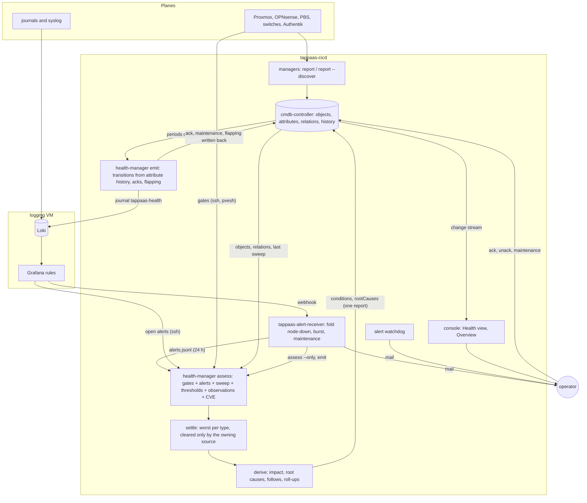

# Health and CMDB review

Independent review of the health, alerting and CMDB design and code (ADR-007e, 039, 040, 041,
042), done 2026-11-10 against `main` at `a3dd5383` and against the live test system hrossen
(checkout `05d9f586`). Review only: no code was changed and nothing was written on hrossen.

Paths are relative to `src/foundation/tappaas-cicd/` unless they start with `docs/`.
"Observed" means read from hrossen on 2026-11-10 (a CMDB snapshot of 417 objects and 575
relations, the `tappaas-health` journal from 2026-10-30, the alert receiver's journal and state
files). "Inferred" means concluded from the code and not seen happening.

## Summary

The model is sound in its main idea: conditions on CMDB objects, one assessor, derivation over
typed relations, events per transition. Three things in it do not hold up against the live data:

1. **Root-cause selection is wrong in common cases.** The "common ancestor" rule made an
   advisory warning on `tappaas3` the root of an unrelated stopped `identity` VM, and a
   `depends-on` relation placed on a machine turned that five-minute VM stop into 72 objects with
   a critical impact. No mail named the real fault.
2. **Mails follow condition transitions, not the life of a root cause.** Of 88 journal lines that
   match the at-once rule, 21 were followed by a RESOLVED line. The rest eased through warning,
   were retired, or are still open. A critical that becomes a root without changing status is
   never mailed (inferred).
3. **Nothing ages.** A judgement over an attribute last reported eleven days ago is green, an `ok`
   that no source has looked at since October stays `ok`, a roll-up says "19 of 42 members
   critical" when two are, and relations stay until someone ends them explicitly.

The structure has one deeper cause behind several findings: there are two alerting pipelines (the
receiver's folding and the CMDB's conditions), each with its own state, its own maintenance
windows and its own node-down correlation, joined by a regular expression over a JSON log line.

## (a) The as-built model

### What is produced, stored, read, and for how long

| Signal | Produced by | Stored in | Read by | Lives |
|---|---|---|---|---|
| Log lines | every host's journal (Alloy), node and firewall syslog | Loki on the logging VM | Grafana alert rules, Explore, `{lines}` in mails | Loki's retention (not checked) |
| Module alert rules | `<module>-alerts.json`, rendered by `scripts/tappaas-alert-rules.py` | Grafana rule groups `module-<m>` | Grafana, every minute | until the group is re-applied |
| Open alerts | Grafana alertmanager | Grafana | `alerts.ts` over ssh (`fetchGrafanaAlerts`), the `open-alerts` gate | while firing |
| Alert webhooks | Grafana contact point | `scripts/tappaas-alert-receiver.py`: `/var/lib/tappaas/alerts.jsonl` (2 MB, keeps the newer half), `config/alerts.log` (breadcrumb) | `health-manager alerts` (24 h of events), assess | 24 h as a condition source |
| Receiver folding state | the receiver | `/var/lib/tappaas/node-down/*.json`, `silent-burst.json`, `maintenance/*.json`, `alerts-open/` | the receiver, `site-notify.sh` | node-down: until the node is online; burst: until every member resolves, or 24 h; window: its `until` |
| Heartbeat | Grafana's Heartbeat rule | `/var/lib/tappaas/alert-heartbeat` | `tappaas-alert-watchdog.sh` (stale after 2100 s) | overwritten |
| Observations | the managers' `report` (5-minute `cmdb-refresh.timer`) and `report --discover` (nightly sweep) | CMDB attributes and relations, with validity periods | assess (thresholds, observations), the console | forever; an object is `unseen` after its class's expiry (7 d), a resource or place never |
| Sweep record | `cmdb sweep` (01:00) | a `change` row, journal `cmdb-sweep` | `fromSweep`, the `cmdb` gate, the digest | until the next sweep; stale after 48 h |
| Gate results | `checks.ts`, run by assess | the site's `assessment` attribute (volatile) | `validate` as a read | until the next full assess |
| Conditions | `health-manager assess` (5 min, after each sweep, and `--only` from the receiver) | the `conditions` attribute on every object, with history | emit, validate, the console, the digest | forever as history |
| Root causes | `derive.ts` | `rootCauses` on the site object | emit, `roots`, the console | replaced every assess |
| Health events | `health-manager emit` | journal `tappaas-health`, then Loki; cursor in `config/.health-emit-cursor` | the five rules in `tappaas-cicd-alerts.json` | journal and Loki retention |
| Acks, maintenance, flapping | the verbs and emit | members of each condition | assess (carries them), emit, validate, console | until `until`, a status change, or ok |

The control-plane controllers (`proxmox-`, `opnsense-`, `pbs-`, `authentik-controller`,
`node-provisioner`) do not talk to `cmdb-controller`. The managers above them do: only managers
and `lib/cmdb*.sh` call the report API (`lib/ts/src/cmdb-reporter.ts`, `cmdb-source.ts`).

### From a raw signal to what the operator sees

**How a condition clears.** A source condition clears in `settle` (`manager/health-manager/src/assess.ts:98`)
when the source that owns its `reason` ran and looked at that object and no longer reports a
failure. An impact, roll-up or `follows` condition is recomputed whole each run and set to ok
when nothing produces it (`assess.ts:202`). The mail clears separately: the `health-root-recovered`
rule matches a journal line `from critical`, `kind recovery`, `root true`.

## (b) Findings: logic soundness

### L1. The common-ancestor rule names the wrong root and suppresses the at-once mail (high)

`manager/health-manager/src/derive.ts:326-346`. A failing object "no rule crosses from" (in
practice a warning) becomes the root of two or more failing objects of the same type beneath it.
"Beneath" is `dependantsOf` (`derive.ts:173`): every object reachable over any required relation,
whatever the rules say. Because services run on machines and most guests depend on those
services, almost the whole site is beneath every machine. The covered conditions stay
`derived: false` but leave `rootCauses`, so emit classifies their transitions as `symptom`
(`emit.ts:132`) and the digest drops them too (`digest.ts:61`).

**Observed.** `machine/tappaas3` carries a standing advisory, `lan-uplink` warning ("fencing is
armed and lan has one port"). It is listed as root "impacts 2" of `storage-pool/tankc1`
`pool-state` (a DEGRADED pool, whose real cause, `disk/dsk-08` reason `zfs`, is a root of its
own) and of `vm/network` `ipv6-egress` (the firewall, which runs on `tappaas1`). On
2026-11-05 11:51 UTC the `identity` VM stopped: its `guest-stopped` critical was emitted as
`symptom` with root `machine tappaas3`, so no critical-root mail went. Same for `immich` on
2026-11-10 01:16, `network` on 2026-11-05 01:56, `karakeep` on 2026-11-08 18:06.

**Scenario.** Any open operational warning on a machine or the cluster (every Grafana alert is a
warning, `assess-sources.ts:118`) plus two unrelated failures anywhere beneath it: both become
symptoms of the warning, and a critical among them is mailed by nobody.

**Direction.** Remove the rule, or restrict it to failures the ancestor's own reason can explain
through a rule that actually crosses. A critical must never lose its root status to a warning.

### L2. A dependency on a machine turns one stopped VM into a site-wide critical (high)

`manager/module-manager/src/cmdb-report.ts:140-148` puts a module's `dependsOn` on its host. For
an app without a guest the host is a machine, so `machine/tappaas1` `depends-on`
`identity:accessControl`, `network:proxy` and `network:rules` (the console's dependencies). Those
services run on VMs that run on `tappaas1`: a cycle. The shipped rules cross `depends-on` and
`runs-on` at critical (`controller/cmdb-controller/metamodel/health-rules.json`), and `spread`
carries the state on, so a stopped provider reaches the machine and then everything on it.
`spread` terminates on a cycle, and two seeds that reach each other are settled by `since`, but
nothing checks the graph for a dependency cycle.

**Observed.** 2026-11-05 11:51: with `identity` stopped for under five minutes, 72 objects got a
critical `impact` naming `vm identity`, among them `machine/tappaas1`, the pools `tanka1` and
`tankb1`, the firewall VM, every manager and controller and all services. `site impact` read
"72 of 72 members critical".

**Direction.** Put an app's dependencies on the app (the relation's ends are `node → service`
today). Refuse or flag a `depends-on` from a machine to a service hosted on it, and add a cycle
check over required relations to `rules check` or the sweep.

### L3. Mails follow transitions, so alerts and their clears do not pair up (high)

The at-once rule matches `"to":"critical" … "kind":"causal" … "silenced":false}` and the recovery
rule `"from":"critical" … "kind":"recovery" … "root":true` (`tappaas-cicd-alerts.json`), both
event rules over a 300 s window. Consequences, from `emit.ts:132`, `:239-240`, `:285`:

- A root that eases to warning, or goes to unknown, before ok never gets a RESOLVED (the rule's
  own summary says so).
- A retired CI emits nothing: emit walks live objects only (`emit.ts:187`); the set change shows
  only as a `rootcause` event with `cleared: true`, which no rule reads.
- A condition that becomes a root with no status change is never mailed (inferred): a guest that
  stays down after its node returns, a fault that started inside an ack or a maintenance window
  and outlives it, a critical released by L1's ancestor.
- The mail needs the logging VM. A line that reaches Loki more than five minutes late, for
  example because the failed node hosts the logging VM, raises nothing; only the watchdog's
  "log alerting is down" mail goes (inferred).

**Observed.** Journal lines since 2026-10-30 that match today's at-once rule: 88. Followed by a
line matching the recovery rule: 21. Left critical for warning: 30 (18 as symptom, 12 as causal).
To unknown: 1. No later event at all: 36, most of them test CIs that were deleted while
`sweep-missing`.

**Direction.** Drive the mails from the root-cause set, not from condition transitions: open a
notice when the set gains a critical root, close it when that root leaves the set for any reason
(ok, eased, retired, silenced), and say which. emit and the receiver run on the same host, so the
notice need not travel through Loki; the journal line can stay as the record.

### L4. Two maintenance systems: planned restarts mail a critical root cause (high)

The update's window is a file for the receiver (`scripts/tappaas-maintenance.sh`, opened by
`lib/converge-lib.sh:96` and `cluster/update.sh:66`) and holds back only `HostSilent` and
`QuorumLost` (`scripts/tappaas-alert-receiver.py:674`). The conditions' maintenance is
`health-manager maintenance` (`manager/health-manager/src/ack.ts:192`), which nothing calls
automatically. ADR-041 D1 names "the update sweep's own" window as one that silences
conditions; it is not wired.

**Observed.** Windows `restart-test-vmdrift` (08:50–09:50 UTC) and `restart-demo`
(09:29–10:29 UTC) on 2026-11-09; "ALERT: critical root cause rossen (impacts nothing)" was sent at
09:12, 09:42 and 09:53 UTC, inside them. The journal holds no `maintenance` event at all since
2026-10-30.

**Direction.** One window model. Either `tappaas-maintenance.sh open` also sets the condition
window on the CIs it names, or assess reads the window directory and marks what it covers.

### L5. A finding the CMDB cannot place becomes an anonymous critical on the site (high)

`manager/health-manager/src/assess-sources.ts:84`: a failing gate row whose subject resolves to no
object lands on the site with the row's text. For `service-liveness` the text is "not running",
without the guest's name.

**Observed.** 19 at-once lines `site rossen operational guest-stopped`, message "not running";
the receiver sent "critical root cause rossen (impacts nothing)" 21 times. The guests were test
VMs not yet (or no longer) in the CMDB. The site's own condition then masks every other
site-level operational finding, since there is one condition per type per object.

**Direction.** The fallback must carry the subject (`module test-vmdrift: not running`), and a
guest that exists in the cluster but not in the CMDB is a discovery finding, not a site outage.

### L6. Judgements are made over observations of any age (high)

`fromThresholds` and `fromObservations` (`assess-sources.ts:172`, `assess-observations.ts`) read
attributes with no notion of when each was observed. The only freshness signal is the object's
`stage: unseen` after its class's expiry, seven days (`controller/cmdb-controller/src/store.ts:372`,
`metamodel/ci.json:49`), and it is a warning. Resources and places never expire, and ports,
addresses, assets and software are exempt from the lifecycle judgement
(`assess-observations.ts:33`). A source that runs and reports nothing counts as a successful
source in the sweep.

**Observed.** The four switches' assets and 46 of their ports were last reported on
2026-10-30T12:58, eleven days ago. Each carries a `link` value; four are cabled and judged
`ok` ("cabled, link up"). The last sweep lists `switch-manager` as ok in 1.6 s.

**Scenario.** A switch dies after its last successful read: its ports stay "up" and green for
ever. The reverse sticks too: a port last seen "down" before its switch was unplugged stays
critical until someone retires the CI.

**Direction.** Keep an observed-at per source and attribute group (the store already has
`object.seen` per source), and let assess turn a judgement whose input is older than a few
intervals into `unknown`. A discover source should report which devices it reached.

### L7. An ok is never re-examined, and derived messages freeze (medium)

- `assess.ts:109` strips prior derived conditions by reason (`roll-up`, `follows`) or type
  (`impact`). A roll-up that was ok has reason `ok`, survives the filter, and is carried as a
  source condition with `derived: false` (`assess.ts:117`). Nothing owns it, so nothing refreshes it.
- `assess.ts:137` keeps the stored message while status and reason hold. For a source condition
  that avoids history rows; for a roll-up it freezes the count.
- An `ok` whose source no longer reports on the object keeps its old `lastChecked` and stays
  green; ADR-041 D1 says an object nobody can assess is `unknown`.

**Observed.** 204 conditions have a `lastChecked` older than 30 minutes, 182 of them `drift ok`,
most from 2026-10-31. Collections carry non-derived ok conditions such as `cluster/rossen
capacity ok "3 of 3 ok"`, last checked 2026-10-30. The site's `security` reads "19 of 42 members
critical" since 2026-11-08; the snapshot has 2 critical among 41. `maintenance` reads "5 of 59
members warning"; there are 2 among 54.

**Direction.** Drop every prior condition with `derived: true` before `settle`, recompute a
derived condition's message every run (make `message` volatile for derived conditions), and age
an `ok` that its owner has not confirmed into `unknown`.

### L8. Aggregates and noise are root causes (medium)

A zone's and an environment's CVE score is a source condition (`assess-sources.ts:257-268`), so
each is a root beside the modules that set it. Leases that appear between sweeps are `drift`
warnings on each address.

**Observed.** 2026-11-08 18:31: six at-once lines for one scan, `environment` and `zone`
`mgmt`, `rossen`, `test`, all `cve-critical`. The site lists 68 root causes: 29 CVE levels, 26 sweep
findings (23 of them `sweep-appeared`), and 13 others. An acknowledged condition
(`vm/unifi-os`) is still in the list.

**Direction.** A zone's and environment's score is derived from its modules and should not be a
root. A leased address appearing is expected. `roots` should lead with operational roots and
leave silenced ones out.

### L9. Relations never go stale (medium, inferred)

A relation has no last-seen. An `n:m` relation (`depends-on`, `provides`, `member-of`, `connects`,
`serves`) stays open until a report sends `end: true` or an end closes the object
(`store.ts:1370`). `stored-on`, `built-on` and recorded cables are ended by their reporters;
`depends-on` and `provides` are not (`cmdb-report.ts:119`, `:148`). All 118 `depends-on` rows on
hrossen date from 2026-10-30 and match `config/` today, so no stale one was seen.

**Scenario.** A module drops a `dependsOn`: the required edge stays, and its old provider's
failure still marks it critical.

**Direction.** Let an observation say it is complete for a relation type from an object, so the
store closes what the report no longer names.

### L10. An open burst swallows every later silent host for up to a day (medium, inferred)

`scripts/tappaas-alert-receiver.py:791-796`: while a silent burst is open, every new `HostSilent`
joins it with a breadcrumb and no mail. The burst closes only when every member has resolved, or
after 24 h (`:673`). One member that stays down keeps it open.

**Direction.** Stop adding members after the burst window, or mail again when the member list
grows.

### L11. Smaller clearing gaps (low)

- **Unknown reason never clears.** `ownerOf` (`assess.ts:74-80`) maps a reason to its source by
  string tables; a reason no table knows is its own owner, never in `ran`, so the failure stands
  for ever. None is stored on hrossen today. A renamed reason in a release would create them.
- **Drift is as old as the last sweep.** `fromSweep` re-reads the nightly record every run
  (`assess-sources.ts:130`), so a drift fixed by a reconcile stays a warning until 01:00 (inferred).
- **Placeholders are permanent.** A placeholder has no `last_seen` and never expires
  (`store.ts:957`); `cmdb retire --orphans` finds only keyed dependants (`store.ts:307`).
  Observed: 15 placeholder `node` objects from 2026-10-30, three still holding an `allocated-to`.
- **Node-down incidents** close with "node is back" when the node has left the cluster, since
  the test is "not offline" (`tappaas-alert-receiver.py:632`) (inferred).
- **Concurrent writers.** `conditions` is one attribute rewritten whole by assess, emit
  (`emit.ts:327`) and the ack verbs, with no lock across them; an ack made during an assess run
  is lost (the DESIGN says so). The timer's assess and the receiver's `assess --only` can also
  overlap. No lost ack was seen: four acks in the journal.
- **`rootcause` events** are 4184 of 7732 journal lines and nothing reads them.

### What held up

- A failure is taken back only by the source that raised it, after it looked (`settle`); a gate
  that skipped or could not reach a guest leaves the failure standing. Sound, and tested.
- Redundancy groups degrade instead of failing, in a fixpoint (`derive.ts:97`). hrossen has
  groups on a mirror's `built-on` and on bonded `connects`; none has failed, and no guest has an
  `HANode`, so the HA rule is untested live.
- Flapping is detected and ends by itself: 184 starts and 184 ends in the journal, none unpaired.
- An ack's own lifecycle (expiry, status change, sticky, a root's ack covering its symptoms) is
  in one place, `reconcileAcks`, and tested.
- A receiver maintenance window that ends with the host still silent is mailed by Grafana's next
  repeat, so that clear does not hide a real outage.

### Clearing matrix

| Case | Condition | Mail |
|---|---|---|
| Source recovers | cleared at the next assess | RESOLVED only for critical → ok directly (L3) |
| Source silent or gone | value stays; `unseen` warning after 7 d for CIs, never for resources (L6); a stale `ok` stays green (L7) | none |
| CI retired | conditions stay on the ended row; relations close, so impacts clear | no recovery (L3) |
| Operator ack | silenced; ends at `until`, on a status change, or at ok | recorded, not mailed; no re-announcement when it ends |
| Maintenance (conditions) | silenced; joins new conditions of the object | same as ack |
| Maintenance (receiver file) | not seen by conditions (L4) | holds `HostSilent` and `QuorumLost` only |
| Burst | not a condition | one mail; later hosts hidden while open (L10) |
| Flapping | status still written; transitions not emitted until it ends | one start and one end event |

## (b) Findings: structure

### S1. Two alerting pipelines with separate state (high)

The receiver folds node-down, bursts and maintenance from files under `/var/lib/tappaas/`;
health-manager derives roots, acks and maintenance in the CMDB. Each correlates a node failure
(`fold_node_down`, `tappaas-alert-receiver.py:613`, against `derive.ts`), each has a window
concept (L4), and a node down can produce both a "node X is down" thread and a critical-root
thread with different lifecycles (inferred: the node-down directory does not exist on
hrossen, so no incident has been folded there). **Direction:** the receiver keeps delivery and the pre-CMDB safety
net (heartbeat, watchdog); correlation and silencing live in one place.

### S2. The mail contract is a regular expression over JSON key order (medium)

`events.ts:4-6` and the rule file depend on `"kind"` preceding `"silenced"` and on `}` following
`false`. A reordered or added key changes which mails go, with no test that renders the rules
against real event lines end to end. **Direction:** emit hands notices to the receiver directly;
if the log path stays, test each rule's `match` against `eventLine` output.

### S3. The condition's state machine is implicit and spread over five functions (medium)

Raise and clear are in `settle`; carry-over of ack, window and flapping in `stamp`
(`assess.ts:127`); ack and window ends in `reconcileAcks` and again in `endedBeforeEmit`
(`ack.ts:38`, `:107`); flapping in `emit`. ADR-041 D2 says assess is the only writer of
`conditions`; emit and the verbs write it too. **Direction:** keep what the operator set (ack,
maintenance) and what emit keeps (flapping) in attributes of their own, so each has one writer
and the read-modify-write races go away; write the lifecycle down as one table.

### S4. Duplicated logic (medium)

- Status rank, `silenced` and the `Condition` shape: `assess-model.ts:48-60`, `emit-cmdb.ts:17-50`
  with `ack.ts:18`, and `ui/src/health.ts:18`.
- Alert placement in two languages: `alerts.ts:48` and `tappaas-alert-receiver.py:874`.
- Root sets and roll-ups recomputed in the console (`ui/src/health.ts`, 948 lines) beside
  `derive.ts` and `emit.ts`'s `rootSet`.
- The reason-to-owner mapping is three hand-kept lists (`assess.ts:74-80`, `GATES`,
  `OBSERVATION_REASONS`); a `Finding` already carries `owner`, which is dropped before storage.
  **Direction:** store the owner on the condition.

### S5. Shell, Python and TypeScript split (low)

The split itself is workable: Python for the webhook, TS for the model, shell for glue. The cost
is that correlation logic sits on both sides of it (S1) and the receiver's 1073 lines include a
second incident model.

### S6. Tests cover single faults (medium)

`test/unit/derive.test.ts`, `assess.test.ts` and `emit.test.ts` cover a node down, redundancy,
HA, a cable, the ancestor, roll-ups, "held until the source looks", acks, flapping and
maintenance. Not covered: two independent faults and which of them is mailed, a dependency
cycle, a stale input, a retired root, a symptom that becomes a root, a silence that ends while
the fault holds, concurrent writers, and the rule file against real event lines.

### S7. Drift between the ADRs and the code (low)

| ADR says | Code does |
|---|---|
| ADR-041 D2: assess is the only writer of `conditions` | emit and the ack verbs write it |
| ADR-041 D1: the update sweep's window silences conditions | not wired (L4) |
| ADR-041 D3: a machine is impacted by a faulty asset over `allocated-to` | no rule; `asset-faulty` is a maintenance condition and `follows` only colours |
| ADR-041 D3: a switch down takes what is cabled to it | no rule crosses `part-of`; the switch's ports follow it by colour only, and `connects` starts from a port's own link state |
| ADR-041 D3: a symptom whose event precedes its root's is flagged | not implemented |
| ADR-041 D3: a roll-up is never a root | holds for roll-ups; zone and environment scores are roots (L8) |
| ADR-040 D4: controllers report | only managers report |
| ADR-040 D6: drift shows until the next reconcile clears it | the condition clears at the next nightly sweep (L11) |
| `health-manager/DESIGN.md` | describes the pre-ADR-041 verbs first; the ADR-041 parts are accurate |

## (c) The changes that would matter most

1. **Fix root selection** (L1, L2): drop or narrow the common-ancestor rule so a critical never
   becomes the symptom of a warning; move an app's `depends-on` off its machine and check
   required relations for cycles.
2. **Mail from the root-cause set, not from transitions** (L3, S2): one notice per critical root
   from when it enters the set to when it leaves, for any reason, with a guaranteed close.
3. **Give every judgement an age** (L6, L7, L9): observed-at per source, `unknown` for a stale
   input or an unconfirmed `ok`, derived messages recomputed, relations closed by complete
   reports.
4. **One silence model** (L4, L10, S1): the update's window sets the condition window; the
   receiver's folds read the same state; a burst stops absorbing new hosts.
5. **Make the condition lifecycle explicit with one writer per part** (S3, S4, L5): operator
   state apart from assessed state, the owner stored on the condition, shared rank and placement
   code, and a site fallback that names its subject.

## How this was checked

- Code read: the ADRs above, `health-manager` (`assess*.ts`, `derive.ts`, `emit*.ts`, `ack.ts`,
  `events.ts`, `alerts.ts`, `cmdbsweep.ts`, `digest.ts`), `cmdb-controller` (`store.ts`,
  `rescan.ts`, the metamodel, `DESIGN.md`), the alert scripts, `tappaas-cicd.nix`, and the
  reporters' relation handling. Not read in depth: `checks.ts`, `security.ts`, `sweep.ts`,
  `asset-manager`, the console's pages, ADR-042's implementation.
- hrossen, read-only: `GET /v1/query`, `/v1/relations`, `/v1/rules`, `/v1/sweep` on the CMDB
  socket, `health-manager roots`, `journalctl -t tappaas-health` and `-u tappaas-alert-receiver`,
  the state files under `/var/lib/tappaas/`, `config/` for `dependsOn`. Nothing was written and
  no scratch directory was created there.
- Counts of "lines matching the rule" were computed from the journal's event lines with the
  rule's conditions, not read from Grafana's alert history.

## (d) After the review: re-check against main, fixes and status (2026-11-11)

Fixed on branch `fix/health-review`, cut from `main` at `80946e7a` (which has ADR-046's performance
monitoring). Suites green: health-manager's `test.sh` (33 unit files), module-manager's (277),
cmdb-controller's integration suite (196), the receiver's (106), the rule file's (201); the
console compiles.

### Re-check against main before changing anything

Every finding still held on `80946e7a`. Line numbers had moved (`derive.ts` ancestor rule at
326-346 → unchanged; `assess.ts` `ownerOf` at 210, `settle` at 235; `emit.ts` `kindOf` at 132; the
receiver's burst at 791 → 790). ADR-046 added four interactions the review could not see:

- **A performance warning crosses relations** (`runs-on` from a machine, `stored-on` from a pool,
  as a warning). Together with `derive.ts`'s `open = roots.filter(s => !impacted.has(s.obj))`, a
  slow node or pool removed every root on the guests it reached from `rootCauses`: a guest that
  stopped on a busy node was mailed by nobody. Worse than L1, and new with ADR-046. Fixed with L1.
- **The ancestor rule took performance in**: its candidate types are the rules' source types, so
  a node's performance warning could become the "root" of unrelated performance warnings below.
  Gone with the rule.
- **`digestOnly` depended on key order** (S2): it worked only because it came after `silenced`,
  ending the root-cause rule's match. The notice now leaves performance out by type.
- **Performance's owner** (`performance`, set only when metrics and trends both looked) and its
  `perf-no-numbers` unknown fit the stored owner and the ageing unchanged; the timed raise
  (`investigation`) was already an attribute with one writer, the pattern S3 now follows.

### Status per finding

| Finding | Status | What was done |
|---|---|---|
| L1 ancestor rule | **fixed** | rule removed; a root is hidden only by a critical impact on its object; roots ordered critical first. The ADR-046 interaction above is fixed with it. |
| L2 machine `depends-on` | **fixed** | an application's `depends-on` starts at the app (metamodel allows `app → service`); a module never depends on a service it provides (found live: `vm/network → network:proxy`); `complete` reports end the old relations; `rules check` and the sweep report cycles. |
| L3 mail from transitions | **fixed** | `notices.ts`: one ALERT when a critical root enters the set, one RESOLVED when it leaves, saying why (recovered, eased, unchecked, retired, acknowledged, maintenance, symptom); delivered by emit through `site-notify.sh`, retried until sent; the two log rules removed. |
| L4 two maintenance systems | **fixed** | the window files are the one model: assess silences what an open window covers and what runs on it; `health-manager maintenance` writes a window file; converge names the instance beside the host. |
| L5 anonymous site critical | **fixed** | the fallback names its subject; a guest not in the CMDB is a `drift` warning `not-in-cmdb`. |
| L6 stale observations | **fixed** | the store returns `seen` per source; a threshold or observation over an object nobody reported for 48 h is `unknown`; the sweep records `reached`/`missed` per source and fails a source that reached nothing. |
| L7 frozen ok, frozen counts | **fixed** | derived conditions (owner `derive`) dropped before `settle`, messages recomputed; an ok its owner stopped confirming ages to unknown; one it no longer gives is dropped, and so is a legacy ok without an owner (230 on hrossen). |
| L8 aggregates and noise as roots | **fixed** | zone and environment scores derived; a leased address appearing or going is expected; `roots` leads with critical and operational, silenced ones only with `--all`. |
| L9 relations never stale | **fixed** for `depends-on` | reports may be `complete` for a relation type; module-manager uses it. Other n:m reporters (`provides`, `member-of`, `serves`) can adopt it the same way: not done here. |
| L10 burst swallows hosts | **fixed** | a silent host after the burst's window is mailed on its own. |
| L11 unknown reason | **fixed** | the owner is stored on the condition. |
| L11 drift as old as the sweep | **fixed** | a `changed` attribute whose store drift mark a change cleared stops showing at the next assess. The difference is placed by the object's id where the sweep gives one (found live: three pools named `tanka1`, the drift moving between them every run). |
| L11 placeholders | **fixed** | a placeholder nothing reported within its class's expiry, and that no object seen within that expiry refers to, is an orphan the sweep retires (12 of 15 on hrossen; the age-only rule, found live, also retired the three that asset-manager's `allocated-to` still names, and the next refresh made them again). |
| L11 node-down when removed | **fixed** | closed as "left the cluster". |
| L11 concurrent writers | **fixed** | the ack verbs write `acknowledgements`, emit writes `flapping`; assess alone writes `conditions`. The timer's assess and the receiver's `assess --alert` can still overlap: two writers of the same projection from the same inputs, last one wins, nothing operator-set is lost. |
| L11 `rootcause` events | **fixed** | no longer written. |
| S1 two pipelines | **changed** | silencing is one model (window files) and correlation of conditions is health-manager's; the critical-root mail is emit's. The receiver keeps delivery, the heartbeat and watchdog, and its node-down and burst folding of Grafana's own `HostSilent` mails, which are not conditions and must work while the CMDB or assess is down: kept deliberately as the safety net. |
| S2 regex over key order | **fixed** | the critical-root mail is no regex; the remaining rules are tested against `eventLine` output in `emit.test.ts` and `performance.test.ts`. |
| S3 implicit state machine | **fixed** | one writer per attribute; the ack lifecycle and via-acks in `assess.ts` `stamp`/`viaAcks`, written down in health-manager's DESIGN. |
| S4 duplicated logic | **partly** | rank shared (`assess-model.ts`); owner stored instead of the three tables (kept only as a fallback for old conditions); alert placement only in `alerts.ts` (`assess --alert`). **Deferred:** the console's own root-set computation in `ui/src/health.ts` (it reads the projected conditions, so it keeps working), and one TypeScript `Condition` type for both halves. |
| S5 language split | unchanged | as the review judged it workable; the receiver lost its placement code. |
| S6 tests | **fixed** | two independent faults, a cycle, a stale input, a retired root, a symptom becoming a root, a silence ending while the fault holds, concurrent writers, the rule file against real lines, and an assess→emit→notice run over the identity stop (`health-flow.test.ts`). |
| S7 ADR drift | **fixed** | ADR-041 v1.6, ADR-040 v1.9, both DESIGNs and the README. The ADR now says what is not built (flagging a symptom that precedes its root; asset and switch impact by colour only) instead of claiming it. |

### Live proof on hrossen (read-only, 2026-11-11)

Compiled code in `~/tmp-health-proof` reading the live CMDB socket (queries only), then removed.
Nothing else was running (pgrep before each step).

- **2026-11-05 11:54, identity stopped.** As stored then: 14 roots led by `machine/tappaas3`
  (impacts 2), identity's operational critical not among them, 80 objects with a critical impact.
  The relations then hold one cycle through `machine/tappaas1` (its three `depends-on`). New derive
  with the old relations: identity is the first root (critical), still 80 impacted (the cycle).
  With `depends-on` as the new reporter puts it: **no cycle**, identity the first root, **23**
  objects impacted — its real SSO consumers (nextcloud, forgejo, immich, …), not tappaas1, the
  pools, the firewall or the controllers. **L1 and L2 do not reproduce.**
- **Notices over 11:34–12:19** (every 5 minutes, new derive): `ALERT vm/identity` at 11:54,
  `RESOLVED vm/identity (recovered)` at 11:59; also `vm/logging` capacity critical 11:34 → 11:39.
  Nothing left open. **L3 does not reproduce.**
- **Stale observations today:** 20 cabled ports judged, all green before; 4 are `unknown` now,
  "not observed since 2026-10-30T12:58"; 52 judgements over stale inputs in all (the four
  switches and their ports, an SSID, a test environment). 15 live placeholders.
- **`assess --dry-run` in health-assess.service's context** (`tappaas-unit-run.sh --unit
  health-assess.service`): exit 0, 402 objects, 627 conditions, every one with an owner, 0 aged
  "not checked" (after the legacy-ok fix; 233 before it), 44 roots. It read the window directory
  inside the unit's sandbox.
- **`converge_open_maintenance` in update-tappaas.service's context**: writes the window
  (`restart-identity`, scope `identity`) into a scratch directory.

Not provable without deploying: emit's delivery (it mails and moves the cursor), and the site's
first run of the new assess (it rewrites conditions).

### Live verification on hrossen (2026-11-12)

hrossen was brought to `f646d7b7` (main with these fixes) by a manual start of
`update-tappaas.service`, the sweep in its own unit context (07:58–08:39, stall watch every
10 minutes, nothing else running). tappaas-cicd rebuilt its OS; health-assess.service has
`/var/lib/tappaas` writable. Results:

| Check | Result |
|---|---|
| logging:metrics re-apply on tappaas1–3 | **pass**: all three converge (failed on all three the night before). |
| Sweep result | one failure, not from this work: cluster's `test-guest-hook.sh` "the firewall's own start never waits" measured 1 s (a `$SECONDS` boundary; cluster code unchanged in the merge). |
| assess and emit in the unit | **pass**: exit 0 every run, ~72 s, no write error; Grafana's `module-tappaas-cicd` group holds HealthDailyDigest, CveNewCritical and CveLevelUp only, so no `HealthRoot*` rule is left to mail twice. |
| L1 roots | **pass**: critical first; no warning hides a critical; no site, zone or address among the roots. |
| L2 cycles | **pass**: 0 `depends-on` from a machine; `rules check` and the sweep: no cycle. |
| L5 anonymous site critical | **pass**: the site carries derived roll-ups only. |
| L6 stale inputs | **pass**: the four switches, the AP and their ports `unknown`, "not observed since 2026-10-30"; `environment/vitest` and `ssid/TAPPaaS-Test` likewise. |
| L7 legacy oks | **pass**: 633 conditions, every one with an owner, none of the old "ok"-owned oks. |
| L6 reached/missed | **pass**: the sweep lists switch-manager missing crs-a, crs-b and the USW, ap-manager missing the Nano HD; 0 sources failed. |
| L11 placeholders | **pass with a fix**: 15 → 3. The three left were retired and made again within a minute (see the status row); fixed in the controller, not yet deployed. |
| L4 window silences | **pass**: `maintenance vm/deconz-test --until 30m`, VM stopped: operational critical, stamped with the window, `silenced`, its two services symptoms; no notice, no mail. |
| L3 window end | **pass**: `maintenance end` with the VM still stopped: one ALERT "critical root cause deconz-test (impacts 2 service)" on the next run. |
| L3/S3 ack, unack | **pass**: ack: one RESOLVED (acknowledged, "by tappaas: …"); unack: one new ALERT. An ack made while a run is reading shows at the following run. |
| L3 recovery | **pass**: VM started: one RESOLVED (recovered). |
| Notices and the outbox | **pass**: the cursor's open notices and `site-notify.sh --list-open`'s `health-root:` keys matched at every step. |
| L11 drift placement | **fixed, not yet deployed**: the `tanka1` size drift alternated between two of the three same-named pools, two transitions every run. |
| L10, node left the cluster | not exercised live (needs a node outage); unit-tested in the receiver suite. |

Teardown: deconz-test running and ok on every condition, its window file gone, no open notice
in the cursor or the outbox, no window in the cursor. Left: the `acknowledgements` attribute
on vm/deconz-test holds the unack (`ack: null`), which is the record the design keeps. Two
expired window files from 2026-11-09 (`restart-demo`, `restart-test-vmdrift`) belong to other
work and were left.

The two fixes found here (`fix(cmdb)` placeholders, `fix(health)` drift by id) are on
`fix/health-review` after the merge and need a push and a tappaas-cicd update to take effect.

### Overlap with other work

- `design/cve-vex`: `health-manager/src/security.ts` is untouched here. Zone and environment
  scores are made derived in `derive.ts`, not in the scoring; ADR-047 D7's "a module's CVE
  condition is derived when only baseline components set its level" would mark the module's
  condition `derived` the same way and needs no change here. `assess-sources.ts` `fromCve` is
  unchanged.
- The console (`ui/`) is untouched: it reads the conditions, which keep their shape (acks and
  flapping projected). An ack from the console shows on the condition at the next assess.

### Deploy and verify (for Lars)

Deploy: push `fix/health-review` (or merge it to main and push), then update tappaas-cicd on
hrossen so the OS rebuild picks up `tappaas-cicd.nix` (health-assess.service now has
`/var/lib/tappaas` writable, needed for emit's notices), the cmdb-controller, health-manager and
module-manager builds, the receiver and the rule file.

Expect on the first runs:

- the first emit mails one ALERT per current critical root cause that is not silenced (none or
  very few on hrossen today: `vm/network`'s critical is a CVE level, which is no notice);
- the next nightly sweep retires the 15 old placeholders, lists dependency cycles (expect none
  after module-manager's next report), and records `reached`/`missed` per source: the four
  switches not reported since 2026-10-30 show as missed by switch-manager (a source failure if it
  reaches none);
- the switch ports and the four switches go `unknown` ("not observed since"), 230 legacy ok
  conditions disappear, and the Grafana rule group `module-tappaas-cicd` loses
  `HealthRootCause` and `HealthRootRecovered`.

Verify:

1. `journalctl -u health-assess --since -10min` — assess and emit exit 0; no "read-only file
   system" from site-notify.sh.
2. `health-manager roots` — critical first; `health-manager rules check` — "no dependency cycle".
3. `cmdb relations --type depends-on --json | jq '[.[] | select(.from.class == "machine")] | length'`
   — 0 after module-manager's next report.
4. `health-manager list --status unknown` — the stale ports, "not observed since 2026-10-30".
5. A planned restart: `health-manager maintenance <guest> --until 30m --note test`, stop the guest,
   `assess`: its condition shows `maintenance`, no mail; `maintenance end <guest>` with the guest
   still stopped: one ALERT on the next run; start it: one RESOLVED (recovered).
6. Ack a critical root: one RESOLVED "(acknowledged)"; `unack`: one new ALERT.
7. `site-notify.sh --list-open` — the `health-root:` keys match `jq .notices
   ~/config/.health-emit-cursor`.
8. After the next sweep: `cmdb sweep --last` shows `reached`, any `missed`, any `cycle`.
