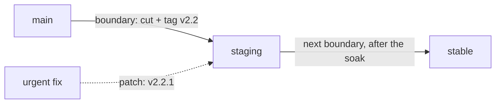

# Releasing TAPPaaS

**A release is a release-train boundary.** Every two weeks `tappaas-train.sh boundary`, run on
the mothership of the site where TAPPaaS is developed, promotes the revision that has soaked on
`staging` to `stable` and cuts the next one from `main` into `staging`. The revision it cuts gets
the next version — an annotated tag, `v<MAJOR>.<MINOR>` — and the same version reaches
production at the boundary after. How to run a boundary, and what it refuses, is the operator
reference: [RELEASE-TRAIN.md](../src/foundation/tappaas-cicd/RELEASE-TRAIN.md). Why it works
this way is [ADR-028](../docs/ADR/ADR-028%20-%20Release%20Cadence%20and%20Patching.md), D9
(the train), D12 (urgent fixes) and D13 (versions).



## What is in this directory

| File | What it is |
|------|------------|
| [`releases.json`](releases.json) | **The release history**: every version, the commit it names, and the day it reached staging and production. Written by `tappaas-train` at each boundary and urgent fix; [`RELEASES.md`](../RELEASES.md) at the repository root is rendered from it. |
| [`roadmap-cut.py`](roadmap-cut.py) | **The ROADMAP.md cut**, run by the boundary just before `main` reaches staging: every ✅ row leaves the waves for a `## Release <version>` section, `## Next release` becomes its summary, the promoted release gets its production date. `--check` shows what it would do; `--normalize` rewrites counts without cutting. Tested by `scripts/test/test-roadmap-cut.sh`. |
| `changelog.sh` | Release notes between two refs: the issues delivered and the changes, grouped, plus the config migrations added (ADR-025 D6). `--enrich` adds issue titles from the forge. |
| `bump-version.sh` | Repoints `templates/tappaas-nixos.json` and `network/network.json` at newly built VM images and writes each image's SHA-256 beside its URL, from the release's signed `SHA256SUMS`; `--check` reports drift. Tested by `scripts/test/test-image-hashes.sh`. |
| `sign-image-release.sh` | Signs an image release's `SHA256SUMS` with a release manager's key and uploads `SHA256SUMS.sig` — the step CI cannot do. See `src/foundation/tappaas-cicd/SIGNING.md`, *Signing an image release*. |
| `lib.sh` | Logging helpers shared by the release scripts (sourced, not run). |

`make-release.sh`, the driver for the procedure before the train (cut `rc/<ver>`, tag it,
fast-forward `stable` from the candidate), was retired on 2026-10-02: it skipped staging, so it
could not keep `stable ⊆ staging`.

## Versions

| Change | Version | Made by |
|---|---|---|
| a boundary | the next minor: 2.1 → 2.2 | `tappaas-train.sh boundary` |
| a boundary that changes shape | the next major: 2.7 → 3.0 | `tappaas-train.sh boundary --major` |
| an urgent fix | a third number: 2.2 → 2.2.1 | `tappaas-train.sh patch <channel> <commit> --why …` |

`tappaas-train.sh releases` lists them; `git checkout v<version>` gives you the code of one. Two
other version surfaces are separate from the product version and are not touched by the train:

- **Image tags** (`nixos-template-v*`, `opnsense-firewall-v*`) name VM images built on GitHub
  Actions. `bump-version.sh` moves the module configs to a new one.
- **Each module's own `version`** in its JSON, maintained by hand with the module.

## Release notes

```bash
release/changelog.sh --from v2.1 --to v2.2 --enrich > NOTES.md
```

## New VM images

Images are built from a tag pushed to the **`github`** remote (that fires the Actions build; the
mirror does not trigger it promptly), then the configs are repointed and the change travels the
train like any other commit:

```bash
git tag nixos-template-v1.5 && git push github nixos-template-v1.5
# … wait for the GitHub Release …
release/sign-image-release.sh nixos-template-v1.5
release/bump-version.sh --nixos 1.5      # then commit and push to main
```
