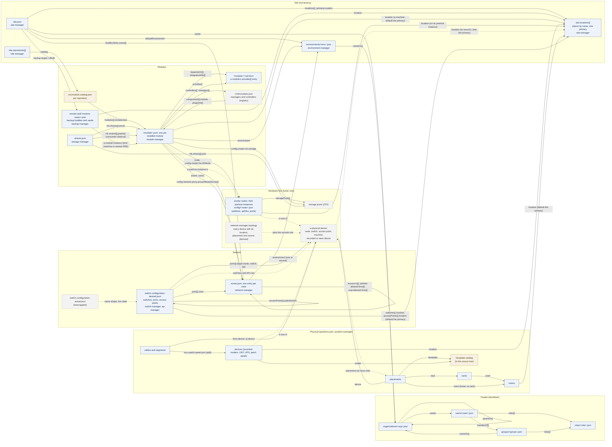

# The TAPPaaS data model

The configuration of a site is a set of JSON files under `~/config/` on the
mothership, each owned by one manager and written only through its verbs. This
document is the **meta model**: which objects exist, which file holds each, and
**which field of one object names another**. It does not list the fields
themselves: that is what `src/foundation/schemas/*-fields.json` is for, and
`schemas/README.md` maps each object to its schema, its file and its manager.

Read the arrows as "this field names that object". A reference is resolved by
name at read or reconcile time; nothing is embedded twice. Current as of
2026-10-24, after ADR-036 (locations and placement) and the zone, device and
organization simplifications below.

## The diagram

Solid boxes are records a manager writes. Dashed boxes are what the system
sees or derives (live state, registries), never edited. Tan boxes live in the
source tree, not under `~/config/`.

## The objects and what they name

| Object | File | Owner | Names (field → object) |
|---|---|---|---|
| Site | `site.json` | site-manager | `defaultEnvironment` → environment; `owner` → organization; `backup.target`, `backup.offsite` → the backup server and buddy; `dnsBlocklists.zones[]` → zones; `repositories[]` → the repositories whose catalogs list the modules; `locations{}` → its places; `primaryLocation` → the one it is at, whose timezone is the site's and where a device or room that names none is; `locale`, `keyboard` are site-wide |
| Location | `site.json` → `locations{}` | site-manager | names nothing: a place with a country, city, address and timezone, of kind `site` (this site's own equipment) or `remote` (another site's). A backup peer, a machine module, a switch, an access point, a room and a recorded device name one; the primary one and one that is named cannot be deleted |
| Environment | `environments/<env>.json` | environment-manager | `ownerOrg` → organization; `domains` are its own (no file names them back). It names no zone: its zone is the Service zone naming it |
| Zone | `zones.json` (one object per zone) | network-manager | `environment` → the environment it belongs to: a Service zone's (and `mgmt`'s) own environment, exactly one per environment, or the one or several a client, IoT or guest zone serves; `access-to[]`, `pinhole-allowed-from[]`, `snat-allowed-from[]` → zones; `bridge` → an interface, not an object |
| Switches and access points | `switch-configuration-desired.json` (`-actual.json` is the interrogated copy) | switch-manager, ap-manager, driven by network-manager | `switches{}.ports{}.zone` → zone (access and native VLAN); `ports{}.target` → the node, switch or AP on the other end; `accessPoints{}.uplinkSwitch` → switch; `ssids` → zones by VLAN; `switches{}.location`, `accessPoints{}.location` → a location (unset: the primary; free text goes in `description`) |
| Module (installed instance) | `<module>.json` | module-manager | `environment` → environment; `zone0`, `zone1` → zones; `node`, `config.cluster:ha.HANode` → nodes; `config.cluster:vm.storage` → a pool; `dependsOn[]`, `integratesWith[]` → `module:service` pairs another module `provides`; `config.network:proxy.proxyAllowedZones[]` → zones; `controllers[]`, `managers[]` → components the module contributes to the control plane; `moduleSource` → its source directory; `location` → the location a machine (not a guest) is at, unset the primary |
| Module catalog | `src/module-catalog.json` in each repository | site-manager (`repository validate-catalog`) | `modules[].moduleJson` → the module's JSON in the source tree; `vmid`, `stack` must agree with it |
| Control-plane registry | `control-plane.json` | written by the refresh, read by the self-check and the console | `components[].module` → the module that ships a component; `plugsInto[]` → the manager a controller serves |
| Organization | `identities/organizations/<org>.json` | identity-manager | `owner` → user; `parentOrg` → organization |
| User | `identities/users/<user>.json` | identity-manager | `memberOf[]` → groups; `roles[]` → roles |
| Group | `identities/groups/<group>.json` | identity-manager | `ownerOrg` → organization; `roles[]` → roles |
| Role | `identities/roles/<role>.json` | identity-manager | names nothing |
| Shares | `shares.json` | storage-manager | `nfs.shares{}.server` → the module instance carrying the share; `pool` → a pool on it; `grants{}` → consumer module instances |
| Backup peers | `remote-<peer>.json`, `pull-<peer>.json`, `receive-<peer>.json` | backup-manager | each is a module instance of a peer kind; `location` → a location of the site, compared with the primary one to show its copy is off-site; `site.backup.offsite` and an environment's `backup.residency` are checked against the peer's location |
| Satellite | `<instance>.json` of kind machine | module-manager (satellite module) | a module instance; `vault.pull.*` → the home PBS and datastore; `location` → the location it runs at, compared with the primary one to show its copy is off-site |
| Room | `positions.json` → `rooms{}` | position-manager | `location` → a location of the site (unset: the primary) |
| Rack | `positions.json` → `racks{}` | position-manager | `room` → room |
| Placement | `positions.json` → `placements{}` (keyed by device) | position-manager | `device` → a physical device; `rack` → rack (with its unit), or `room` → room when loose; `faceplate` → the catalog; the room is at the device's own location |
| Recorded device | `positions.json` → `devices{}` | position-manager | `model` → the faceplate catalog; `location` → a location (unset: the primary); its `ports` are its own; `mac` when a switch port saw it; it is a physical device like a node, switch or AP |
| Cable | `positions.json` → `cables[]` | position-manager | `from.device`, `to.device` → physical devices and their ports; a split link is two segments whose `origin` names the link they came from |
| Faceplate catalog | `position-manager`'s catalog in the source tree | position-manager | names nothing |

### Runtime and derived files (no references into them)

`last-update-result.json` (the sweep), `release-train.json` and
`train-preview*.json` (the release train), `firewall/sequence-map.json`
(rules-manager's rule slots per module), `cert-refids.json` (one entry per
environment), `wgvpn/peers.json` (admin tunnel peers), `sbom/` and
`/var/lib/tappaas/wan-address.json` are written by the system from the records
above. They name modules and environments by the same names, but nothing names
them back.

## The physical device, as the model sees it

A **physical device** is anything a cable can end on. It comes from four
places, and the topology (`network-manager topology --json`) is what joins them,
giving each its `location`, its `placement` and the `source` it came from:

| Device kind | Recorded in | Seen by |
|---|---|---|
| Cluster node | its `pvehost` module instance, `config/<node>.json` (`address`, `uplinks`, `storagePools`, `location`) | Proxmox |
| Switch | `switch-configuration-desired.json` | the switch controller (`-actual.json`) |
| Access point | `switch-configuration-desired.json` → `accessPoints{}` | the AP controller |
| Modem, ONT, UPS, patch panel | `positions.json` → `devices{}` | nothing: it is known by its record and its cables |
| Something behind a switch port (a printer, a camera) | nowhere until `position-manager device record` | the switch controller at the port (MAC, LLDP, lease): the topology lists it as seen |

`positions.json` never repeats a device the cluster sees: a placement, a cable end
or a split segment names it, and the topology resolves the name. A name that is
neither seen nor recorded is what `position-manager validate` warns about.

Where a device is has two parts, each with one owner: its **location**, the
`location` name on its own record (unset: the primary), resolved by site-manager
to an address; and its **placement**, position-manager's — a rack and its units,
or loose in a room at that same location, or none. The console's Physical view
draws the site that way: location by location (the primary first), each with
its rooms, each room with its racks and loose devices, then what is at the
location placed nowhere; a device's panel shows the two lines, each a link.

## What was simplified, and what is parked

The first survey of this model (2026-10-22) found seven places where one thing
was said in two ways or a reference ran both ways. Four are resolved; three are
parked in #866. Every installation was moved by a numbered config migration.

| # | Finding | State |
|---|---|---|
| 1 | Environment ↔ zone was a two-way link (`environment.network.zone` and `zone.serves[]`) | **Resolved** (#865, migration 0018): the zone names its environment in one field, `environment`; a client, IoT or guest zone may list several; nothing points the other way. An environment's zone is the Service zone naming it |
| 2 | Location was recorded in four shapes (the site's, rooms, a machine's `physicalLocation`, free text on switches and APs) | **Resolved** (ADR-036, #869 and #871, migrations 0019 and 0021): one list, `site.locations{}` with a primary; everything that is somewhere names one by `location` |
| 3 | Devices lived in three files, joined only by name | **Resolved** (ADR-036, #870 and #872, migrations 0020 and 0022): each kind has one record and one owner (a node is its `pvehost` instance), placements are position-manager's, the topology is the one derived list with each device's location, placement and source |
| 4 | Organizations were listed twice (`site.organizations[]` and the identities directory) | **Resolved** (#867, migration 0017): the directory is the list |
| 5 | Backup policy is a cascade across three objects (module › environment › site `backup` blocks) plus peers as module instances of three kinds; the resolved policy is named nowhere | **Parked** (#866) |
| 6 | A module's placement is spread over its record (`node`, `zone0`, `config.cluster:vm.storage`, `config.cluster:ha.HANode`), partly nested and partly flat | **Parked** (#866) |
| 7 | `module:service` pairs (`dependsOn`, `integratesWith`, `provides`) are the one reference that is not a file name | **Parked** (#866) |
