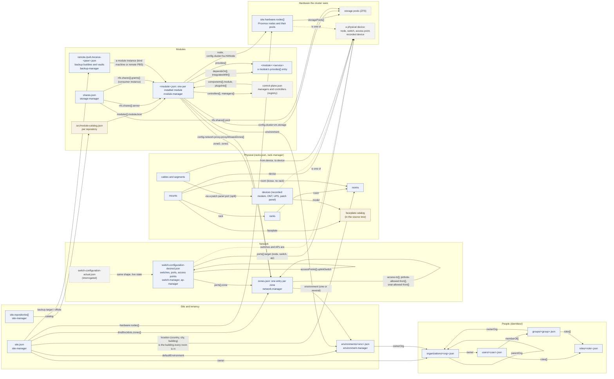

# The TAPPaaS data model

The configuration of a site is a set of JSON files under `~/config/` on the
mothership, each owned by one manager and written only through its verbs. This
document is the **meta model**: which objects exist, which file holds each, and
**which field of one object names another**. It does not list the fields
themselves: that is what `src/foundation/schemas/*-fields.json` is for, and
`schemas/README.md` maps each object to its schema, its file and its manager.

Read the arrows as "this field names that object". A reference is resolved by
name at read or reconcile time; nothing is embedded twice.

## The diagram

Solid boxes are records a manager writes. Dashed boxes are what the system
sees or derives (live state, registries), never edited. Tan boxes live in the
source tree, not under `~/config/`.

## The objects and what they name

| Object | File | Owner | Names (field → object) |
|---|---|---|---|
| Site | `site.json` | site-manager | `defaultEnvironment` → environment; `owner` → organization; `hardware.nodes[]` → the cluster's nodes, each with its `storagePools[]`; `backup.target`, `backup.offsite` → the backup server and buddy; `dnsBlocklists.zones[]` → zones; `repositories[]` → the repositories whose catalogs list the modules; `location` → the building every room is in |
| Environment | `environments/<env>.json` | environment-manager | `ownerOrg` → organization; `domains` are its own (no file names them back). It names no zone: its zone is the Service zone naming it |
| Zone | `zones.json` (one object per zone) | network-manager | `environment` → the environment it belongs to: a Service zone's (and `mgmt`'s) own environment, exactly one per environment, or the one or several a client, IoT or guest zone serves; `access-to[]`, `pinhole-allowed-from[]`, `snat-allowed-from[]` → zones; `bridge` → an interface, not an object |
| Switches and access points | `switch-configuration-desired.json` (`-actual.json` is the interrogated copy) | switch-manager, ap-manager, driven by network-manager | `switches{}.ports{}.zone` → zone (access and native VLAN); `ports{}.target` → the node, switch or AP on the other end; `accessPoints{}.uplinkSwitch` → switch; `ssids` → zones by VLAN |
| Module (installed instance) | `<module>.json` | module-manager | `environment` → environment; `zone0`, `zone1` → zones; `node`, `config.cluster:ha.HANode` → nodes; `config.cluster:vm.storage` → a pool; `dependsOn[]`, `integratesWith[]` → `module:service` pairs another module `provides`; `config.network:proxy.proxyAllowedZones[]` → zones; `controllers[]`, `managers[]` → components the module contributes to the control plane; `moduleSource` → its source directory; `physicalLocation` → where a machine (not a guest) stands |
| Module catalog | `src/module-catalog.json` in each repository | site-manager (`repository validate-catalog`) | `modules[].moduleJson` → the module's JSON in the source tree; `vmid`, `stack` must agree with it |
| Control-plane registry | `control-plane.json` | written by the refresh, read by the self-check and the console | `components[].module` → the module that ships a component; `plugsInto[]` → the manager a controller serves |
| Organization | `identities/organizations/<org>.json` | identity-manager | `owner` → user; `parentOrg` → organization |
| User | `identities/users/<user>.json` | identity-manager | `memberOf[]` → groups; `roles[]` → roles |
| Group | `identities/groups/<group>.json` | identity-manager | `ownerOrg` → organization; `roles[]` → roles |
| Role | `identities/roles/<role>.json` | identity-manager | names nothing |
| Shares | `shares.json` | storage-manager | `nfs.shares{}.server` → the module instance carrying the share; `pool` → a pool on it; `grants{}` → consumer module instances |
| Backup peers | `remote-<peer>.json`, `pull-<peer>.json`, `receive-<peer>.json` | backup-manager | each is a module instance of a peer kind; `site.backup.offsite` and an environment's `backup.residency` are checked against the peer's location |
| Satellite | `<instance>.json` of kind machine | module-manager (satellite module) | a module instance; `vault.pull.*` → the home PBS and datastore; `physicalLocation` → its own site |
| Room | `racks.json` → `rooms{}` | rack-manager | names nothing; the building is the site's `location` |
| Rack | `racks.json` → `racks{}` | rack-manager | `room` → room |
| Mount | `racks.json` → `mounts{}` (keyed by device) | rack-manager | `device` → a physical device; `rack` → rack, or `room` → room when loose; `faceplate` → the catalog |
| Recorded device | `racks.json` → `devices{}` | rack-manager | `model` → the faceplate catalog; its `ports` are its own; it is a physical device like a node, switch or AP |
| Cable | `racks.json` → `cables[]` | rack-manager | `from.device`, `to.device` → physical devices and their ports; a split link is two segments whose `origin` names the link they came from |
| Faceplate catalog | `rack-manager`'s catalog in the source tree | rack-manager | names nothing |

### Runtime and derived files (no references into them)

`last-update-result.json` (the sweep), `release-train.json` and
`train-preview*.json` (the release train), `firewall/sequence-map.json`
(rules-manager's rule slots per module), `cert-refids.json` (one entry per
environment), `wgvpn/peers.json` (admin tunnel peers), `sbom/` and
`/var/lib/tappaas/wan-address.json` are written by the system from the records
above. They name modules and environments by the same names, but nothing names
them back.

## The physical device, as the model sees it

A **physical device** is anything a cable can end on. Today it comes from four
places, and the topology (`network-manager topology --json`) is what joins them:

| Device kind | Recorded in | Seen by |
|---|---|---|
| Cluster node | `site.hardware.nodes[]` | Proxmox (and a `pvehost` module instance for its `uplinks`) |
| Switch | `switch-configuration-desired.json` | the switch controller (`-actual.json`) |
| Access point | `switch-configuration-desired.json` → `accessPoints{}` | the AP controller |
| Modem, ONT, UPS, patch panel | `racks.json` → `devices{}` | nothing: it is known by its record and its cables |

`racks.json` never repeats a device the cluster sees: a mount, a cable end or a
split segment names it, and the topology resolves the name. A name that is
neither seen nor recorded is what `rack-manager validate` warns about.

## Where the model is harder than it needs to be

These are the places where one thing is said in two ways, or where a reference
runs in both directions. They are the candidates for the next simplification;
nothing here is a bug.

1. **Environment ↔ zone — resolved.** This was a two-way link: an environment
   named its service zone and a client or IoT zone named the environments it
   served. Now the zone names the environment in one field, `environment` (a
   client or IoT zone may list several), and nothing points the other way. An environment's zone is the Service zone
   naming it; the zones it owns are the zones naming it.
2. **Location is recorded in four shapes.** `site.location` (country, city,
   building) is the building; `rooms` are rack-manager's; a machine module has
   `physicalLocation` (same shape as the site's); a switch or AP has a free-text
   `location`. The two free-text ones could name a room.
3. **Devices live in three files** (site hardware, switch configuration, racks)
   and are only joined by name in the derived topology. A node's uplinks are on
   a fifth object (the `pvehost` instance). One device list with a `seenBy`
   would make mounts, cables and ports reference one thing.
4. **Resolved — organizations are listed once.** They are the files under
   `identities/organizations/`, which identity-manager owns; `site.json` no
   longer carries a list of paths to them.
5. **Backup policy is a cascade across three objects** (module › environment ›
   site `backup` blocks) plus peers as module instances of three kinds. The
   console shows it; the model does not name the resolved policy anywhere.
6. **A module's placement is spread over its record** (`node`, `zone0`,
   `config.cluster:vm.storage`, `config.cluster:ha.HANode`), partly under the
   `<module>:<service>` nesting and partly flat, so "where does this module
   run" is four lookups with two conventions.
7. **`module:service` pairs** (`dependsOn`, `integratesWith`, `provides`) are
   the one reference that is not a file name: the module half resolves to a
   module JSON, the service half to that module's `provides[]`.
