# TAPPaaS Foundation Layer - Dependency Documentation

Generated: 2026-11-09 by `src/foundation/generate-dependencies.py`, with [PROGRAMS.csv](PROGRAMS.csv) and [DEPENDENCIES.csv](DEPENDENCIES.csv). Do not edit by hand: change the generator and run it again.

What a foundation program is, and what each code file under `src/foundation/` depends on: the bash files it sources, the TAPPaaS programs its code names, and the site config files it reads. Read from the code, so a program called through a variable is missed and a name that only appears in a message counts; the generator's docstring has the exact rules.

## Summary

162 programs, 845 code files read (414 bash, 335 typescript, 70 python, 26 nix), 1541 direct dependencies.

| Area | Bash | Python | TypeScript | Nix | Files |
|------|-----:|-------:|-----------:|----:|------:|
| `tappaas-cicd/ui` | 5 | 0 | 150 | 1 | 156 |
| `tappaas-cicd/lib` | 31 | 0 | 31 | 1 | 63 |
| `cluster` | 53 | 0 | 0 | 0 | 53 |
| `tappaas-cicd/controller/opnsense-controller` | 5 | 43 | 0 | 1 | 49 |
| `tappaas-cicd/manager/health-manager` | 9 | 0 | 36 | 1 | 46 |
| `tappaas-cicd/scripts` | 32 | 10 | 0 | 0 | 42 |
| `backup` | 41 | 0 | 0 | 0 | 41 |
| `tappaas-cicd/manager/module-manager` | 17 | 0 | 17 | 1 | 35 |
| `tappaas-cicd/manager/site-manager` | 11 | 0 | 20 | 1 | 32 |
| `network` | 28 | 0 | 2 | 1 | 31 |
| `tappaas-cicd/manager/network-manager` | 7 | 0 | 22 | 1 | 30 |
| `tappaas-cicd/migrations` | 27 | 0 | 0 | 0 | 27 |
| `tappaas-cicd/manager/backup-manager` | 4 | 0 | 14 | 1 | 19 |
| `tappaas-cicd/manager/identity-manager` | 5 | 0 | 12 | 1 | 18 |
| `templates` | 15 | 0 | 0 | 3 | 18 |
| `identity` | 13 | 0 | 0 | 2 | 15 |
| `satellite` | 14 | 0 | 0 | 0 | 14 |
| `tappaas-cicd/controller/cmdb-controller` | 3 | 0 | 9 | 1 | 13 |
| `tappaas-cicd/controller/node-provisioner` | 3 | 9 | 0 | 1 | 13 |
| `tappaas-cicd/manager/environment-manager` | 4 | 0 | 8 | 1 | 13 |
| `logging` | 9 | 0 | 0 | 1 | 10 |
| `storage` | 10 | 0 | 0 | 0 | 10 |
| `tappaas-cicd/controller/authentik-controller` | 3 | 5 | 0 | 1 | 9 |
| `tappaas-cicd/manager/asset-manager` | 4 | 0 | 4 | 1 | 9 |
| `tappaas-cicd/manager/ca-manager` | 3 | 0 | 5 | 1 | 9 |
| `tappaas-cicd/manager/storage-manager` | 3 | 0 | 5 | 1 | 9 |
| `tappaas-cicd` | 5 | 0 | 0 | 2 | 7 |
| `tappaas-cicd/controller/proxmox-controller` | 7 | 0 | 0 | 0 | 7 |
| `pvehost` | 6 | 0 | 0 | 0 | 6 |
| `tappaas-cicd/update-tappaas` | 3 | 2 | 0 | 1 | 6 |
| `tappaas-cicd/manager/ap-manager` | 5 | 0 | 0 | 0 | 5 |
| `tappaas-cicd/manager/switch-manager` | 5 | 0 | 0 | 0 | 5 |
| `console` | 4 | 0 | 0 | 0 | 4 |
| `debianhost` | 4 | 0 | 0 | 0 | 4 |
| `tappaas-cicd/controller/pbs-controller` | 4 | 0 | 0 | 0 | 4 |
| `(top level)` | 2 | 1 | 0 | 0 | 3 |
| `tappaas-cicd/controller` | 3 | 0 | 0 | 0 | 3 |
| `tappaas-cicd/manager` | 3 | 0 | 0 | 0 | 3 |
| `tappaas-cicd/test-vm-creation` | 2 | 0 | 0 | 0 | 2 |
| `tappaas-cicd/test-repository` | 1 | 0 | 0 | 0 | 1 |
| `tappaas-cicd/test-variants` | 1 | 0 | 0 | 0 | 1 |

## Programs

86 programs, 50 scripts and 26 sourced libraries (PROGRAMS.csv lists each with its source). The front doors are the managers; controllers plug into them; the services run beside them.

| Component | Kind | Programs |
|-----------|------|----------|
| `module-manager` | manager | `module-manager`, `adopt-module.sh`, `copy-update-json.sh`, `delete-module.sh`, `install-module.sh`, `module-format.sh`, `rename-instance.sh`, `resolve-module.sh`, `set-module-field.sh`, `snapshot-vm.sh`, `suspend-module.sh`, `test-module.sh`, `test-validate-module-tier-source.sh`, `update-module.sh`, `validate-module-tier-source.sh`, `validate-modules-mandatory.sh` |
| `site-manager` | manager | `site-manager`, `convert-json-to-config.sh`, `create-configuration.sh`, `create-site.sh`, `repository.sh`, `test-create-site.sh`, `validate-catalog.sh`, `validate-configuration.sh`, `validate-site.sh` |
| `network-manager` | manager | `network-manager`, `zone-reconcile`, `network-manager-wgvpn` |
| `environment-manager` | manager | `environment-manager` |
| `identity-manager` | manager | `identity-manager`, `validate-identities.sh`, `validate-people.sh`, `people-manager` |
| `backup-manager` | manager | `backup-manager` |
| `health-manager` | manager | `health-manager`, `check-disk-threshold.sh`, `check-firewall-cert.sh`, `check-ha-health.sh`, `check-repo-signatures.sh`, `reboot-guest.sh`, `update-os.sh` |
| `storage-manager` | manager | `storage-manager` |
| `ca-manager` | manager | `ca-manager` |
| `asset-manager` | manager | `asset-manager`, `position-manager`, `rack-manager` |
| `ap-manager` | manager | `ap-manager`, `setup-wlan-secrets.sh`, `ap-controller` |
| `switch-manager` | manager | `setup-switches.sh`, `switch-manager`, `switch-controller` |
| `pbs-controller` | controller | `pbs-controller`, `backup-controller` |
| `authentik-controller` | controller | `authentik-controller`, `authentik-manager`, `identity-controller` |
| `node-provisioner` | controller | `node-provisioner` |
| `opnsense-controller` | controller | `opnsense-controller`, `opnsense-firewall`, `zone-manager`, `dns-manager`, `dhcp-manager`, `unbound-manager`, `ipv6-manager`, `mdns-manager`, `caddy-manager`, `nat-manager`, `snat-manager`, `acme-manager`, `trust-manager`, `syslog-manager`, `rules-manager`, `test-network-manager`, `opnsense-ensure-patches`, `opnsense-manager` |
| `proxmox-controller` | controller | `migrate-node.sh`, `migrate-vm.sh`, `proxmox-controller`, `resize-disk.sh`, `proxmox-manager` |
| `cmdb-controller` | controller | `cmdb-controller`, `cmdb` |
| `update-tappaas` | service | `update-tappaas` |
| `console` | service | `console`, `tappaas` |

## Most depended upon

| File or program | Files that name it | What it is |
|-----------------|------------------:|------------|
| `common-install-routines.sh` | 151 | script — tappaas-cicd/lib |
| `site.json` | 122 | config file |
| `module-manager` | 92 | program — manager: module-manager |
| `zones.json` | 91 | config file |
| `site-manager` | 67 | program — manager: site-manager |
| `network-manager` | 54 | program — manager: network-manager |
| `backup-manager` | 52 | program — manager: backup-manager |
| `health-manager` | 34 | program — manager: health-manager |
| `asset-manager` | 30 | program — manager: asset-manager |
| `environments/` | 29 | config file |
| `update-tappaas` | 26 | program — service: update-tappaas |
| `dns-manager` | 24 | program — controller: opnsense-controller |
| `ap-manager` | 24 | program — manager: ap-manager |
| `opnsense-controller` | 23 | program — controller: opnsense-controller |
| `switch-manager` | 22 | program — manager: switch-manager |
| `identity-manager` | 22 | program — manager: identity-manager |
| `environment-manager` | 22 | program — manager: environment-manager |
| `component-install-lib.sh` | 22 | script — tappaas-cicd/lib |
| `network.json` | 21 | config file |
| `ca-manager` | 21 | program — manager: ca-manager |
| `storage-manager` | 20 | program — manager: storage-manager |
| `module-catalog.json` | 19 | config file |
| `pbs-job.sh` | 18 | sourced file |
| `update-module.sh` | 15 | program — manager: module-manager |
| `node-provisioner` | 15 | program — controller: node-provisioner |
| `install-module.sh` | 15 | program — manager: module-manager |
| `authentik-controller` | 15 | program — controller: authentik-controller |
| `pbs-namespace.sh` | 14 | sourced file |
| `control-plane.json` | 13 | config file |
| `caddy-manager` | 12 | program — controller: opnsense-controller |

## Entry points

Programs and scripts no other foundation code names: what an operator, a timer, a node or another repository runs.

- **manager: ap-manager:** `ap-controller`, `setup-wlan-secrets.sh`
- **manager: health-manager:** `check-firewall-cert.sh`, `check-repo-signatures.sh`
- **manager: module-manager:** `module-format.sh`, `validate-module-tier-source.sh`, `validate-modules-mandatory.sh`
- **manager: site-manager:** `test-create-site.sh`
- **controller: opnsense-controller:** `opnsense-manager`
- **controller: pbs-controller:** `backup-controller`
- **tappaas-cicd/lib:** `audit-jq-readers.sh`, `test-common-install-routines.sh`, `test-config-readers.sh`, `test-converge-lib.sh`, `test-ha-vm-lib.sh`, `test-log-shipping.sh`, `test-repo-sync.sh`, `test-simulate.sh`, `test-unbound-prune.sh`, `test-verify-repo.sh`
- **tappaas-cicd/scripts:** `control-plane-registry.sh`, `flake-pin-audit.sh`, `migrate-drop-variant.sh`, `move-module.sh`, `nixos-baseline-eval.sh`, `tappaas-alert-watchdog.sh`, `tappaas-render-fragments.sh`, `tappaas-support-bundle.sh`, `tappaas-unit-run.sh`, `test-tappaas-repair-ownership.sh`, `update-tappaas-schedule.sh`

## What each front door calls

Each manager, controller and service, with the programs, sourced files and config files its source names directly.

### `module-manager` (manager)

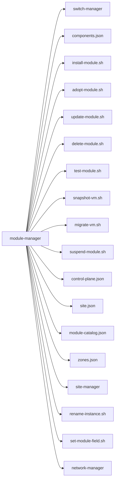

### `site-manager` (manager)

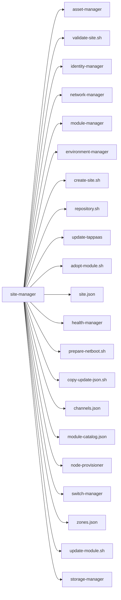

### `network-manager` (manager)

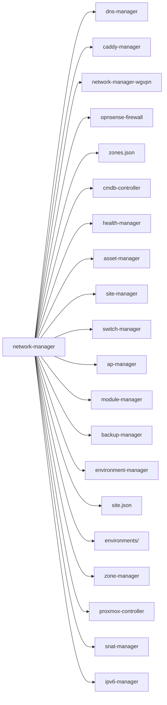

### `environment-manager` (manager)

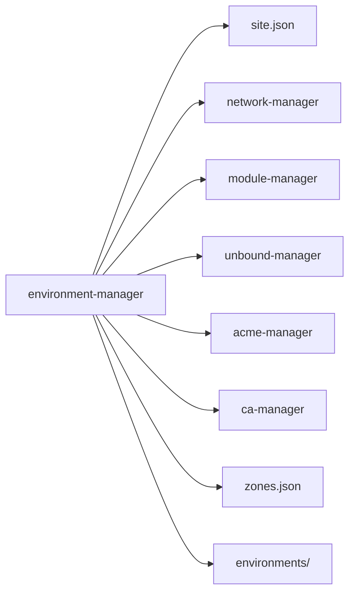

### `identity-manager` (manager)

### `backup-manager` (manager)

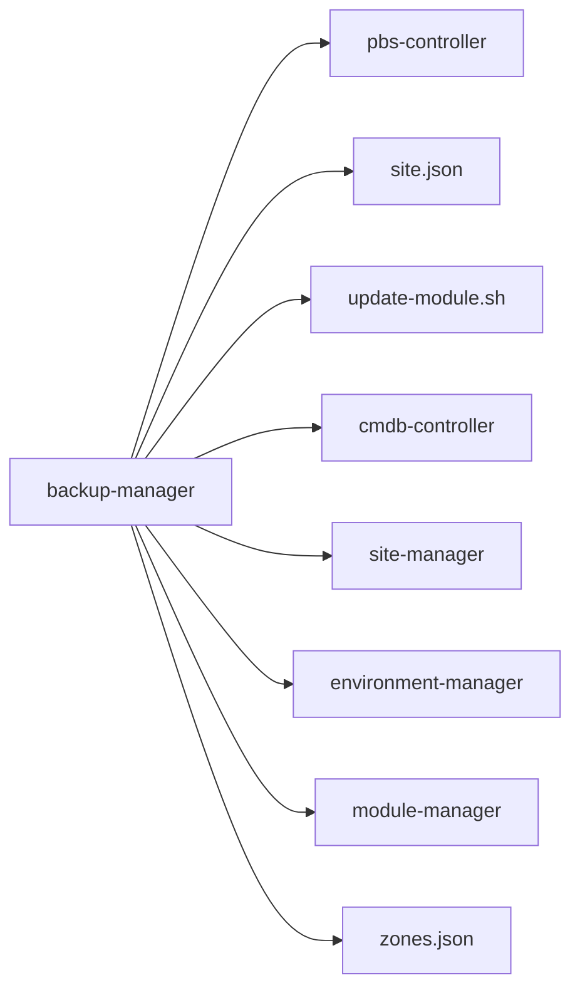

### `health-manager` (manager)

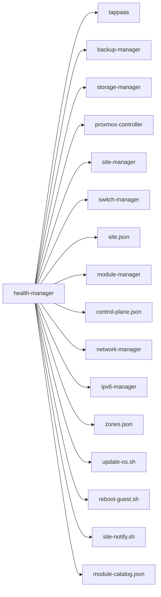

### `storage-manager` (manager)

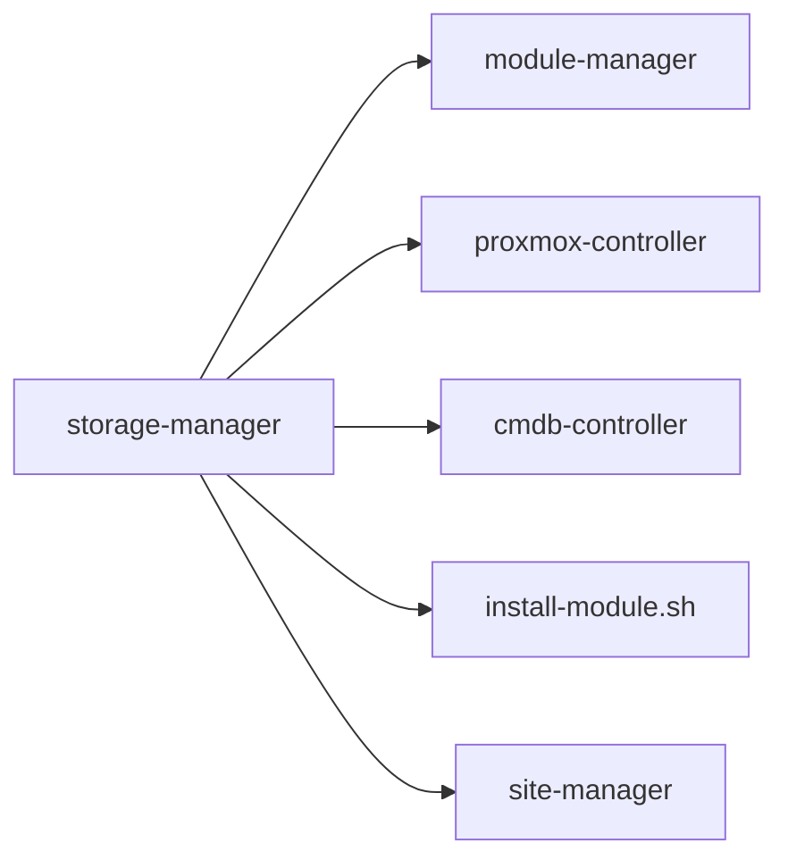

### `ca-manager` (manager)

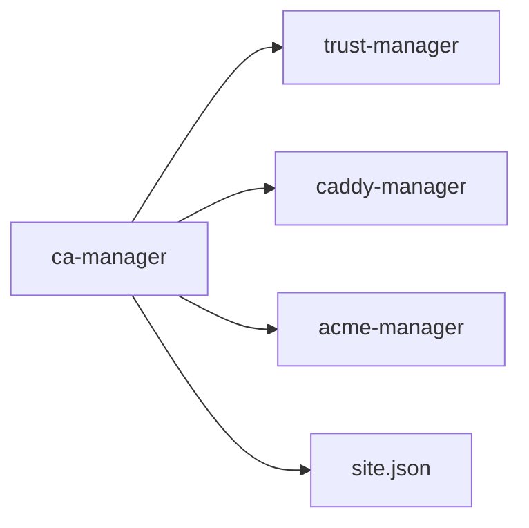

### `asset-manager` (manager)

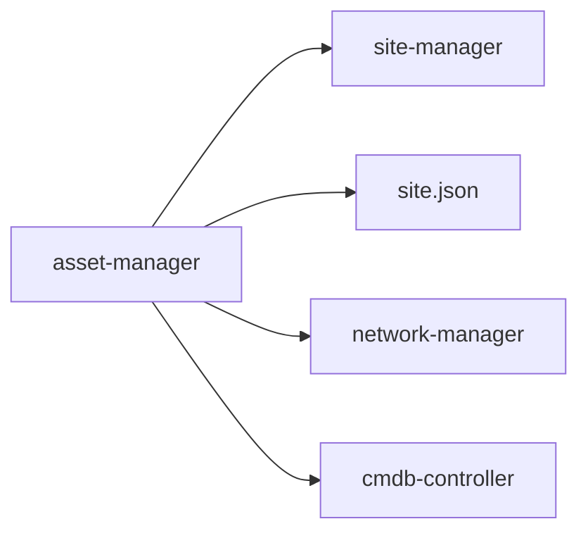

### `ap-manager` (manager)

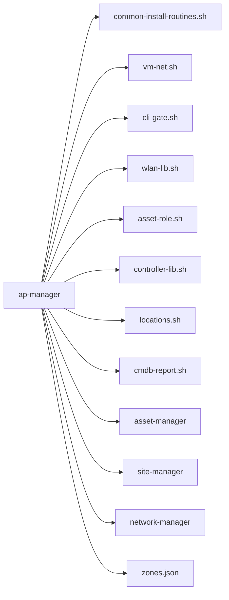

### `switch-manager` (manager)

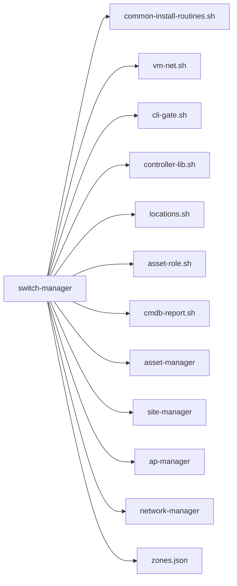

### `pbs-controller` (controller)

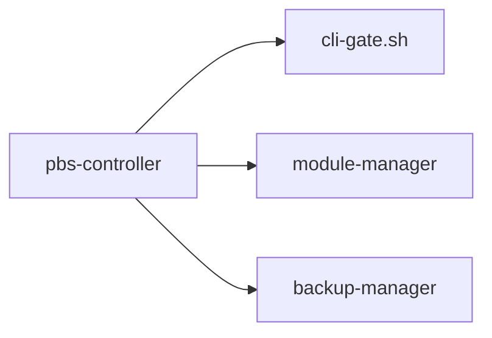

### `authentik-controller` (controller)

Names no other program or config file.

### `node-provisioner` (controller)

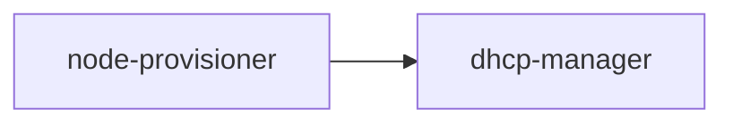

### `opnsense-controller` (controller)

Names no other program or config file.

### `proxmox-controller` (controller)

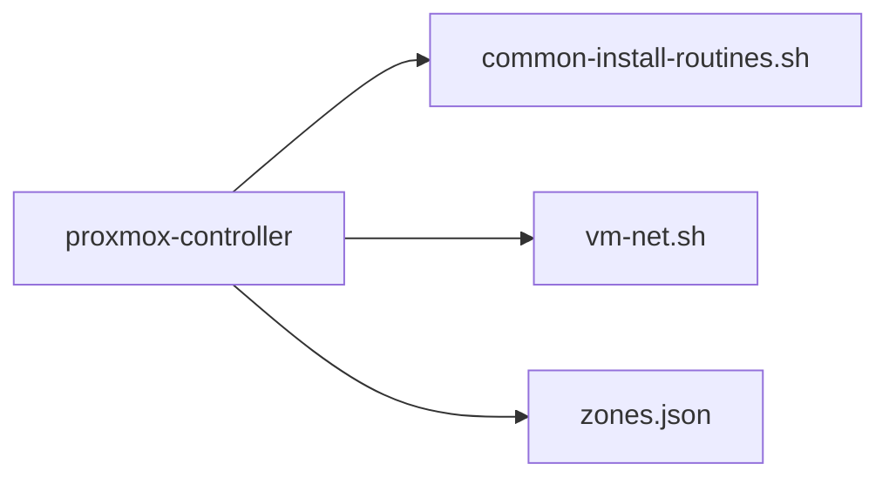

### `cmdb-controller` (controller)

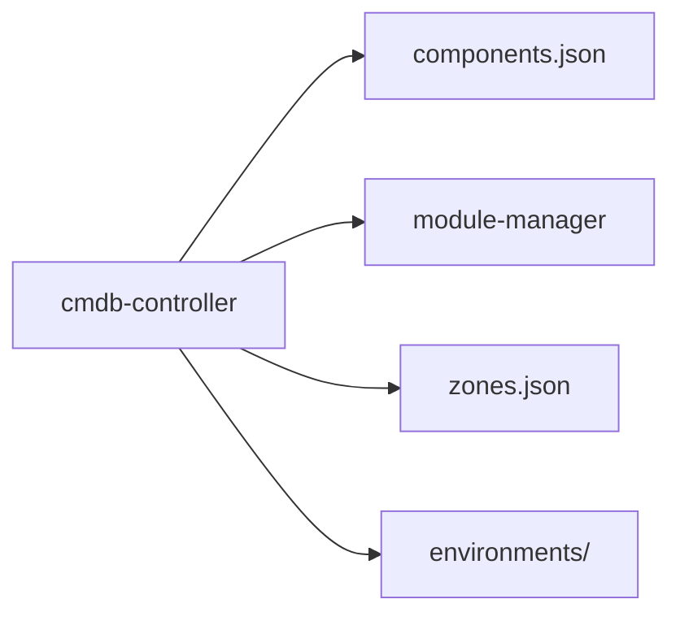

### `update-tappaas` (service)

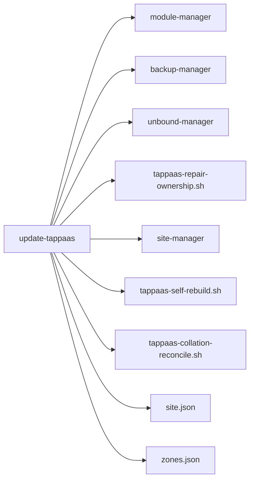

### `console` (service)

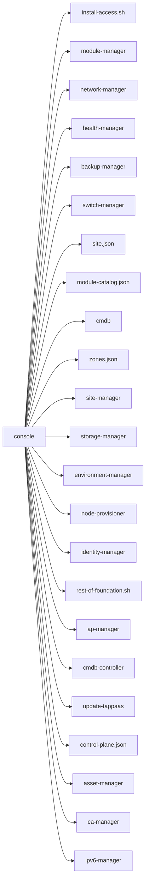
