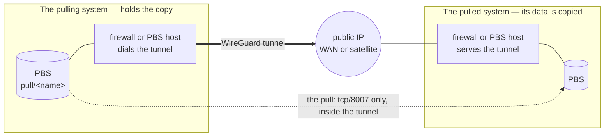

# Backup buddy — keep your off-site copy at another site

Primary audience: the operators of two sites that agree to hold a copy of each other's backups.

A **backup buddy** is another site — a TAPPaaS site, or any site that runs Proxmox Backup Server
(PBS) — that keeps an off-site copy of your backups. The copy is always **pulled**: the buddy's
PBS reads your backups into a namespace of its own; your PBS never pushes anywhere. That is the
rule that makes a compromised site unable to destroy the copy its buddy holds (ADR-012 §1.4.1): a
pull holds only a read-only login on the side it pulls from.

**Status:** the PBS side (`backup-manager peer …`) is built; the tunnel is set up by hand on each
firewall, and serving a tunnel through a satellite needs a satellite change that is not built yet
— see [What is still to build](#what-is-still-to-build).

## One pull, one tunnel

Everything here is built from one unit: **one pull, through one WireGuard tunnel.**



- **The system whose data is pulled serves the tunnel.** It wants its data copied, so it opens
  the door: it listens for the tunnel on its public IP — its own WAN address, or, for a site with
  no public inbound address, its [satellite](../satellite/README.md) — and grants the puller a
  read-only login on its PBS.
- **The pulling system dials the tunnel.** An outgoing connection works from behind any router,
  so the puller needs no public address of its own.
- **The tunnel carries the pull and nothing else.** It has exactly two addresses on it, one per
  end. The serving side exposes one thing at its tunnel address — its PBS's tcp/8007 — to one
  peer address only; the pulling side routes only that one address into the tunnel. Neither side
  routes any of its networks into it, so the two systems never become one network — which also
  matters because every TAPPaaS site uses the same `10.0.0.0/24` mgmt range.

**Two sites that hold each other's copy** are simply two pulls — two tunnels, one in each
direction, each served by the system being pulled.

## The four setups

Each pull has a **pulled** end and a **pulling** end, and each end is either a TAPPaaS system or
some other PBS. That gives four setups — pick the two that make your pull:

| | The pulled end (serves the tunnel) | The pulling end (dials the tunnel) |
|---|---|---|
| **TAPPaaS** | [Setup 1: a TAPPaaS system a buddy can pull](#setup-1-a-tappaas-system-a-buddy-can-pull) | [Setup 2: a TAPPaaS system that pulls a buddy](#setup-2-a-tappaas-system-that-pulls-a-buddy) |
| **Not TAPPaaS** | [Setup 4: a non-TAPPaaS PBS a TAPPaaS system can pull](#setup-4-a-non-tappaas-pbs-a-tappaas-system-can-pull) | [Setup 3: a non-TAPPaaS PBS that pulls a TAPPaaS system](#setup-3-a-non-tappaas-pbs-that-pulls-a-tappaas-system) |

Two TAPPaaS buddies holding each other's copy each do Setup 1 *and* Setup 2.

## The design

### Addresses

Each tunnel has a `/30` of its own from **`10.255.2.0/24`** — clear of the TAPPaaS zones, of
`10.255.0.0/24` (satellite infra tunnels) and of `10.255.1.0/24` (admin VPN). The serving end is
`.1` (its PBS answers there on tcp/8007), the dialling end `.2`:

| | First pull | A second pull (e.g. the other direction) |
|---|---|---|
| `/30` | `10.255.2.0/30` | `10.255.2.4/30` |
| serving end, the pulled system | `10.255.2.1` | `10.255.2.5` |
| dialling end, the pulling system | `10.255.2.2` | `10.255.2.6` |

The `/30` lives on **both** systems, so it must be free on both: the serving side proposes it, and
the two agree. A system with several pulls uses the next free `/30` for each. The examples below
use the first pull's addresses.

### The serving end (the pulled system)

- A **WireGuard instance** for this pull: listens on its own UDP port, tunnel address `.1/30`, one
  peer — the puller's public key, `AllowedIPs = .2/32`, no endpoint (the puller dials in).
- **Its listening port reachable from the internet**: a WAN rule for that UDP port — or, behind a
  satellite, the satellite relays the port to the firewall over its infra tunnel.
- **Only the PBS port, from only the peer**: tcp/8007 on `.1`, from `.2`, reaches the PBS — on a
  TAPPaaS firewall a port forward to the PBS; on a PBS host that ends the tunnel itself, the PBS
  already answers on `.1`. Nothing else is admitted from the tunnel.
- **A read-only login** for the puller on the PBS, granted **without propagation**.

### The dialling end (the pulling system)

- A **WireGuard instance** for this pull: tunnel address `.2/30`, one peer — the server's public
  key, its public endpoint, `AllowedIPs = .1/32` (only the server's tunnel address is routed into
  the tunnel), `PersistentKeepalive = 25` (keeps a NAT mapping open).
- On a TAPPaaS firewall, the PBS's connection to `.1:8007` leaves through the tunnel **translated
  to `.2`** — the only source the server admits — and a rule lets the PBS, and nothing else in
  mgmt, use the tunnel.
- **The pull**: a PBS remote for `.1:8007` with the login and the TLS fingerprint the server sent,
  and a sync job into a namespace of its own.

### Through a satellite

A system whose only public address is its satellite serves its tunnel there: the puller dials
`<satellite-ip>:<port>`, and the satellite forwards that UDP port down its infra tunnel to the home
firewall's `10.255.0.1:<port>`, masquerading it — exactly as it forwards the admin VPN's 51821
(ADR-010 P5). WireGuard authenticates the key, not the address, so the firewall's instance does
not mind that the packets arrive from the satellite. The pull then runs inside the satellite
tunnel: set **`MTU = 1340`** on both ends, as the admin VPN does. Dialling needs nothing on a
satellite.

### What the two operators exchange

| The pulled side sends | The pulling side sends |
|---|---|
| its WireGuard public key, its public IP (or satellite IP) and UDP port | its WireGuard public key |
| the `/30` it proposes | — |
| the PBS login: auth-id and password; the TLS fingerprint; the datastore name | — |
| its country and city (for `--country`/`--city`) | its country and city |

Send the password over a channel you trust; public keys and fingerprints may go by email.

## Setup 1: a TAPPaaS system a buddy can pull

You serve the tunnel and grant read access. On your OPNsense (`https://firewall.mgmt.internal:8443`):

1. **VPN → WireGuard → Instances → +**: name `buddy-<buddy>-in`, generate a key pair, listen port
   e.g. `51830` (unused), tunnel address `10.255.2.1/30`, MTU `1340` if you serve through a
   satellite. Leave *Disable routes* off — the peer's single `/32` route is how replies find it.
   Save; the **public key** goes to your buddy.
2. **Peers → +** (once you have their key): name `buddy-<buddy>-puller`, their public key, allowed
   IPs `10.255.2.2/32`, no endpoint, instance `buddy-<buddy>-in`. Enable WireGuard, apply.
3. **Reachable from the internet** — either
   - **own WAN:** Firewall → Rules → WAN: pass UDP `51830` to *This Firewall*, description
     `buddy-<buddy> wireguard`; or
   - **behind a satellite:** the satellite must relay UDP `51830` to `10.255.0.1:51830` — not built
     yet (#795).
4. **Only the PBS port** — Firewall → NAT → Port Forward, interface `WireGuard (Group)`: source
   `10.255.2.2/32`, destination `10.255.2.1` port `8007`/tcp → your PBS's mgmt address
   (`dig backup.mgmt.internal`) port `8007`, filter rule *Pass*; description `buddy-<buddy> pbs`.
   Under Firewall → Rules → WireGuard, check nothing else passes `10.255.2.2`.
5. **Read-only access to your backups:**

   ```bash
   backup-manager peer add remote <buddy> --auth-id <buddy>@pbs --country <CC> --city <City>
   ```

   It creates `<buddy>@pbs` (prompting for the password) and grants it `DatastoreReader` **without
   propagation** — so the buddy never sees your `fs/` captures (your `config/` and secrets) nor
   what *you* hold for others — and prints what to send. **Send the tunnel address
   `10.255.2.1`, not the host it prints** (`backup.mgmt.internal` — an internal name, #796).

Keep the `buddy-<buddy>` descriptions: TAPPaaS's nightly firewall reconcile deletes only rules
carrying its own `tappaas-…` prefix, so these survive it, and they are how you find them to remove.

## Setup 2: a TAPPaaS system that pulls a buddy

You dial the buddy's tunnel and pull. On your OPNsense:

1. **VPN → WireGuard → Instances → +**: name `buddy-<buddy>-out`, generate a key pair, no listen
   port, tunnel address `10.255.2.2/30`, MTU `1340` if *they* serve through a satellite. Leave
   *Disable routes* off — the peer's `/32` is the only route into the tunnel. The **public key**
   goes to your buddy.
2. **Peers → +**: name `buddy-<buddy>-server`, their public key, endpoint their public IP (or
   satellite IP) and port, allowed IPs `10.255.2.1/32`, keepalive `25`, instance
   `buddy-<buddy>-out`. Apply.
3. **Firewall → NAT → Outbound** (hybrid mode): interface `WireGuard (Group)`, source your PBS's
   address, destination `10.255.2.1/32` port `8007`/tcp, translation address `10.255.2.2`;
   description `buddy-<buddy> pull`.
4. **Firewall → Rules → LAN** (the mgmt zone): pass tcp from your PBS's address to `10.255.2.1`
   port `8007`; description `buddy-<buddy> pull`.
5. **Check the tunnel** — VPN → WireGuard → Status shows a handshake, and:

   ```bash
   ssh root@backup.mgmt.internal 'curl -sk -o /dev/null -w "%{http_code}\n" https://10.255.2.1:8007'   # 200
   ```

6. **The pull:**

   ```bash
   backup-manager peer add pull <buddy> --host 10.255.2.1 --store <their datastore> --country <CC> --city <City>
   ssh root@backup.mgmt.internal proxmox-backup-manager sync-job run sync-<buddy>
   backup-manager peers        # the relationship, and where the copy lives
   backup-manager validate     # warns if the buddy is not shown to be somewhere else
   ```

   `peer add pull` prompts for the auth-id, password and fingerprint the buddy sent (they are
   never written to config), creates the `pull/<buddy>` namespace, a nightly sync job (04:00)
   and its retention, and records the buddy in `config/pull-<buddy>.json`.

## Setup 3: a non-TAPPaaS PBS that pulls a TAPPaaS system

The TAPPaaS system does Setup 1. On your PBS host (Debian), the tunnel ends on the host itself:

```bash
apt install wireguard-tools
wg genkey | tee /etc/wireguard/buddy-out.key | wg pubkey     # send this public key
chmod 600 /etc/wireguard/buddy-out.key
```

`/etc/wireguard/buddy-out.conf`:

```ini
[Interface]
Address    = 10.255.2.2/30
PostUp     = wg set %i private-key /etc/wireguard/buddy-out.key
# MTU = 1340   # if the TAPPaaS system serves through its satellite

[Peer]
PublicKey           = <the TAPPaaS system's buddy-…-in public key>
Endpoint            = <its public IP or satellite IP>:<port>
AllowedIPs          = 10.255.2.1/32
PersistentKeepalive = 25
```

```bash
systemctl enable --now wg-quick@buddy-out
nft add rule inet filter input iifname "buddy-out" drop     # nothing may come in on it (adapt to your firewall)
```

Then the pull, into a namespace of your own, never deleting what the TAPPaaS system removes:

```bash
proxmox-backup-manager remote create tappaas-<site> --host 10.255.2.1 --port 8007 \
    --auth-id <name>@pbs --password '<from the TAPPaaS operator>' --fingerprint '<from them>'
proxmox-backup-manager namespace create <your-store> --ns pull/<site>     # PBS ≥ 2.2
proxmox-backup-manager sync-job create tappaas-<site> --store <your-store> --ns pull/<site> \
    --remote tappaas-<site> --remote-store tappaas_backup --max-depth 0 \
    --remove-vanished false --schedule daily
proxmox-backup-manager prune-job create tappaas-<site> --store <your-store> --ns pull/<site> \
    --schedule daily --keep-daily 14 --keep-weekly 8 --keep-monthly 12
proxmox-backup-manager sync-job run tappaas-<site>
```

`--max-depth 0` matters: the TAPPaaS system grants read on its datastore's root namespace
*without* propagation, so its `fs/`, `pull/` and `receive/` namespaces stay out of reach — and out
of the sync.

## Setup 4: a non-TAPPaaS PBS a TAPPaaS system can pull

The TAPPaaS system does Setup 2. On your PBS host (Debian), the tunnel ends on the host itself, so
no port forward is needed — PBS answers on the tunnel address:

```bash
apt install wireguard-tools
wg genkey | tee /etc/wireguard/buddy-in.key | wg pubkey      # send this public key
chmod 600 /etc/wireguard/buddy-in.key
```

`/etc/wireguard/buddy-in.conf`:

```ini
[Interface]
Address    = 10.255.2.1/30
ListenPort = 51830
PostUp     = wg set %i private-key /etc/wireguard/buddy-in.key
# MTU = 1340   # if the TAPPaaS system dials through a satellite

[Peer]
PublicKey  = <the TAPPaaS system's buddy-…-out public key>
AllowedIPs = 10.255.2.2/32
```

```bash
systemctl enable --now wg-quick@buddy-in
# only the PBS port, only from the puller (adapt to your own input chain):
nft add rule inet filter input iifname "buddy-in" ip saddr 10.255.2.2 tcp dport 8007 accept
nft add rule inet filter input iifname "buddy-in" drop
```

Forward UDP `51830` from your router to the PBS host if it is behind NAT. Then the read-only
login, granted **without propagation** on what the TAPPaaS system may copy:

```bash
proxmox-backup-manager user create tappaas-buddy@pbs --password '<a strong password>'
proxmox-backup-manager acl update /datastore/<your-store> DatastoreReader \
    --auth-id tappaas-buddy@pbs --propagate false
proxmox-backup-manager cert info | grep Fingerprint
```

Send: auth-id `tappaas-buddy@pbs`, the password, the fingerprint and your datastore name — the
TAPPaaS operator passes the store with `peer add pull … --store <your-store>`.

## Prove it

- **The pull completed**: the sync finished without errors, and the namespace holds snapshots.
- **The tunnel carries nothing else**: from the pulling PBS, `curl -k https://10.255.2.1:22` and a
  ping of anything behind the serving firewall time out.
- **The copy is useless without the owner's key** — it is ciphertext. Whoever is pulled: export
  your key now if you have not (`backup-manager key export /media/<stick>`).
- **Rehearse the way back** once a year: restore one VM from the copy the buddy holds —
  [RESTORE.md §8](RESTORE.md#8-recovering-from-an-off-site-buddy).

## End a pull

Each side ends its own half. The pulled side: `backup-manager peer delete remote <buddy>`
withdraws the read access (`--purge` also deletes the login), and its `buddy-<buddy>` WireGuard
instance, WAN or relay rule and port forward go. The pulling side: `backup-manager peer delete pull
<buddy>` stops the pull and keeps the copy (`--purge` deletes it), and its WireGuard instance,
outbound NAT and mgmt rule go. On a non-TAPPaaS PBS: `systemctl disable --now wg-quick@buddy-…`,
and the user, remote and jobs removed with `proxmox-backup-manager`.

## What is still to build

The design above is complete; these parts of it are done by hand today, or not possible yet:

- **Serving through a satellite.** The satellite relays only the admin VPN's UDP 51821 today, and
  its firewall is regenerated by every update, so a hand-added relay does not survive. Wanted: a
  satellite role that relays a declared UDP port to the home firewall — **#795**.
- **The firewall objects.** Every WireGuard instance, rule and NAT entry in Setups 1 and 2 is made
  by hand in OPNsense. Wanted: `backup-manager peer add … --tunnel`, creating and removing them with
  the peer through the network controller, in an Overlay zone of their own (`buddy`), and a check
  in `backup-manager validate` that the tunnel is up — **#796**.
- **`peer add remote` prints `backup.mgmt.internal`** as the host to send — an internal name the
  buddy cannot resolve; it should print the tunnel address (#796).
- **`peer add pull` has no `--port`, `--remote-namespace` or `--max-depth`**, so a TAPPaaS pull
  syncs every namespace it can list. Against a TAPPaaS buddy's non-propagating grant that is the
  root only, but `--max-depth 0` should be explicit, as the satellite's own pull already is (#796).
- **No buddy restore has been rehearsed** ([RESTORE.md §8](RESTORE.md#8-recovering-from-an-off-site-buddy)
  is marked *Unrehearsed*).
- **Several buddies, one site:** ADR-024 (Site Fabric) is where relationships between sites are
  meant to be described; it is a placeholder.
