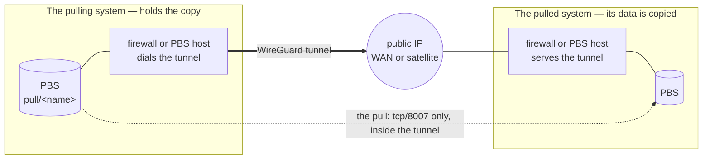

# Backup buddy — keep your off-site copy at another site

Primary audience: the operators of two sites that agree to hold a copy of each other's backups.

A **backup buddy** is another site — a TAPPaaS site, or any site that runs Proxmox Backup Server
(PBS) — that keeps an off-site copy of your backups. The copy is always **pulled**: the buddy's
PBS reads your backups into a namespace of its own; your PBS never pushes anywhere. That is the
rule that makes a compromised site unable to destroy the copy its buddy holds (ADR-012 §1.4.1): a
pull holds only a read-only login on the side it pulls from.

**How each end is set up.** On a TAPPaaS system, every setup below is a `backup-manager peer add`
command: it sets up both the PBS side and the tunnel. For a PBS that is not part of TAPPaaS, the
instructions are for a Debian-based PBS host, with WireGuard running on the host itself. Running
the tunnel on that site's firewall instead, if it supports WireGuard, works as well, but is out of
scope here.

## One pull, one tunnel

Everything here is built from one unit: **one pull, through one WireGuard tunnel.**



- **The system whose data is pulled serves the tunnel.** It wants its data copied, so it opens
  the door: it listens for the tunnel on its public IP — its own WAN address, or, for a site with
  no public inbound address, its [satellite](../satellite/README.md) — and grants the puller a
  read-only login on its PBS.
- **The pulling system dials the tunnel.** An outgoing connection works from behind any router,
  so the puller needs no public address of its own.
- **The tunnel carries the pull and nothing else.** It has exactly two addresses on it, one per
  end. The serving side exposes one thing at its tunnel address — its PBS's tcp/8007 — to one
  peer address only; the pulling side routes only that one address into the tunnel. Neither side
  routes any of its networks into it, so the two systems never become one network — which also
  matters because every TAPPaaS site uses the same `10.0.0.0/24` mgmt range.

**Two sites that hold each other's copy** are simply two pulls — two tunnels, one in each
direction, each served by the system being pulled.

## The four setups

Each pull has a **pulled** end and a **pulling** end, and each end is either a TAPPaaS system or
some other PBS. That gives four setups — pick the two that make your pull:

| | The pulled end (serves the tunnel) | The pulling end (dials the tunnel) |
|---|---|---|
| **TAPPaaS** | [Setup 1: a TAPPaaS system a buddy can pull](#setup-1-a-tappaas-system-a-buddy-can-pull) | [Setup 2: a TAPPaaS system that pulls a buddy](#setup-2-a-tappaas-system-that-pulls-a-buddy) |
| **Not TAPPaaS** | [Setup 4: a non-TAPPaaS PBS a TAPPaaS system can pull](#setup-4-a-non-tappaas-pbs-a-tappaas-system-can-pull) | [Setup 3: a non-TAPPaaS PBS that pulls a TAPPaaS system](#setup-3-a-non-tappaas-pbs-that-pulls-a-tappaas-system) |

Two TAPPaaS buddies holding each other's copy each do Setup 1 *and* Setup 2.

## The design

### Addresses

Each tunnel has a `/30` of its own from **`10.255.2.0/24`** — clear of the TAPPaaS zones, of
`10.255.0.0/24` (satellite infra tunnels) and of `10.255.1.0/24` (admin VPN). The serving end is
`.1` (its PBS answers there on tcp/8007), the dialling end `.2`:

| | First pull | A second pull (e.g. the other direction) |
|---|---|---|
| `/30` | `10.255.2.0/30` | `10.255.2.4/30` |
| serving end, the pulled system | `10.255.2.1` | `10.255.2.5` |
| dialling end, the pulling system | `10.255.2.2` | `10.255.2.6` |

The `/30` lives on **both** systems, so it must be free on both: the serving side picks it, and the
dialling side takes it from them. A system with several pulls uses the next free `/30` for each.
The examples below use the first pull's addresses.

`10.255.2.0/24` is the default, and can be changed:

- **For the whole site** — set `ip` of the `buddy` zone in `config/zones.json` (edit the file;
  `network-manager modify` keeps a zone's range fixed). New tunnels are carved from there.
- **For one tunnel** — `--tunnel-net <a.b.c.d/30>` on `peer add`. Use it when the `/30` the serving
  side picked is already taken at the dialling side: `peer add pull` refuses it and names a `/30`
  that is free there, for the serving side to re-run with.

### The serving end (the pulled system)

- A **WireGuard instance** for this pull: listens on its own UDP port, tunnel address `.1/30`, one
  peer — the puller's public key, `AllowedIPs = .2/32`, no endpoint (the puller dials in).
- **Its listening port reachable from the internet**: a WAN rule for that UDP port — or, behind a
  satellite, the satellite relays the port to the firewall over its infra tunnel.
- **Only the PBS port, from only the peer**: tcp/8007 on `.1`, from `.2`, reaches the PBS — on a
  TAPPaaS firewall a port forward to the PBS; on a PBS host that ends the tunnel itself, the PBS
  already answers on `.1`. Nothing else is admitted from the tunnel.
- **A read-only login** for the puller on the PBS, granted **without propagation**.

### The dialling end (the pulling system)

- A **WireGuard instance** for this pull: tunnel address `.2/30`, one peer — the server's public
  key, its public endpoint, `AllowedIPs = .1/32` (only the server's tunnel address is routed into
  the tunnel), `PersistentKeepalive = 25` (keeps a NAT mapping open).
- On a TAPPaaS firewall, the PBS's connection to `.1:8007` leaves through the tunnel **translated
  to `.2`** — the only source the server admits — and a rule lets the PBS, and nothing else in
  mgmt, use the tunnel.
- **The pull**: a PBS remote for `.1:8007` with the login and the TLS fingerprint the server sent,
  and a sync job into a namespace of its own.

### Through a satellite

A system whose only public address is its satellite serves its tunnel there: the puller dials
`<satellite-ip>:<port>`, and the satellite forwards that UDP port down its infra tunnel to the home
firewall's `10.255.0.1:<port>`, masquerading it — exactly as it forwards the admin VPN's 51821
(ADR-010 P5). WireGuard authenticates the key, not the address, so the firewall's instance does
not mind that the packets arrive from the satellite. The pull then runs inside the satellite
tunnel: set **`MTU = 1340`** on both ends, as the admin VPN does. Dialling needs nothing on a
satellite.

### What the two operators exchange

| The pulled side sends | The pulling side sends |
|---|---|
| its WireGuard public key, its public IP (or satellite IP) and UDP port | its WireGuard public key |
| the `/30` it proposes | — |
| the PBS login: auth-id and password; the TLS fingerprint; the datastore name | — |
| its country and city (for `--country`/`--city`) | its country and city |

Send the password over a channel you trust; public keys and fingerprints may go by email.

## Setup 1: a TAPPaaS system a buddy can pull

You serve the tunnel and grant read access — one command:

```bash
BUDDY="anna"      # a short name for your buddy: letters, digits, - and _
CC="DE"           # the country your buddy's PBS is in (ISO code)
CITY="Berlin"     # the city it is in
MTU="1420"        # 1340 if you serve through a satellite
backup-manager peer add remote "$BUDDY" --auth-id "$BUDDY@pbs" --country "$CC" --city "$CITY" \
    --tunnel serve --mtu "$MTU"
```

- It creates `<buddy>@pbs` (prompting for the password) and grants it `DatastoreReader` **without
  propagation** — so the buddy never sees your `fs/` captures (your `config/` and secrets) nor what
  *you* hold for others.
- It takes the next free `/30` (e.g. `10.255.2.0/30`) and listen port (from `51830`), and on your
  OPNsense creates the WireGuard instance `buddy-<buddy>-serve` (`.1/30`), a WAN rule for the UDP
  port (`buddy-<buddy> serve wg`), and a port forward that lets only `.2` reach your PBS on
  `.1:8007` (`buddy-<buddy> serve pbs`).
- It prints what to send: the host (`10.255.2.1`), datastore, login and fingerprint, and the whole
  `backup-manager peer add pull …` command for a TAPPaaS buddy to run — your site name, datastore,
  location (from your `site.json`), the `/30`, your public key, port and MTU filled in. Fill in your
  public IP in it — your WAN address, or your satellite's. (No location in `site.json`? Set it
  with `site-manager site modify --locationCountry … --locationCity …`.)

When the buddy sends **their** public key, admit it — the same command with `--peer-key` and
`--force` (the `/30` and port are kept, the login is left as it is):

```bash
KEY="…"           # your buddy's public key, as their peer add pull printed it
backup-manager peer add remote "$BUDDY" --auth-id "$BUDDY@pbs" --country "$CC" --city "$CITY" \
    --peer-key "$KEY" --force
backup-manager peer check remote "$BUDDY"      # the instance, its key, the handshake
```

Behind a satellite, the satellite must also relay the UDP port to `10.255.0.1:<port>` — not built
yet (#795).

The firewall objects are named `buddy-<buddy> …`: TAPPaaS's nightly firewall reconcile deletes only
rules carrying its own `tappaas-…` prefix, so they survive it, and `peer delete` removes them.

## Setup 2: a TAPPaaS system that pulls a buddy

You dial the buddy's tunnel and pull. Their `peer add remote` printed the whole command for you
with everything filled in, their location included — run that. By hand, with what they sent:

```bash
BUDDY="anna"                   # a short name for your buddy: letters, digits, - and _
STORE="tappaas_backup"         # their datastore name
NET="10.255.2.0/30"            # the tunnel /30 they sent
ENDPOINT="203.0.113.7:51830"   # their public IP (or satellite IP) and UDP port
KEY="…"                        # their public key
MTU="1420"                     # 1340 if they serve through a satellite
CC="DE"                        # the country their PBS is in (ISO code)
CITY="Berlin"                  # the city it is in
backup-manager peer add pull "$BUDDY" --store "$STORE" --country "$CC" --city "$CITY" \
    --tunnel dial --tunnel-net "$NET" --endpoint "$ENDPOINT" --peer-key "$KEY" --mtu "$MTU"
```

- On your OPNsense it creates the WireGuard instance `buddy-<buddy>-pull` (`.2/30`) with one peer —
  their key and endpoint, `AllowedIPs = .1/32`, keepalive 25 — an outbound NAT that sends your
  PBS's connection to `.1` as `.2` (`buddy-<buddy> pull nat`), and a mgmt rule that lets only your
  PBS use the tunnel, only to `.1:8007` (`buddy-<buddy> pull`).
- It prints **your** public key: send it to the buddy, for their `--peer-key`.
- It prompts for the auth-id, password and fingerprint the buddy sent (they are never written to
  config), creates the `pull/<buddy>` namespace, a nightly sync job (04:00) and its retention
  (`--max-depth 0` makes "their root namespace only" explicit), and records it all in
  `config/pull-<buddy>.json` — the remote host is the tunnel's `.1`.

The pull works once the buddy has admitted your key. Then:

```bash
backup-manager peer check pull "$BUDDY"   # handshake, and their PBS answering on .1:8007
ssh root@backup.mgmt.internal proxmox-backup-manager sync-job run "sync-$BUDDY"
backup-manager peers                      # the relationship, its tunnel, where the copy lives
backup-manager validate                   # tunnel /30s, and whether the buddy is shown to be elsewhere
```

## Setup 3: a non-TAPPaaS PBS that pulls a TAPPaaS system

The TAPPaaS system does Setup 1. On your PBS host (Debian), the tunnel ends on the host itself.
The tunnel could instead run on your site's firewall, if it supports WireGuard; that is out of
scope here.

With what the TAPPaaS operator sent:

```bash
SITE="rossen"                    # the TAPPaaS system's site name (a label on your side)
THEM="10.255.2.1"                # their end of the tunnel /30 they sent (.1) — their PBS
US="10.255.2.2"                  # your end of it (.2)
ENDPOINT="203.0.113.7:51830"     # their public IP (or satellite IP) and UDP port
THEIRKEY="…"                     # their WireGuard public key (buddy-…-serve)
MTU="1420"                       # 1340 if they serve through their satellite
```

The tunnel:

```bash
apt install wireguard-tools
(umask "077"; wg genkey > /etc/wireguard/buddy-out.key)
wg pubkey < /etc/wireguard/buddy-out.key                      # send this public key

cat > /etc/wireguard/buddy-out.conf <<EOF
[Interface]
Address    = $US/30
PostUp     = wg set %i private-key /etc/wireguard/buddy-out.key
MTU        = $MTU

[Peer]
PublicKey           = $THEIRKEY
Endpoint            = $ENDPOINT
AllowedIPs          = $THEM/32
PersistentKeepalive = 25
EOF

systemctl enable --now wg-quick@buddy-out
nft add rule inet filter input iifname "buddy-out" drop     # nothing may come in on it (adapt to your firewall)
```

Then the pull, into a namespace of your own, never deleting what the TAPPaaS system removes:

```bash
STORE="backup"                   # your datastore
AUTHID="you@pbs"                 # the login they created for you
PASSWORD='…'                     # its password
FP='…'                           # their TLS fingerprint
DAILY="14"; WEEKLY="8"; MONTHLY="12"   # how many copies of theirs you keep

proxmox-backup-manager remote create "tappaas-$SITE" --host "$THEM" --port "8007" \
    --auth-id "$AUTHID" --password "$PASSWORD" --fingerprint "$FP"
proxmox-backup-manager namespace create "$STORE" --ns "pull/$SITE"     # PBS ≥ 2.2
proxmox-backup-manager sync-job create "tappaas-$SITE" --store "$STORE" --ns "pull/$SITE" \
    --remote "tappaas-$SITE" --remote-store "tappaas_backup" --max-depth "0" \
    --remove-vanished false --schedule daily
proxmox-backup-manager prune-job create "tappaas-$SITE" --store "$STORE" --ns "pull/$SITE" \
    --schedule daily --keep-daily "$DAILY" --keep-weekly "$WEEKLY" --keep-monthly "$MONTHLY"
proxmox-backup-manager sync-job run "tappaas-$SITE"
```

`--max-depth 0` matters: the TAPPaaS system grants read on its datastore's root namespace
*without* propagation, so its `fs/`, `pull/` and `receive/` namespaces stay out of reach — and out
of the sync.

## Setup 4: a non-TAPPaaS PBS a TAPPaaS system can pull

The TAPPaaS system does Setup 2. On your PBS host (Debian), the tunnel ends on the host itself, so
no port forward is needed — PBS answers on the tunnel address.
The tunnel could instead run on your site's firewall, if it supports WireGuard; that is out of
scope here.

```bash
US="10.255.2.1"                  # your end of the tunnel (.1 of a /30 free at both sites)
THEM="10.255.2.2"                # the TAPPaaS system's end (.2)
PORT="51830"                     # the UDP port you listen on
THEIRKEY="…"                     # the TAPPaaS system's public key (buddy-…-pull), once it sent it
MTU="1420"                       # 1340 if the TAPPaaS system dials through a satellite
STORE="backup"                   # your datastore
LOGIN="tappaas-buddy@pbs"        # the read-only login you create for them
PASSWORD='…'                     # a strong password for it
```

The tunnel:

```bash
apt install wireguard-tools
(umask "077"; wg genkey > /etc/wireguard/buddy-in.key)
wg pubkey < /etc/wireguard/buddy-in.key                       # send this public key

cat > /etc/wireguard/buddy-in.conf <<EOF
[Interface]
Address    = $US/30
ListenPort = $PORT
PostUp     = wg set %i private-key /etc/wireguard/buddy-in.key
MTU        = $MTU

[Peer]
PublicKey  = $THEIRKEY
AllowedIPs = $THEM/32
EOF

systemctl enable --now wg-quick@buddy-in
# only the PBS port, only from the puller (adapt to your own input chain):
nft add rule inet filter input iifname "buddy-in" ip saddr "$THEM" tcp dport "8007" accept
nft add rule inet filter input iifname "buddy-in" drop
```

Forward the UDP port from your router to the PBS host if it is behind NAT. Then the read-only
login, granted **without propagation** on what the TAPPaaS system may copy:

```bash
proxmox-backup-manager user create "$LOGIN" --password "$PASSWORD"
proxmox-backup-manager acl update "/datastore/$STORE" DatastoreReader \
    --auth-id "$LOGIN" --propagate false
proxmox-backup-manager cert info | grep Fingerprint
```

Send: the login, the password, the fingerprint, your datastore name, your public key, the `/30`
and `<public IP>:<port>` — the TAPPaaS operator passes them to Setup 2's `peer add pull`, and sends
back the key it prints. Put that key in `THEIRKEY` and re-write the `.conf` (then
`systemctl restart wg-quick@buddy-in`).

## Prove it

- **The pull completed**: the sync finished without errors, and the namespace holds snapshots.
- **The tunnel carries nothing else**: from the pulling PBS, `curl -k https://10.255.2.1:22` and a
  ping of anything behind the serving firewall time out.
- **The copy is useless without the owner's key** — it is ciphertext. Whoever is pulled: export
  your key now if you have not (`backup-manager key export /media/<stick>`).
- **Rehearse the way back** once a year: restore one VM from the copy the buddy holds —
  [RESTORE.md §8](RESTORE.md#8-recovering-from-an-off-site-buddy).

## End a pull

Each side ends its own half. The pulled side: `backup-manager peer delete remote <buddy>`
withdraws the read access (`--purge` also deletes the login) and removes its `buddy-<buddy>-serve`
WireGuard instance, WAN rule and port forward. The pulling side: `backup-manager peer delete pull
<buddy>` stops the pull and keeps the copy (`--purge` deletes it), and removes its WireGuard
instance, outbound NAT and mgmt rule. On a non-TAPPaaS PBS: `systemctl disable --now wg-quick@buddy-…`,
and the user, remote and jobs removed with `proxmox-backup-manager`.

## What is still to build

- **Serving through a satellite.** The satellite relays only the admin VPN's UDP 51821 today, and
  its firewall is regenerated by every update, so a hand-added relay does not survive. Wanted: a
  satellite role that relays a declared UDP port to the home firewall — **#795**.
- **No buddy tunnel or restore has been rehearsed between two live sites**
  ([RESTORE.md §8](RESTORE.md#8-recovering-from-an-off-site-buddy) is marked *Unrehearsed*).
- **Several buddies, one site:** ADR-024 (Site Fabric) is where relationships between sites are
  meant to be described; it is a placeholder.
