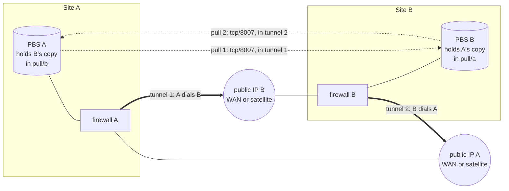

# Backup buddy — keep your off-site copy at another site

Primary audience: the operators of two sites that agree to hold a copy of each other's backups.

A **backup buddy** is another site — a TAPPaaS site, or any site that runs Proxmox Backup Server
(PBS) — that keeps an off-site copy of your backups while you keep one of theirs. Each side
**pulls** the other's backups into a namespace of its own; neither side ever pushes to the
other. That is the rule that makes a compromised site unable to destroy the copy its buddy holds
(ADR-012 §1.4.1): a pull holds only a read-only login on the far side.

This guide is the operator's procedure, and the design of the network path between the two
sites. **Status:** the PBS side (`backup-manager peer …`) is built; the tunnels are set up by hand
on each firewall, and relaying a tunnel through a satellite needs a satellite change that is not
built yet — see [What is still to build](#what-is-still-to-build).

## The setup



Two sites, **two tunnels — one per direction**, and **two pull connections**:

- **Tunnel 1** carries pull 1: PBS A copies B's backups into its `pull/b` namespace. Site A dials
  it; site B serves it.
- **Tunnel 2** carries pull 2: PBS B copies A's backups into its `pull/a` namespace. Site B dials
  it; site A serves it.
- **A public IP per site** is where its served tunnel is reached: its own WAN address, or — for a
  site with no public inbound address (behind another router, like makerfloss) — its
  [satellite](../satellite/README.md), which relays the tunnel's UDP port home through its own
  infra tunnel, as it already relays the admin VPN (ADR-010 P5).

**A tunnel carries PBS traffic and nothing else — it does not join the two networks.** Each
tunnel has exactly two addresses on it, one per end; neither side routes any of its own networks
into it. The serving site exposes one thing at its tunnel address — its PBS's tcp/8007 — and its
firewall forwards only that, only from the one peer address. The dialling site sends one thing
into the tunnel — its PBS's connection to that address. Nothing else on either side can be
reached, and the two sites' networks (which use the same `10.0.0.0/24` mgmt range on every
TAPPaaS site) never meet.

Why two tunnels rather than one: each is owned by the site that serves it — its listening port,
its peer key, its single forwarded port — so each operator controls exactly the access they grant,
and either side can end its half of the relationship without touching the other's.

## The design

### Addresses

Each tunnel is a WireGuard link with a `/30` of its own, taken from **`10.255.2.0/24`** — clear of
the TAPPaaS zones, of `10.255.0.0/24` (satellite infra tunnels) and of `10.255.1.0/24` (admin VPN):

| | Tunnel 1 (A pulls B) | Tunnel 2 (B pulls A) |
|---|---|---|
| `/30` | `10.255.2.0/30` | `10.255.2.4/30` |
| serving end (`.1`, its PBS at tcp/8007) | B: `10.255.2.1` | A: `10.255.2.5` |
| dialling end (`.2`) | A: `10.255.2.2` | B: `10.255.2.6` |
| WireGuard listens | on B, UDP port of B's choosing | on A, UDP port of A's choosing |

**Both firewalls hold both tunnels**, so the two `/30`s must be free on **both** sites. The buddies
agree on them once; a site with several buddies uses the next free `/30`s. Write them down in each
peer's config notes.

### On the serving site (it is pulled)

- A **WireGuard instance** for this buddy: listens on its own UDP port, tunnel address `.1/30`,
  one peer — the buddy's public key, `AllowedIPs = <.2>/32`, no endpoint (the buddy dials in).
- The **listening port reachable from the internet**: a WAN rule for that UDP port — or, behind a
  satellite, the satellite relays the port to the firewall over its infra tunnel.
- A **port forward**: tcp/8007 to `.1` → this site's PBS, tcp/8007. Nothing else is forwarded.
- A **firewall rule on the WireGuard interface**: from `.2/32` to the PBS, tcp/8007 — the only
  rule that admits the buddy. TAPPaaS's other WireGuard rules (the admin VPN's) match their own
  source ranges, so they do not admit it.
- **A read-only login for the buddy**: `backup-manager peer add remote` (below).

### On the dialling site (it pulls)

- A **WireGuard instance** for this buddy: tunnel address `.2/30`, one peer — the buddy's public
  key, its public endpoint, `AllowedIPs = <.1>/32` (only the buddy's tunnel address is routed into
  the tunnel), `PersistentKeepalive = 25` (keeps a NAT mapping open, as the satellite tunnel does).
- An **outbound NAT rule on the WireGuard interface**: from this site's PBS to `.1`, tcp/8007,
  translated to `.2` — the only source the buddy's tunnel accepts.
- A **firewall rule on mgmt**: from this site's PBS to `.1`, tcp/8007. (mgmt's `access-to: all`
  does not include overlay ranges, so nothing else in mgmt can use the tunnel.)
- The **pull itself**: `backup-manager peer add pull --host <.1>` (below).

### Through a satellite

A site whose only public address is its satellite serves its tunnel there: the buddy dials
`<satellite-ip>:<port>`, and the satellite forwards that UDP port down its infra tunnel to the
home firewall's `10.255.0.1:<port>`, masquerading it — exactly as it forwards the admin VPN's
51821. The firewall's buddy instance listens on that port as usual; it sees the buddy's packets
come from the satellite's tunnel address, which WireGuard does not care about (it authenticates
the key, not the address). The buddy's tunnel then runs inside the satellite tunnel, so give it
**`MTU = 1340`** on both ends (as the admin VPN does). A site that only *dials* needs nothing on
its satellite: an outbound connection works from behind any NAT.

## Set it up — between two TAPPaaS sites

Each site does both halves: it **serves** the tunnel its buddy pulls through, and **dials** the
tunnel it pulls through. Below, *you* serve tunnel 2 and dial tunnel 1; your buddy does the
mirror image.

### 1. Agree, and exchange

| You give your buddy | Your buddy gives you |
|---|---|
| your WireGuard public key for the tunnel you serve, your public IP (or satellite IP) and port | the same for the tunnel they serve |
| the `/30`s you both agreed (tunnel 1 and 2) | — |
| the PBS login from step 4: auth-id, password, TLS fingerprint, datastore `tappaas_backup` | theirs |
| your country and city, for `--country`/`--city` | theirs |

Send the password and keys over a channel you trust; only the **public** keys may go by email.

### 2. Serve your tunnel (tunnel 2 — your buddy pulls you)

On your OPNsense (`https://firewall.mgmt.internal:8443`), **VPN → WireGuard**:

1. **Instances → +**: name `buddy-<buddy>-in`, generate a key pair, listen port e.g. `51830`
   (unused), tunnel address `10.255.2.5/30`, MTU `1340` if your buddy reaches you through a
   satellite. Leave *Disable routes* off: the peer's single `/32` route is how replies find it.
   Save; copy the **public key** for your buddy.
2. **Peers → +**: name `buddy-<buddy>-dialler`, their public key, allowed IPs `10.255.2.6/32`, no
   endpoint, instance `buddy-<buddy>-in`. Enable WireGuard and apply.

Then:

3. **Reachable from the internet** — either
   - **own WAN:** Firewall → Rules → WAN: pass UDP `51830` to *This Firewall*, description
     `buddy-<buddy> wireguard`; or
   - **behind a satellite:** the satellite must relay UDP `51830` to `10.255.0.1:51830` — see
     [What is still to build](#what-is-still-to-build); until then use a site with a public
     address for the served end.
4. **Forward PBS only** — Firewall → NAT → Port Forward, interface `WireGuard (Group)`: destination
   `10.255.2.5` port `8007`/tcp → redirect to your PBS's mgmt address (`dig backup.mgmt.internal`)
   port `8007`; filter rule association *Pass* is fine, but source must be `10.255.2.6/32`.
   Description `buddy-<buddy> pbs`.
5. **Nothing else** — Firewall → Rules → WireGuard: check that no rule passes `10.255.2.6` anywhere
   but the forwarded PBS port.

Keep the `buddy-<buddy>` descriptions: TAPPaaS's nightly firewall reconcile deletes only rules
whose description carries its own `tappaas-…` prefix, so these survive it — and they are how you
find them again to remove.

### 3. Dial your buddy's tunnel (tunnel 1 — you pull them)

**VPN → WireGuard** again:

1. **Instances → +**: name `buddy-<buddy>-out`, generate a key pair, no listen port, tunnel
   address `10.255.2.2/30`, MTU `1340` if *they* are behind a satellite. Leave *Disable routes*
   off: the peer's `/32` is the only route into the tunnel. Copy the public key for your buddy.
2. **Peers → +**: name `buddy-<buddy>-server`, their public key, endpoint = their public IP (or
   satellite IP) and port, allowed IPs `10.255.2.1/32`, keepalive `25`, instance
   `buddy-<buddy>-out`. Apply.
3. **Firewall → NAT → Outbound** (hybrid mode): interface `WireGuard (Group)`, source your PBS's
   address, destination `10.255.2.1/32` port `8007`/tcp, translation address `10.255.2.2`.
   Description `buddy-<buddy> pull`.
4. **Firewall → Rules → LAN** (the mgmt zone): pass tcp from your PBS's address to `10.255.2.1`
   port `8007`, description `buddy-<buddy> pull`.

When both of you have done steps 2 and 3, **VPN → WireGuard → Status** shows a handshake on both
instances, and from your mothership:

```bash
ssh root@backup.mgmt.internal 'curl -sk -o /dev/null -w "%{http_code}\n" https://10.255.2.1:8007'   # 200
ssh root@backup.mgmt.internal 'ping -c1 -W2 10.0.0.1'   # your own gateway answers, as always
```

### 4. Grant your buddy read access (they pull you)

```bash
backup-manager peer add remote <buddy> --auth-id <buddy>@pbs --country <CC> --city <City>
```

It creates `<buddy>@pbs` (it prompts for the password), grants it read-only access
(`DatastoreReader`, **not** propagating — so the buddy never sees your `fs/` captures, which hold
your `config/` and secrets, nor what *you* hold for others), and prints what to send. **Send the
tunnel address, not the host it prints:** your buddy reaches your PBS at `10.255.2.5`, not at
`backup.mgmt.internal`.

### 5. Pull your buddy (you pull them)

```bash
backup-manager peer add pull <buddy> --host 10.255.2.1 --country <CC> --city <City>
```

It prompts for the auth-id, password and TLS fingerprint your buddy sent, creates the PBS remote,
the `pull/<buddy>` namespace, a nightly sync job (04:00) and its retention, and writes
`config/pull-<buddy>.json` (never the credential). Then the first copy, and a check:

```bash
ssh root@backup.mgmt.internal proxmox-backup-manager sync-job run sync-<buddy>
backup-manager peers                  # both relationships, and where each copy lives
backup-manager validate               # warns if the buddy is not shown to be somewhere else
```

### 6. Prove it

- The sync finished without errors, and `pull/<buddy>` holds snapshots.
- **Your buddy can restore your data only with your key** — the copy is ciphertext. Export it now
  if you have not: `backup-manager key export /media/<stick>`.
- **The tunnels carry nothing else:** from the PBS, `curl -k https://10.255.2.1:22` and a ping of
  anything behind your buddy's firewall time out.
- Put the drill in your calendar: once a year, restore one VM *from the copy your buddy holds* —
  [RESTORE.md §8](RESTORE.md#8-recovering-from-an-off-site-buddy).

## Set it up — when your buddy is not TAPPaaS

Any Proxmox Backup Server can be a buddy. Your side is exactly as above. The buddy's PBS host
(Debian) does its half with plain `proxmox-backup-manager` and `wireguard-tools`, and — since the
tunnel ends on the PBS host itself — needs no port forward: PBS answers on the tunnel address.

### Be pulled by the TAPPaaS site (it serves tunnel 1)

```bash
apt install wireguard-tools
wg genkey | tee /etc/wireguard/buddy-in.key | wg pubkey     # send this public key
```

`/etc/wireguard/buddy-in.conf`:

```ini
[Interface]
Address    = 10.255.2.1/30
ListenPort = 51830
PostUp     = wg set %i private-key /etc/wireguard/buddy-in.key
# MTU = 1340   # if the TAPPaaS site dials through its satellite

[Peer]
PublicKey  = <TAPPaaS site's buddy-…-out public key>
AllowedIPs = 10.255.2.2/32
```

```bash
chmod 600 /etc/wireguard/buddy-in.key; systemctl enable --now wg-quick@buddy-in
```

Admit only the PBS port from the tunnel, and nothing else from it (nftables, with your own
`input` chain; adapt to your firewall):

```bash
nft add rule inet filter input iifname "buddy-in" ip saddr 10.255.2.2 tcp dport 8007 accept
nft add rule inet filter input iifname "buddy-in" drop
```

Forward UDP `51830` from your router to the PBS host if it is behind NAT. Then the read-only
login, granted **without propagation** on what the TAPPaaS site may copy:

```bash
proxmox-backup-manager user create tappaas-buddy@pbs --password '<a strong password>'
proxmox-backup-manager acl update /datastore/<your-store> DatastoreReader \
    --auth-id tappaas-buddy@pbs --propagate false
proxmox-backup-manager cert info | grep Fingerprint
```

Send: auth-id `tappaas-buddy@pbs`, the password, the fingerprint, your datastore name (the
TAPPaaS operator passes it with `peer add pull … --host 10.255.2.1 --store <your-store>`).

### Pull the TAPPaaS site (it serves tunnel 2)

`/etc/wireguard/buddy-out.conf`, with a key pair of its own:

```ini
[Interface]
Address    = 10.255.2.6/30
PostUp     = wg set %i private-key /etc/wireguard/buddy-out.key
# MTU = 1340   # if the TAPPaaS site serves through its satellite

[Peer]
PublicKey           = <TAPPaaS site's buddy-…-in public key>
Endpoint            = <TAPPaaS public IP or satellite IP>:<port>
AllowedIPs          = 10.255.2.5/32
PersistentKeepalive = 25
```

```bash
systemctl enable --now wg-quick@buddy-out
nft add rule inet filter input iifname "buddy-out" drop      # nothing may come in on it
```

Then the pull, into a namespace of your own, never deleting what the TAPPaaS site removes:

```bash
proxmox-backup-manager remote create tappaas-<site> --host 10.255.2.5 --port 8007 \
    --auth-id <name>@pbs --password '<from the TAPPaaS operator>' --fingerprint '<from them>'
proxmox-backup-manager namespace create <your-store> --ns pull/<site>     # PBS ≥ 2.2
proxmox-backup-manager sync-job create tappaas-<site> --store <your-store> --ns pull/<site> \
    --remote tappaas-<site> --remote-store tappaas_backup --max-depth 0 \
    --remove-vanished false --schedule daily
proxmox-backup-manager prune-job create tappaas-<site> --store <your-store> --ns pull/<site> \
    --schedule daily --keep-daily 14 --keep-weekly 8 --keep-monthly 12
proxmox-backup-manager sync-job run tappaas-<site>
```

`--max-depth 0` matters: the TAPPaaS site grants read on its datastore's root namespace *without*
propagation, so its `fs/`, `pull/` and `receive/` namespaces stay out of reach — and out of the
sync.

## End the relationship

Each side ends its own half: `backup-manager peer delete remote <buddy>` withdraws their read
access (`--purge` also deletes the login), `backup-manager peer delete pull <buddy>` stops your
pull and keeps the copy you hold (`--purge` deletes it), and the firewall objects named
`buddy-<buddy> …` go — the WireGuard instance and peer, the WAN or relay rule, the port forward,
the outbound NAT and the mgmt rule.

## What is still to build

The design above is complete; these parts of it are done by hand today, or not possible yet:

- **The satellite relay for a served tunnel.** The satellite relays only the admin VPN's UDP
  51821 today, and its firewall is regenerated by every update, so a hand-added relay does not
  survive. Wanted: a satellite role that relays a declared UDP port to the home firewall.
- **The firewall objects.** Every WireGuard instance, rule and NAT entry above is made by hand in
  OPNsense. Wanted: `backup-manager peer add … --tunnel`, creating and removing them with the peer
  through the network controller, in an Overlay zone of their own (`buddy`), and a check in
  `backup-manager validate` that the tunnel is up.
- **`peer add remote` prints `backup.mgmt.internal`** as the host to send — an internal name the
  buddy cannot resolve; it should print the tunnel address.
- **`peer add pull` has no `--port`, `--remote-namespace` or `--max-depth`**, so a TAPPaaS pull
  syncs every namespace it can list. Against a TAPPaaS buddy's non-propagating grant that is the
  root only, but `--max-depth 0` should be explicit, as the satellite's own pull already is.
- **No buddy restore has been rehearsed** ([RESTORE.md §8](RESTORE.md#8-recovering-from-an-off-site-buddy)
  is marked *Unrehearsed*).
- **Several buddies, one site:** ADR-024 (Site Fabric) is where relationships between sites are
  meant to be described; it is a placeholder.
