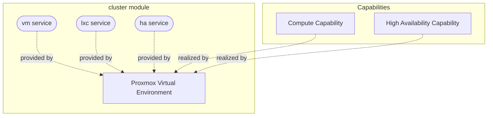

# cluster

Primary audience: TAPPaaS admin.

The Proxmox VE layer of TAPPaaS — turns commodity nodes into a cluster that provides the
VM, LXC and HA services every other TAPPaaS module builds on.

## What you get

| Capability | Access from | How |
|------------|-------------|-----|
| Proxmox VE cluster (`tappaas1`, `tappaas2`, … — `.10`+, up to the mgmt DHCP pool) | mgmt zone | `https://tappaas1.mgmt.internal:8006` (`10.0.0.10`) |
| VM provisioning (`cluster:vm`) | consumer modules | `dependsOn: ["cluster:vm"]` → `services/vm/` hooks |
| LXC provisioning (`cluster:lxc`) | consumer modules | `dependsOn: ["cluster:lxc"]` → `services/lxc/` hooks |
| HA placement + replication (`cluster:ha`) | consumer modules | `dependsOn: ["cluster:ha"]` → `services/ha/` hooks. `haCpu` picks the CPU model the guest runs: `common` (default) — the richest x86-64 level its node and HANode share, so every move between them is live; `host` — the node's full CPU, moved by stop and start. See [services/ha/README.md](services/ha/README.md) |
| CPU inventory of the nodes | TAPPaaS admin | `update.sh` Step 9 runs `proxmox-controller cpu-inventory --apply`: each node's x86-64 level as KVM reports it, the level all nodes share, and which live moves of a `cpu: host` guest are safe — `config/cluster-cpu.md` (and `.json`, which `haCpu` reads) |
| Automatic disk growth (VMs) | consumer modules | every module update grows a VM disk whose `/` is 80% full by 50% when its pool has room — `services/vm/auto-grow.sh`, settings in `site.json` `diskAutoGrow`; see [services/vm/README.md](services/vm/README.md) |
| `lan`/`wan` bridge model (VLAN-aware trunk) | nodes | built by `config-network.sh` at install |
| ZFS data pools (`tankXY`) | nodes | built by `config-storage.sh` at install |
| Controlled node/cluster reboots | TAPPaaS admin | `reboot-node.sh` / `reboot-cluster.sh`. A node is drained only when every running HA guest on it can move live to the node HA would choose; otherwise it is left for a window (`DEFERRED:`) and nothing moves. `haCpu: host` guests are moved off by stop and start first, and back afterwards |
| Key-only SSH on every node (#19) | TAPPaaS admin | enforced by `update.sh` Step 5 (`tappaas-cicd/scripts/ssh-key-only.sh`, shared with the machine modules' `sshKeyOnly`, #756). No password SSH for any user; root by key only. The web GUI, its node Shell and the physical console still take the root password |
| Guests wait for the firewall before they start (#127) | TAPPaaS admin | enforced by `update.sh` Step 5d (`setup-guest-hook.sh`). Guests take their address by DHCP from the firewall VM, and after a cold start of the site (a power cut) each node starts its guests at once while the HA firewall waits for quorum. Every guest but the firewall carries a pre-start hookscript (`local:snippets/tappaas-guest-hook.sh`) that waits until the firewall answers DNS, at most 180 s, then starts the guest anyway; with the firewall up it costs one probe. In Grafana: `{source="proxmox"} \|= "tappaas-guest-hook"`. A guest's own hookscript is kept, and reported |
| Microcode and an audit trail on every node (#128) | TAPPaaS admin | enforced by `update.sh` Step 5b (`setup-host-hardening.sh`). The CPU vendor's microcode package; auditd records changes **made from a login session** (SSH, the sweep, the console, the GUI node Shell) to `/etc/pve`, `/etc/ssh`, `/root/.ssh` and `/etc/network`, and forwards them to the logging module. In Grafana: `{source="proxmox"} \|= "tappaas-pve"` (or `tappaas-ssh`, `tappaas-network`). Changes made through the web GUI or API are PVE's own task log lines, already in Loki. A key added to or removed from root's `authorized_keys` is logged as `tappaas-rootkeys-changed:` (a 5-minute fingerprint check) and alerts as RootKeyChanged; a rewrite with the same keys does not |
| Proxmox's own notification mails off (#126) | TAPPaaS admin | `update.sh` Step 5c disables PVE's built-in `default-matcher` (cluster-wide), so smartd/ZED system mail, backup-job mails, replication, fencing and update notices no longer go to root@pam's address. Alerts come from the logging module instead, through `site-notify.sh` (see `logging/DESIGN.md`, *Alerting from the logs*). Disabled, not deleted: `pvesh set /cluster/notifications/matchers/default-matcher --disable 0` brings PVE's mails back until the next cluster update; a matcher of the site's own is left alone |
| Every node on the site's timezone (#837) | TAPPaaS admin | `update.sh` Step 5e sets each node's timezone to `site.json` `.location.timezone` when it differs, and says so. Only the timezone; keyboard and locale stay as installed. The `site-timezone` health gate reports a node or guest still on another zone |

A guest is **either** a VM **or** an LXC container, never both.

## Architecture

The Compute and High Availability capabilities are realized by Proxmox VE, which
provides the `vm`, `lxc` and `ha` services (the module's `provides` in
`cluster.json`) that every other TAPPaaS module builds on.

## What is not included

- The firewall/router itself — that is the [`network`](../network/README.md) module
  (its VM runs on this cluster).
- The VM base images — the [`templates`](../templates/README.md) module.
- Backup, identity, logging — separate foundation modules.
- General Proxmox administration guidance beyond the TAPPaaS conventions.

## Requirements

- One node (or three for a cluster) capable of running **Proxmox VE 9.2**, each with **two NICs** (one WAN, one LAN) —
  three or more for a redundant LAN uplink (see *Redundant LAN uplink*).
- A dedicated **boot disk** (ext4/LVM) plus separate data disks for the `tankXY` pools.
- An existing network with a free IP, DHCP and internet for the bootstrap.
- Multi-node: a switch between the nodes — unmanaged works out of the box; a managed
  switch needs VLAN trunking configured first (see the repo-root
  [INSTALL.md](../INSTALL.md)).

## Two-node clusters

Two nodes are two votes, and Proxmox needs a majority — two — to stay quorate.
When one node is down the other is not quorate, and HA fences it: the whole site
goes down, the firewall with it. `site-manager node add` warns when a cluster
reaches two nodes, and the health check (`quorum`) keeps saying so.

The fix is a third vote: a **QDevice** — `corosync-qnetd` on a small always-on
Debian machine that is not a node (a `debianhost`, or the satellite). It holds no
guests and needs almost no resources; the nodes must reach it on TCP 5403.

    site-manager node qdevice add <host>        # --user root if not the tappaas user
    site-manager node qdevice status
    site-manager node qdevice remove            # --user as for add

`add` installs `corosync-qnetd` on the host and `corosync-qdevice` on every node,
lets the first node log in to the host as root (to exchange certificates), runs
`pvecm qdevice setup`, and then removes that login again; `pvecm status` then
lists the Qdevice and *Expected votes* is 3. `remove`, and an `add` that finds the
QDevice already there, remove that login as well, so a host set up by an earlier
version loses it too. It restarts corosync on every node, so run it in a quiet
moment.

A third node does the same and adds capacity. A QDevice with three nodes is not
needed (and Proxmox advises against it on an odd number of nodes).

## Redundant LAN uplink

A node's `lan` bridge carries everything that keeps it in the cluster: management,
corosync, backup sync and every guest VLAN. On one port behind one switch, a pulled
cable, a dead port or a switch being re-provisioned takes all of it down at once —
and with HA's watchdog armed (the default), a node that loses quorum resets itself.
The health check (`lan-uplink`) warns about exactly that combination.

The fix is redundancy in the link itself: two (or more) ports bonded under the
`lan` bridge as `lanbond`, cabled to **two different switches that are connected to
each other**. The node keeps one address and one corosync link; a failed port, cable
or switch is absorbed below corosync, and a node that really loses its LAN is still
fenced and its guests move.

**Pick the mode by your ports and switches:**

| Ports | Switches | Mode | Behaviour |
|---|---|---|---|
| any mix (10G + 1G) | any two, interconnected | `active-backup` (default) | one leg carries traffic — the primary (the fastest) when it is up; the other takes over |
| equal speeds (2 × 10G) | one switch, or two acting as one (stack, MLAG) | `lacp` | both legs carry traffic (802.3ad) |

Proxmox documents `active-backup` as the bond mode for cluster traffic; `lacp` across
two switches works only where the switches present **one** LAG to the node — two
independent switches cannot, and the bond will not aggregate.

**Switch side.**
- `active-backup`: both ports are ordinary trunks with **identical** VLANs and MTU —
  a VLAN missing on the backup port only shows on failover. No LAG.
- `lacp`: one LAG per node spanning both switch ports, LACP active, fast rate, the
  same VLANs as the node's current uplink.

**Commands.**

    site-manager node network show tappaas2                         # declared vs live, and what is wrong
    site-manager node network set tappaas2 --lan-ports nic2,nic3    # declare and preview the change
    site-manager node network set tappaas2 --apply                  # converge it
    site-manager node network test tappaas2 --apply                 # fail each leg over in turn

`--lan-mode lacp`, `--lan-primary <port>` and `--mtu <n>` go with `set`; ports may be
given by name or MAC address. A new node gets the same flags on `node add`.

A node whose second port is its `wan` bridge's — a node that will never run the
firewall — can give it to the bond: `--no-wan` with `set` moves it from `wan` into
`lan` (e.g. `--lan-ports enp97s0,enp98s0 --no-wan`, 10G primary, 1G backup). Its switch
port must first carry the same VLANs as the `lan` port. It is refused while a guest
is on the node's `wan` bridge.

`set --apply` changes one node at a time: it moves the node's HA guests off (HA
maintenance), re-carries `lan` on the declared ports with a 45-second automatic
rollback, checks from the mothership that the node is reachable, every leg is up,
LACP has aggregated and corosync is connected — and only then keeps the change.
Anything else and the node goes back to its previous uplink on its own. Then the
node returns to HA placement.

**A USB NIC as a lan leg (#849).** A node without a free PCIe slot can take a USB
Ethernet adapter as its second `lan` leg, normally the `active-backup` backup:
`site-manager node network set <node> --lan-ports <onboard>,<usb-mac> --lan-mode
active-backup --lan-primary <onboard> --apply`. The adapter is pinned to `usblanN` by its
MAC (Proxmox's `pve-network-interface-pinning`), USB autosuspend is turned off for it,
and a udev rule (`/etc/udev/rules.d/90-tappaas-usb-nic.rules`, running
`/usr/local/sbin/tappaas-usb-nic-up`) puts it back in its bond when it appears after boot
or a replug; a missing adapter at boot is skipped and the bond runs on the other leg. On
hrossen tappaas3 runs `eno1` + an RTL8156 2.5G dongle (`usblan0`) this way. Prefer
Realtek adapters on the in-kernel `r8152` driver — RTL8153 (1G), RTL8156B (2.5G); ASIX
AX88179 adapters have a history of dropping out. `node network show` marks a USB leg
`(USB)`; a missing or down one says how to bring it back (replug, or `ifup lanbond`).
The pinning tool also stages its rename in `/etc/network/interfaces.new`, which Proxmox
puts in place at the next boot; the set drops that copy, refuses to pin while the GUI has
pending network changes there, and `node network show` warns when one is waiting.

**Moving the firewall's WAN role to another node (#849).** A node carries the
firewall's WAN only when its `wan` bridge has a port. `site-manager node network set
<node> --wan-port <port> --apply` gives it one (the reverse of `--no-wan`), through the
same drain and 45s rollback. For the firewall to fail over there as well:

1. the switch port that cable reaches is an access port in the WAN VLAN
   (`switch-manager add-port <switch> <port> --type device --zone wan`), cabled the
   same way as the current WAN node's;
2. the network module's HA placement (its `HANode`, which writes the `ha-network`
   affinity rule) names the node as the failover target —
   `module-manager modify network --set HANode=<node>`;
3. the guest-bridge check (#836) then allows the firewall there, since the node has
   a `wan` bridge with a port.

The old node can give its WAN port up (`--no-wan`) once the new one carries it.

**Switching to `lacp`** needs both ends: the node speaking LACP and its switch ports
one aggregate (LAG). When the switch controller knows which switch ports the node's
LAN NICs reach (`switch-manager add-port <switch> <port> --type node --target
<node> --target-port <nic>`) and the switch has a vendor controller (UniFi, MikroTik),
`set --lan-mode lacp --apply` does both: the node switches to LACP first (running on one
leg until the switch answers), then the aggregate `<node>-lan` is formed, and the
change is kept once LACP has aggregated — otherwise the aggregate is taken apart and
the node reverts. Leaving `lacp` takes the aggregate apart first. On a switch that
is configured by hand — or whose ports switch-manager does not know, or two switches
that are not an MLAG pair — the step is printed, and `--switch-wait 600` gives you time
to do it while the node waits. The two legs may reach two switches when they are a
declared MLAG pair (`switch-manager mlag-pair set`, MikroTik): the aggregate is then
formed across both, the same `mlag-id` on each. Never form the aggregate first, against a node still
in `active-backup`: the switch would send half its frames to the leg the node ignores.

`test --apply` (on a drained node too) takes each leg down for ten seconds and
checks management and corosync stay up; a timer on the node brings the leg back
after 30 seconds whatever happens. Pulling one cable at a time while watching
`site-manager node network show <node>` is the test that also proves the switch side.

**What is recorded and watched.** The ports are declared in the node's config
(`config/<node>.json`, `uplinks`, by MAC — interface names can move). A node that
has none gets its current layout recorded by the next cluster update, which also
installs `lldpd` in receive-only mode so `show` can say which switch and port each
leg reaches. The health check warns when a leg is down, a bond runs on its backup,
LACP has no partner, both legs reach the same switch, MTUs differ, or the live
layout differs from the declaration; a leg that goes down and does not come back is also mailed (`LanLegDown`); a flap that recovers within the window, as at a node's boot, is not.

**When you work on the switches,** change one switch at a time and wait until
`site-manager node network show` reports every leg up again before the next.

## Alternatives considered

- XCP-ng — seems less polished and with fewer features (though it also seems more "free").
- FreeNAS/TrueNAS — good for storage (same ZFS underpinning) but not really a cloud
  platform: no clustering and HA like Proxmox.
- Dedicated SAN/NAS for storage — ZFS on commodity local disks delivers the redundancy
  without extra hardware (up to 50% cheaper in small/medium deployments); Ceph/Garage S3
  remain a roadmap option for synchronous cross-node replication.

Source: the TAPPaaS curation criteria (Design Principles, tappaas.org
What → Principles). Depth: see [DESIGN.md](./DESIGN.md).

## Dependencies

None — `cluster` is the bottom layer of the foundation (`dependsOn: []`). It provides
`vm`, `lxc` and `ha` to everything else.

For installation steps see [INSTALL.md](./INSTALL.md).

Design and implementation detail: [DESIGN.md](./DESIGN.md). Test coverage: [TEST.md](./TEST.md).
