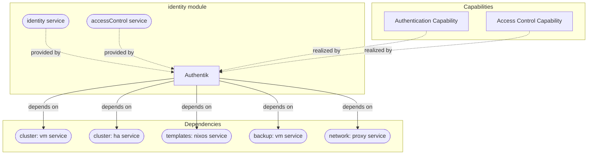

# identity

Primary audience: TAPPaaS admin.

Authentik SSO identity provider for TAPPaaS — one login per person, roles via groups,
single sign-on across all modules.

## What you get

| Capability | Access from | How |
|------------|-------------|-----|
| Authentik SSO web UI (login + admin) | internet (via reverse proxy) | `https://identity.<domain>` |
| Forward-auth gating for apps without native SSO (e.g. Jellyfin) | consumer modules | module declares `dependsOn: ["identity:accessControl"]` — wired automatically at its install |
| OIDC provider for native-OIDC apps (e.g. Nextcloud) | consumer modules | module declares `dependsOn: ["identity:identity"]` — OAuth2/OpenID provider, app, group bindings and VM secrets wired automatically |
| Role-based access (people reconciled by `identity-manager`) | admin (tappaas-cicd) | `identity-manager reconcile --apply`; also manageable in the Authentik admin UI |
| Authentik API access for tooling | tappaas-cicd | `authentik-manager` with auto-bootstrapped `~/.authentik-credentials.txt` |

Reference docs in this directory:

- [USERS.md](./USERS.md) — users, groups & roles operator guide (the people model,
  `identity-manager` verbs, password reset).
- [TEST.md](./TEST.md) — what the module tests cover (fast and deep tiers).

## The sign-in page

The sign-in page shows the site, not Authentik: the site's `displayName` with "powered by
TAPPaaS" beneath, in a light and a dark variant, and the name as the page title. To use your own
logo instead, put the image in the config directory and point `site.json` at it:

```bash
mkdir -p ~/config/branding
cp my-logo.svg ~/config/branding/
site-manager site modify --brandingLogo branding/my-logo.svg
# optional, a variant for the dark theme (same file type):
site-manager site modify --brandingLogoDark branding/my-logo-dark.svg
module-manager update identity
```

SVG, PNG, JPG or WebP, at most 2 MB. One file serves both themes, so pick colours that read on a
white and on a dark card, or give a dark variant. The logo is shown about 300 px wide; text in
an SVG should not depend on a particular font being installed. To go back to the generated
logo, remove `branding` from `site.json` and update identity again.

## The start page

After signing in, people see the applications they may use (*My applications*). Each tile shows
the module's `displayName` ("Forgejo", "Open WebUI") and its icon: the project's own logo,
shipped as `icon.svg` in the module's directory. A module without one gets a generated tile, its
initial on a colour taken from its name.

To use your own icon or name for an application, put the image in the config directory and set
it on the module:

```bash
cp forgejo.svg ~/config/branding/
module-manager module modify forgejo --set icon=branding/forgejo.svg
module-manager module modify forgejo --set "displayName=Code"
module-manager update forgejo
```

SVG or PNG, at most 2 MB; tiles are small, so a square image works best. A changed icon is
uploaded under a new name, so browsers show it at once. Remove `icon` to go back to the
module's own.

## Architecture



The Authentication and Access Control capabilities are realized by Authentik, which
provides the `identity` (OIDC) and `accessControl` (forward-auth) services (the
`provides` in `identity.json`) consumed by other modules; the VM itself is
provisioned, backed up and published by the foundation services it depends on.

## What is not included

- Emailed one-time enrollment links — deferred until SMTP is set up; the fallback is a
  printed temporary password (see [USERS.md](./USERS.md)).
- Role/user lifecycle — owned by `identity-manager` (ADR-007), not by this module's
  scripts.
- Per-app authorization beyond group bindings — each app is gated per-app via its
  Authentik application (ADR-006).
- Never stack forward-auth and OIDC on the same app (double login — ADR-006 §4).

## Requirements

- TAPPaaS foundation base installed: cluster, network (OPNsense + Caddy), templates,
  tappaas-cicd, backup.
- A resolved domain (from `config/environments/` or legacy
  `configuration.json .tappaas.domain`).
- Sizing defaults: 2 cores, 4096 MB RAM, 32G disk on `tanka1` (VMID 140, zone `mgmt`,
  NixOS template 8080).

## Alternatives considered

- Keycloak — the most widely adopted open-source IdP (OIDC, SAML, OAuth2, LDAP), but
  heavier and more complex to operate than a self-hosted platform needs.
- Authelia — lightweight MFA/access-policy portal; too narrow to be the platform IdP.
- Gluu, Zitadel, IdentityServer, Apereo CAS — enterprise-, cloud-native- or .NET-focused;
  a poorer fit for TAPPaaS. Authentik was chosen for its modern UI, protocol coverage
  (OIDC, forward-auth proxy, SAML, LDAP) and light footprint.

Source: the documentation site's single-signon solution-design page (analysis now in
[DESIGN.md](./DESIGN.md)). Depth: see [DESIGN.md](./DESIGN.md).

## Dependencies

| Depends on | Purpose |
|------------|---------|
| `cluster:vm` | Creates the identity VM (clone of template 8080) |
| `cluster:ha` | HA registration for the VM |
| `templates:nixos` | NixOS VM template |
| `backup:vm` | Registers the VM in the managed PBS backup job |
| `network:proxy` | Public HTTPS via Caddy (proxy port 9000, allowed from `internet`) |

Provides the `identity` and `accessControl` services consumed by other modules.

For installation steps see [INSTALL.md](./INSTALL.md).
