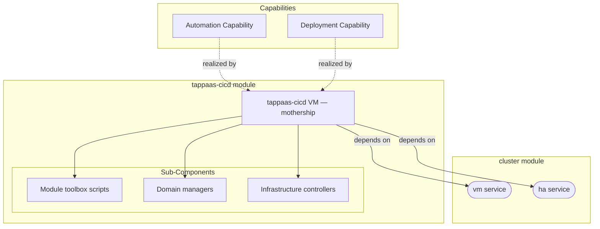

# tappaas-cicd

Primary audience: TAPPaaS admin.

The TAPPaaS "mothership" — the control-plane VM that installs, updates, tests and
configures every other module in the system.

## What you get

| Capability | Access from | How |
|------------|-------------|-----|
| Admin shell + module toolbox | mgmt zone | `ssh tappaas@tappaas-cicd`; `install-module.sh`, `update-module.sh`, `test-module.sh`, `delete-module.sh`, … in `~/bin` |
| Domain managers (config state) | mothership CLI | `site-manager`, `environment-manager`, `module-manager`, `network-manager`, `identity-manager`, `health-manager`, `storage-manager`, … |
| Infrastructure controllers (runtime state) | mothership CLI | `opnsense-controller`, `proxmox-controller`, `switch-controller`, `identity-controller`, `node-provisioner`, … |
| Scheduled system updates | automatic | `update-tappaas.service`, started by a timer rendered from `site.json` `updateSchedule`; the unit updates the mothership itself first (logs → journald → Loki) |
| Run an update now | mothership CLI | `site-manager update [--dry-run] [--force] [--no-git-pull]` — starts the unit and follows it |
| Pause one repository's pull | mothership CLI | `site-manager repository hold <name> --reason … [--until …]` / `release` (#653) |
| Local changes a sync set aside | mothership CLI | `site-manager repository stash list` — then `show` / `restore` / `discard --force` (#681) |
| Failed-update notice | automatic | mail to `site.json` `email` through a Proxmox node, naming the step that failed (#651) |
| System configuration store | mothership | `/home/tappaas/config` (`site.json`, `zones.json`, environments, module jsons) |
| Unattended node adding (PXE) | mothership CLI | `site-manager node add <name> --pxe` (netboot assets staged at install) |
| Admin VPN termination on OPNsense | anywhere (WireGuard) | set up at install; enrol devices with `network-manager wgvpn` per [ADMIN-VPN.md](./manager/network-manager/ADMIN-VPN.md) |
| Module store registration | mothership CLI | `repository.sh add <repo>` for community module stores |
| The mothership's SSH key | mothership CLI | `cicd-key.sh status` · `rotate` · `recover` — see [Mothership SSH key](#mothership-ssh-key) below (#122, #755) |

## Mothership SSH key

The mothership holds one SSH key, `~/.ssh/id_ed25519` (comment `tappaas-cicd`). It is root on
every node, so treat it as the site's master key. `cicd-key.sh` manages everything that trusts it:

| Target | Login | File the key lives in |
|--------|-------|-----------------------|
| Proxmox nodes | `root` | `/etc/pve/priv/authorized_keys` (cluster-wide) |
| VMs | `tappaas` | `/home/tappaas/.ssh/authorized_keys` (cloud-init put it there) |
| Managed machine modules — an adopted `debianhost`, the satellite | `root` at the machine's `address` | `/root/.ssh/authorized_keys` |

Not targets: the firewall (it trusts a separate key, `~/.ssh/tappaas-fw`), an **unmanaged**
machine (the mothership's key was removed on purpose — the satellite vault), and a `pvehost`
instance (it is a node, covered by the cluster file).

**`cicd-key.sh status`** — read-only. Shows each target with ✓, and warns about any *other*
`tappaas-cicd` key still trusted (a stale mothership key is root on every node until removed).

**`cicd-key.sh rotate [--dry-run] [--skip-unreachable]`** — use when the current key still works
but may have been exposed (a leaked backup, a lost disk), or as routine hygiene. Always start
with `--dry-run`, which lists every target and changes nothing. The real run:

1. checks the current key reaches every target — and **refuses to start** if any VM or managed
   machine is in doubt: no answer, a host key that does not match `known_hosts`, or a machine
   with no `address`. Skipping one would leave the old key valid there and lock the mothership
   out of it after the switch;
2. generates a new key and **adds** it everywhere;
3. **proves** the new key logs in to every target — if any refuses, it stops here and the old
   key keeps working everywhere;
4. **switches** the mothership to the new key (the old one is archived as
   `~/.ssh/id_ed25519.old-<time>`);
5. **revokes** every other `tappaas-cicd` key on every target, and refreshes the copies on the
   nodes (`/root/tappaas/tappaas-cicd.pub`, and the console debug key where it exists);
6. verifies every target again.

Run it when no update is in progress (it refuses while `update-tappaas.service` runs).
`--skip-unreachable` proceeds past a stopped VM or an unreachable machine and names it as
**not rotated**: the old key may still be valid there, so bring it up and rotate again.

**`cicd-key.sh recover [--dry-run]`** — use when the old key is **lost**, after a mothership
reinstall. Nodes first: paste the one line it prints into any node's web-GUI *Shell*. It then
puts the key on every VM through its QEMU guest agent (no SSH to the VM needed) and revokes the
old one. A machine has no guest agent: if it already takes the new key it is finished over SSH,
otherwise recover prints the line to run on that machine's console — run recover again after.
A Windows VM is named for a manual fix. The full procedure is in
[Disaster Recovery](../backup/RESTORE.md) §5.2.

## Architecture

The Automation and Deployment capabilities are realized by the mothership VM through
its toolbox scripts, domain managers and infrastructure controllers. The module
provides no `dependsOn` services of its own (`provides: []` in `tappaas-cicd.json`)
— it is the control plane that installs and drives every other module.

## What is not included

- The hypervisor layer (`cluster`), the firewall (`network`), the base images
  (`templates`) — this VM *drives* them, it does not contain them.
- Backup, identity and logging services — separate foundation modules that this VM
  installs (`rest-of-foundation.sh`).
- TLS certificate issuance — a post-install step (`acme-setup.sh`).

## Requirements

- The NixOS template (VM 8080) imported on the cluster (`templates` module).
- The OPNsense firewall at `10.0.0.1` (`network` module). Without it the platform is
  configured with `firewallType: "NONE"` and proxy/rules need manual handling.
- Defaults (from `tappaas-cicd.json`): VM 130 in zone `mgmt`, 4 cores, 16 GB RAM,
  32 GB disk on `tanka1`, HA replication every 15 min.

## Dependencies

| Depends on | Purpose |
|------------|---------|
| `cluster:vm` | Creates the mothership VM (clone of the NixOS template) |
| `cluster:ha` | HA placement + `*/15` replication of the VM |

For installation steps see [INSTALL.md](./INSTALL.md).

How a release reaches a site — the three channels, the two-week boundary, the version each
boundary cuts and the `tappaas-train.sh` command that runs one:
[RELEASE-TRAIN.md](./RELEASE-TRAIN.md). What the
mothership updates on its own, and when: [UPDATE-POLICY.md](./UPDATE-POLICY.md).

Design and implementation detail (component contract, manager/controller dispatch):
[DESIGN.md](./DESIGN.md). Test coverage: [TEST.md](./TEST.md). Remote admin access:
[ADMIN-VPN.md](./manager/network-manager/ADMIN-VPN.md). The `manager/` and `controller/` subtrees carry their
own READMEs.
