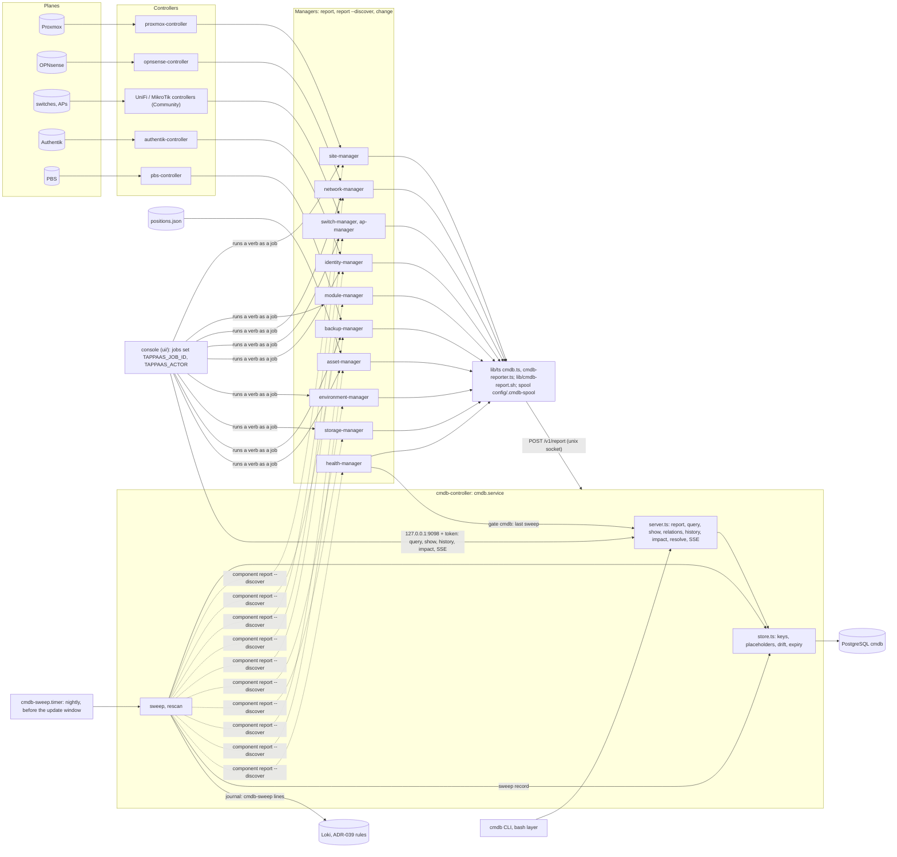
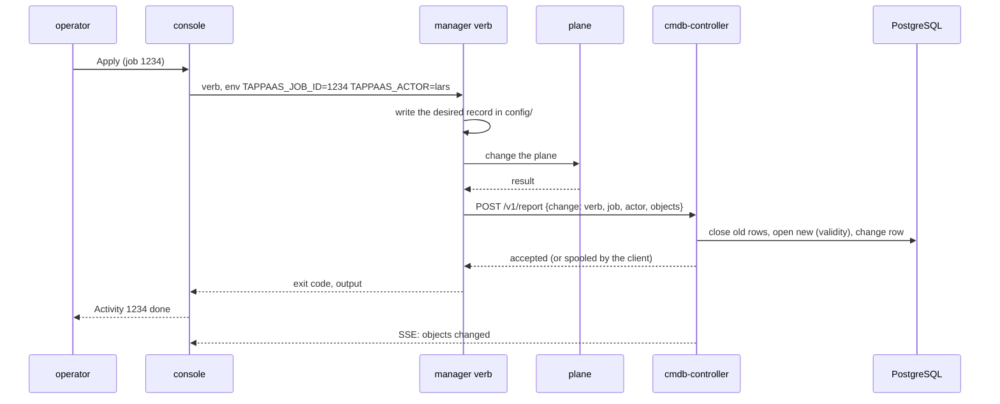
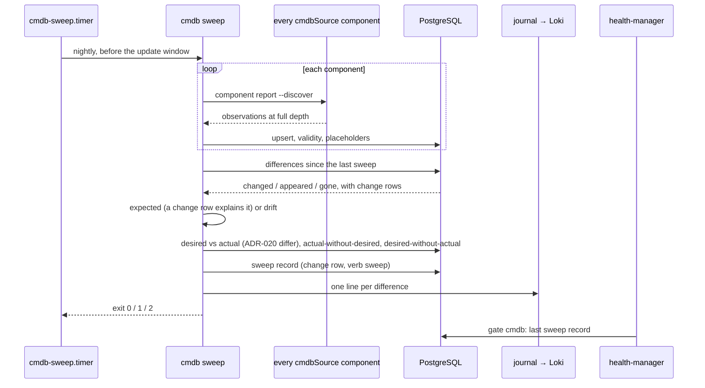

# cmdb-controller — design

ADR-040 decides the what; this is how step 1 builds it.

## Shape

```
 managers, bash ──cmdb CLI / lib/ts/src/cmdb.ts (curl)──┐
 console ── 127.0.0.1:9098 + token ─────────────────────┤
                                                        ▼
                        cmdb-controller serve (node, as tappaas)
                          server.ts   routes, auth, SSE
                          store.ts    report / query / show / history / impact / resolve
                          metamodel.ts  metamodel/*.json → checks, keys; → the metamodel tables
                          pg.ts       one connection, wire protocol v3
                                                        │ /run/postgresql, peer
                                                        ▼
                                    PostgreSQL: database cmdb (cmdb-v1.sql)
```

- **No npm dependencies.** TAPPaaS's TypeScript builds with `tsc` alone
  (`lib/nix/ts-manager.nix`), so the PostgreSQL client is the protocol itself
  (`pg.ts`): startup, the extended query for parameterised statements, the
  simple query for the schema file, text formats, no password authentication.
  About 300 lines, for exactly what the controller uses.
- **One connection, one statement at a time.** The controller is the only
  writer and its batches are small. A report holds the connection from BEGIN to
  COMMIT; queries queue behind it. A pool would add concurrency the store has no
  use for. If PostgreSQL drops the connection the service exits 75 and systemd
  starts it again; reporters spool meanwhile.
- **The client is synchronous** (curl per call), because the managers are: they
  run `spawnSync` from top to bottom. The CLI uses the same client, so a script,
  a manager and the CLI go through one code path.

## The store

The eight tables of D13 (`schema/cmdb-v1.sql`). Beyond the columns D13 lists:

| Column | Why |
|---|---|
| `attribute_def.spec` (jsonb) | the rest of a field's declaration (enum, items, relation, direction, otel, allowedBy, derived) as the metamodel file has it, so a reader of the table sees what the controller checks |
| `relation_type`: one row per (name, from, to) | a relation joins several pairs of classes (`runs-on`: vm → machine, software → node); the key is the triple |
| `object.last_seen`, `object.seen` | `lastSeen` and `sources[]` of D3's `object`: when each reporter last reported it. Kept on the row, not as attribute history: every observation would otherwise write a row |
| `attribute.change`, `relation.change` | the report that wrote the row, so a value's history links to its job (D6) |
| `change.kind`, `source`, `objects`, `relations`, `drift` | an observation is recorded as well as a change, so the change stream and an object's history show both |

`cmdb-v2.sql` adds `object.recorded` and `relation.recorded` (D7): sticky, so
a source that later sees a recorded thing does not unrecord it.

The schema version is the comment on table `object` (`cmdb schema 2`), not a
ninth table. Each `cmdb-v<N>.sql` above the recorded version is applied at
start; a store newer than the build is refused. v1 is idempotent; a change to
the eight tables is an ADR-025 migration and a `cmdb-v2.sql`.

**Validity.** A value's row holds `tstzrange(from, to)`; the current one is
open at the upper end. The exclusion constraint (`btree_gist`) makes overlap
impossible. A report time earlier than the current row's start (a spooled
report replayed after a newer one) is recorded at that start instead, so
history stays a sequence; a row closed at its own start is empty and history
leaves it out.

**Nothing is deleted.** `end` sets `object.ended`, closes the object's open
relations and sets `stage` to `retired` (a CI) or `disposed` (a resource). The
attributes keep their last periods open: "what was it when it ended" is the
current row of an ended object.

## Identity (D5)

A class's keys are its fields with a `key` rank; fields of one rank form one
key, tried lowest rank first. A key is looked up among live objects of the
classes, in the reporting class's **scope** (its nearest abstract ancestor),
that have the same key: a vm's VMID is matched among vms and lxcs; `name`,
which every node class keys on, across vm, lxc, machine and device — and a hit
of another class is a conflict, not a merge. A relation field can be part of a
key (a port is its name on its asset; software its name on its node — its
`version` is an attribute, so an upgrade is the same CI and the version's
history is the upgrades). Outcomes:

- no complete key in the report: refused (it cannot be identified);
- a key matching two objects: conflict;
- two keys matching two different objects: conflict;
- a match of another class: conflict;
- a CI matched under another name: conflict (a CI's name is immutable; a
  renamed CI is a new one, D7). A resource or place matched by a stronger key
  under another name keeps its stored name, and the result says `reportedAs`:
  the installer's hook (D8) knows a box's serial and MACs, not its tag;
- otherwise the match, or a new object.

**A key through a related object** (`keyVia` on the class): an asset is also
known by any of its ports' MACs, at rank 2, between vendor + serial and its
tag. The values are the `mac`s of the ports in the same report whose `asset`
is that asset's `ref`; they are looked up, case-insensitively, on the stored
ports that are `part-of` a live asset. MACs pointing at two assets, or at
another asset than the serial does, are a conflict.

## Placeholders

A report may name something its owner has not reported yet (a vm's machine, an
allocation's node). Refusing the batch made reporters send stubs or split
their reports, so a reference by class and name that finds nothing makes a
placeholder: an object of that class with the attribute `placeholder: true`
from the reporting source, no stage, and no `last_seen`, which keeps it out of
the expiry. A reference by an abstract class (`node`) keeps that class until
the owner says what it is: the one case of an object of an abstract class.

Placeholders take no part in key matching: they have no keys, and a guessed
class must not turn into a conflict. They are looked up afterwards, by name, in
the reported class and the abstract classes above it. With no keyed match the
report **adopts** the first: same id and relations, its class set, the mark
closed. With a keyed match (a stronger key found the real asset) each is
**absorbed**: its open relations move to the real object and it ends. A
placeholder of another concrete class (the reporter guessed `machine`, the
owner reports a `vm`) is not merged and stays visible. Port placeholders named
without their asset match only by name, so two by one name are a conflict.

## Unseen (D5)

A class's `expiry` (declared on `ci` as `7d`, inherited, refinable per class)
is how long a CI may go unreported. `Store.expire()` runs after each report
and on the service's timer (`CMDB_EXPIRY_CHECK_SECONDS`, an hour): every live
CI whose `last_seen` plus its expiry is past gets `stage: unseen`, from the
moment the expiry ran out, written by `cmdb-controller` under a change of its
own (verb `expire`), which the change stream carries. Nothing is deleted. An
observation of an unseen CI makes it `operational` again (D7), unless the
report sets the stage itself. Resources and places do not expire: an asset on
a shelf is not reported by anyone, and is not missing.

## Checks

Before a row is written: the class exists and is concrete; every attribute is
a field of the class or an ancestor, not derived, of its type (enum and array
items included); a relation field's target is an allowed end of its relation
type; required fields are present on create; immutable fields keep their value;
`allowedBy` holds over the merged state (stored values with the report's on
top). Problems are collected for the whole batch and returned together; the
transaction is rolled back.

## Drift (D6)

An observation that changes a stored value (an attribute or a relation field)
writes the `drift` attribute: since when, which source, each attribute's old
and new value, and the object's `desired` reference. More drift merges into it
(a new period). A change report that touches the object closes it. ADR-020's
differ (step 6) will supply the comparison with desired state; until then
"no change behind it" means: not reported as a change.

**Volatile fields** (`attribute_def.volatile`, schema v3) change by themselves: a
pool's `used`, a lease, a port's link, what is seen behind it. A whole attribute
is one value, so `nics[]` and `storages[]` are volatile because of what moves
inside them; a NIC that is added shows through its port. `disks[]`, `vdevs[]`
and `firewall` are not: a change there is what a sweep is for. They get periods like any other value and never count
as drift. `firmware` is deliberately not one: it does not change on every read,
and a firmware nobody reported changing is what drift is for.

## The sweep (D15)

`sweep.ts`. It runs in the service, not the CLI: the sources report back to the
service, and one sweep at a time is its call (a second gets 409). The sources,
the differ and the journal are injected.

**Expected or drift** is decided row by row, from the history. For each
attribute and relation the window (last sweep, now] holds, the value at the
start is compared with the value now; equal is no difference. Where a new row
exists, it names the report that wrote it (`attribute.change`): a `change` row
makes it expected, with its verb and job; an observation makes it drift, even
if a verb touched the same object for another attribute. A value or relation
that **went** has no row of its own, and neither does an object that appeared
or ended, so those fall back to the object: expected if a `change` row in the
window lists it.

So a change is explained only if the verb reported it itself. A verb that
changes something and says nothing shows as drift the next sweep: that is the
reporter's bug, and the sweep is what finds it.

The first sweep has no window. Listing the site as "appeared" would be noise,
so it is the baseline: only the differences from desired count.

**Which differences from desired.** ADR-020's differ needs a service's reporter
and manifest, so it answers for module records only (`module-manager drift`, one
per module, a read). A zone's or a user's record is checked for being there
(missing, unmanaged), not field by field: no differ exists for it yet. A module
the differ cannot read is `unread`, exit 1: unknown is not clean, and it is not
"desired without actual" either.

**Unmanaged** means a class that can have a record (`desiredRecord` in the
metamodel: nodes, zones, shares, identities, environments, the site). D15's list
is "a guest, a VLAN, a firewall rule, a share, a user". The other classes never
carry a `desired` (a lease, a service derived from its module, a DNS name), so
flagging them would make every sweep exit 1 and hide what matters. A firewall
rule has no class yet; when a controller reports them, the class says so.

**Missing** is `last_seen` before this sweep's start, so a failed source also
makes everything only it reports missing. That is true and is exit 2 either way.
Records are enumerated from `config/` (`desiredRecords`): modules, zones, shares,
environments, identities. A switch's or AP's record comes in through its CI's
`desired`, so a switch never reported at all is not seen.

**The timer** is rendered, not declared, because its hour is `site.json`'s. The
sweep is nightly even for a weekly update, and `Persistent`, unlike the update.

## Impact

A recursive CTE over current relations, both directions by default, each object
once at its shortest distance, with the relation type it was reached by. No
per-type direction yet: `runs-on`, `part-of` and `allocated-to` point different
ways, and "what does a down node take with it" crosses all three.

## Integration: the managers, the controllers and the console

cmdb-controller writes nothing but its own store and asks nothing of a plane
itself. Everything it knows comes in through the managers, and everything that
shows it goes out through one API. The picture, with every arrow a call the
code makes today:



### Who reports what

| Manager | Observations (every `report`; `--discover` adds the depth of D15) | Changes (the verbs that write) |
|---|---|---|
| site-manager (proxmox-controller) | site, locations, cluster, machines with `pve` as an app, VMs and containers, storage pools; `--discover`: NICs used or not as ports, disks and partitions, pool layouts, storages, PCI, CPU and memory, corosync links | node add/delete, site modify, location verbs, migrate-vm |
| module-manager | each module as the node of its kind (or an app), its services, controllers and managers, `depends-on`/`provides` | add, adopt, modify, delete, migrate, suspend/resume |
| network-manager (opnsense-controller) | zones, addresses, DNS names, proxy routes, VPN peers; `--discover`: interfaces, VLANs, rules and aliases by UUID in live order, NAT, DHCP, DNS overrides, routes, certificates, packages | zone add/modify/delete, modify --set, dns, proxy, wgvpn verbs |
| switch-manager, ap-manager | devices with their `network-device` assets, D9 ports, links the controllers and LLDP see, SSIDs; `--discover`: every port's link, PoE, STP, VLANs, seen MACs; radios and clients | add-switch, modify-switch, ssid verbs, port verbs |
| identity-manager (authentik-controller) | organizations, groups, users, roles; `--discover`: providers, applications, outposts, flows | every write verb, reconcile --apply |
| environment-manager | environments, `owned-by`, `serves` | add, modify, delete |
| storage-manager | storage pools, shares | nfs share and grant verbs |
| backup-manager (pbs-controller) | datastores, backup peers, `backs-up`; `--discover`: GC, restore points, sync jobs | peer add/delete, restore-point verbs |
| asset-manager | rooms, racks, assets by subclass, ports, placements, recorded cables, allocations — all marked recorded | every verb that writes positions.json |
| health-manager | `health` on each CI it checks; reads the last sweep for its `cmdb` gate | — |

Two rules hold them together. **A report is a side effect, never a gate:** a
manager reports after it has done its work, through the client's spool, and no
verb fails because the CMDB is down. **One identity per thing:** a manager
names an object by its class keys (D5) and refers to another manager's object
by class and name; the store merges the two views into one CI, or makes a
placeholder until the owner reports it.

### How a change gets in



### How the sweep finds drift



### The console

The console (ADR-034) is built on two kinds of call and the CMDB adds a third
source to the first:

| The console… | Today | With the CMDB (ADR-040 D10, plan step 4) |
|---|---|---|
| **reads** what is | `reads.ts`: cached calls to `health-manager`, `module-manager list`, `backup-manager`, `network-manager topology`, `site-manager`, `environment-manager` | the same reads, answered by `query`/`show`/`relations` on `127.0.0.1:9098` with the token; `network-manager topology` keeps its verb and answers from the CMDB, so the Physical view changes source without changing shape; the SSE stream replaces the 5-minute cache for what changed |
| **changes** things | every change is a job that runs a manager verb (`jobs.ts`, `run.ts`), recorded in Activity | unchanged, plus `TAPPAAS_JOB_ID` and `TAPPAAS_ACTOR` in the verb's environment, so the change's row in the CMDB is the Activity entry's twin |
| **shows a thing** | a module page, a device panel, a zone page, each from its own read | one CI panel for every class: attributes with their sources, relations both ways, history (`history` as of a time), drift against its desired record, open events (step 5), and the backbone trace upward (desired record, release, module, issues as links) |
| **Physical** | the topology's `positions` | every `physical` object by location, room and rack, each asset labelled with the CI it is allocated to |
| **Assets** (new) | — | every `resource` by stage: ordered and stock first, then placed and unallocated, allocated, disposed; faulty flagged; an asset's allocation history; Record…, Place…, Allocate…, Dispose… as jobs |
| **Operations** (new) | — | the last sweep: expected changes, drift, actual-without-desired, desired-without-actual, each a link to its CI; a Sweep now button (a job running `cmdb sweep`); open events by CI once step 5 lands |
| **Setup** | the physical-site step places nodes and switches | the same step, reading what the installer's hook already reported as the node's asset |

What step 4 must not do: open the database, or make the console a writer. It
reads the API and runs verbs; cmdb-controller stays the only writer and the
managers the only way to change a plane.

## What step 1 leaves to later steps

| Later | Here |
|---|---|
| Reports from the managers (step 2) | `rescan` runs `<component> report` for each component components.json marks `"cmdbSource": true` (read at each rescan; `CMDB_COMPONENTS`), one at a time, as `tappaas` with the managers' PATH, in the service's sandbox. Module components (`config/control-plane.json`) are not asked yet |
| asset-manager, `positions.json` migration (step 3) | the classes and relations are in the metamodel |
| The console's views (step 4) | the loopback listener and the token; the change stream |
| Per-relation impact direction | see above |

## The rescan sandbox

`cmdb.service` keeps `ProtectHome=read-only`; its rescan sources run as its
children, in the same sandbox. Two writes are let through with
`ReadWritePaths`, the two a `report` verb may need:

- `/home/tappaas/config/.cmdb-spool`: a report the service cannot take. Rare
  here, as the service is the parent, but a restart mid-rescan would lose the
  report otherwise.
- `/home/tappaas/.ssh/known_hosts`: a host's key on the first ssh to it. This
  is a bind mount of one file: ssh appends in place, which works; `ssh-keygen
  -R` replaces the file by rename, which fails inside the unit. The same rename
  from outside (a module update does one) detaches the bind mount: the file is
  read-only in the unit until `cmdb.service` restarts. ssh then warns and still
  connects; only a new host's key is not kept.

A missing path is ignored by the unit and then stays read-only, so
`cmdb-paths.service` makes both first, as `tappaas`: a fresh install's `config/`
must not come out root's. `NoNewPrivileges` also means a source cannot `sudo`.
