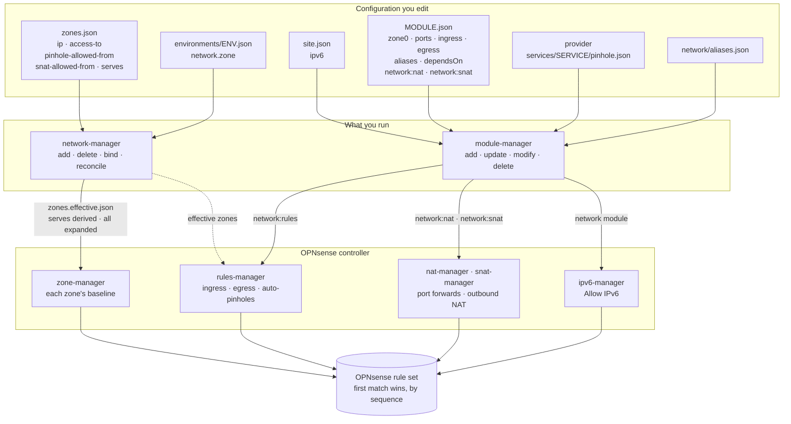

# Firewall Rules in TAPPaaS

How the zones a site declares, and the modules installed in them, become the rule set on the
OPNsense firewall: who writes which rules, in what order the firewall evaluates them, and what
each kind of rule is for. [ZONES.md](ZONES.md) describes the zones themselves — what a zone is,
the trust model it is meant to express, and the zone lifecycle. This page is the other half:
what the firewall actually does with them.

It describes the system as it is built. Where the rules do less than the zone model
describes, the difference is listed under [Current limitations](#current-limitations).

## In one paragraph

Every rule TAPPaaS writes is a **pass or block on the interface where traffic arrives**, marked
`quick` — the first rule that matches decides. The order is set by a **sequence number**, and
TAPPaaS keeps its rules in fixed bands: a zone's protective blocks first, then the per-module
pinholes, then each zone's own baseline (its gateway, the zones it may reach, a block on every
other private network, and the internet). Zone rules come from `zones.json`; module rules come
from each module's `network:rules` and its service dependencies. Everything not passed is
dropped by OPNsense's default deny.

## What the rules are made from

Everything the firewall enforces comes from five places in the configuration. Nothing is
written into the firewall by hand.

**1. A zone** — `config/zones.json` ([ZONES.md](ZONES.md) has every field). The fields the
firewall reads:

```jsonc
"home": {
    "state": "Active",                 // only Active and Mandatory zones get rules
    "ip": "10.3.10.0/24",              // the zone's subnet: source of its rules
    "access-to": ["internet"],         // zones it may reach, whole subnet, every port
    "pinhole-allowed-from": [],        // zones whose modules may open a pinhole into it
    "snat-allowed-from": [],           // zones whose traffic may be masqueraded into it
    "serves": "warmelo"                // adds the environment's service zone (derived)
}
```

`tier` and `isolated` are in the same object, but they feed the checks, not the rules.

**2. A module's own traffic** — in `config/<module>.json`, for a module whose `dependsOn`
lists `network:rules`. The ports it offers, who may reach them, and what it may reach beyond
its zone's `access-to`:

```jsonc
"zone0": "warmelo",                    // the zone the module runs in
"ports":   [{ "port": 3478, "protocol": "UDP" }],
"ingress": [{ "from": "home", "ports": [3478], "protocol": "UDP",
              "description": "Talk clients relay through coturn" }],
"egress":  [{ "to": "internet", "ports": [443], "protocol": "TCP",
              "description": "why this is needed" }]
```

`from` / `to` is a zone, another module, `internet`, or `alias:<name>` (an alias the module
declares under `aliases`, or one from the site-wide `network/aliases.json`). Schema and a
worked example: [network/DESIGN.md](../../../network/DESIGN.md#per-module-firewall-rules).

**3. A service pinhole** — a provider module ships `services/<service>/pinhole.json`
listing the ports of a service it offers; a consumer opens it by naming the service in its
`dependsOn` or `integratesWith` (`litellm:models`). No rule is declared by either side: the
pinhole follows from the dependency, if the zones allow it.

```jsonc
{ "ports": [{ "port": 4000, "protocol": "TCP", "description": "model web service" }] }
```

**4. A port forward or source NAT** — in the module's `config`, for a module that depends on
`network:nat` or `network:snat`:

```jsonc
"config": {
    "network:nat":  { "natRules": [{ "externalPort": 2022, "internalPort": 22,
                                     "protocol": "TCP", "description": "Git over SSH" }] },
    "network:snat": { "snatFrom": ["home"], "snatReason": "the device only answers its own subnet" }
}
```

A port forward is accepted only for a module in a zone that lists `internet` in
`pinhole-allowed-from` (the `dmz`); the control plane (`tappaas-cicd`) is the one exception,
so an operator may expose its SSH as the way in.

**5. The site** — `config/site.json` `ipv6` (default `false`): whether the firewall allows
IPv6 at all ([Address family](#address-family)). How a site gets IPv6, and which zones carry
it, is in [IPV6.md](IPV6.md).

## How the rules get written

An administrator works with two managers:

- **`network-manager`** — the zones: `add`, `delete`, `bind`, `reconcile`.
- **`module-manager`** — the modules: `add`, `update`, `modify`, `delete`.

Neither writes to OPNsense itself. Both change the rules **through the OPNsense controller**,
which has one procedure for each kind of rule:

| OPNsense controller procedure | Called by | Writes |
|---|---|---|
| `zone-manager` | `network-manager reconcile` (which `add`, `delete` and `bind` run too) | each zone's baseline: `Zone <zone> …` |
| `rules-manager` | `module-manager`, through the module's `network:rules` service | module ingress and egress, auto-pinholes: `tappaas-module:<vm>:…`, `tappaas-svcdep:<consumer>:…` |
| `nat-manager` | `module-manager`, through the module's `network:nat` service | port forwards |
| `snat-manager` | `module-manager`, through the module's `network:snat` service | outbound NAT |
| `ipv6-manager` | `module-manager`, when it updates the `network` module | the firewall's *Allow IPv6* and the site's IPv6 ([IPV6.md](IPV6.md)) |

The [diagram below](#from-the-configuration-to-the-rule-set) shows the whole path, from the
configuration through the two managers and the controller to the rule set. The procedures are
the controller's internals: an administrator changes the configuration and runs a manager,
never a procedure directly (a few have read-only listings, under [Checking it](#checking-it)).

`network-manager reconcile --only opnsense` without `--apply` shows what would change and
changes nothing. A module's **install adds** its rules; its **update reconciles** them (adds
what is missing, removes what the module no longer declares); its **delete removes** them.
Each writer touches only rules carrying its own names, so a rule an operator adds in the
OPNsense GUI under any other description is left alone. A TAPPaaS rule changed on the firewall
— disabled, or with another protocol, port, address family or order — is put back as declared
at the next reconcile, and the rules of a zone that is removed or renamed are removed with it.

A few modules write their own rules as part of their install — the admin VPN, the satellite,
the backup buddy and Caddy ([below](#rules-written-by-other-modules)).

## From the configuration to the rule set



1. **Effective zones.** `network-manager reconcile` adds the edges `serves` derives — a Client
   or Guest zone that serves an environment reaches that environment's service zone; an IoT
   zone accepts pinholes from it — and writes `config/zones.effective.json`. Only the zone that
   declares `serves` changes ([ZONES.md](ZONES.md#linking-a-client-or-iot-zone-to-an-environment-serves)).
2. **`all`.** Where `mgmt` says `all`, it is read as `internet` plus every zone that is not
   `Disabled`, an `Overlay` or the `WAN` hand-off.
3. **Zone rules.** `zone-manager` writes the rules of every `Active` or `Mandatory` zone,
   removes the rules of disabled and deleted zones, and applies once.
4. **Module rules.** `rules-manager` turns each module's ingress, egress and service
   dependencies into rules and host aliases, checks them against the effective zones, and
   applies them. Port forwards and source NAT are written by their own tools, and source NAT
   only into a zone whose `snat-allowed-from` names the source.
5. **IPv6.** Updating the `network` module runs `ipv6-manager`, which sets the firewall's *Allow IPv6* from `site.json` and gives each zone its IPv6 network ([IPV6.md](IPV6.md)).

## Evaluation order

All rules are `quick`: the **lowest sequence number that matches decides**. On a zone's
interface the order is:

| Order | Sequence | Rules | Written by |
|---|---|---|---|
| 1 | OPNsense | anti-lockout, DHCP, bogons and system rules | OPNsense |
| 2 | 970 / 971 | **anti-spoofing** — drop any source outside the zone's networks (IPv4 / IPv6) | zone-manager |
| 3 | 975 | **mDNS** — pass UDP 5353 to `224.0.0.251` on the zones that share discovery ([ZONES.md](ZONES.md#discovery-across-zones-mdns)) | mdns-manager |
| 4 | 980, 981 | **admin guard** — block TCP 8443 (GUI) and 22 (SSH) to every firewall address | zone-manager |
| 5 | 990, 991 | **caddy-reach** — pass TCP 443 and 80 to the DMZ gateway (`/32`), where Caddy listens | zone-manager |
| 6 | 10000–19999 | **module ingress** and **auto-pinholes** | rules-manager |
| 7 | 20000–29999 | **module egress** | rules-manager |
| 8 | 30000–39999 | the **zone baseline** (table below) | zone-manager |
| 9 | — | rules created without a sequence (other components, the GUI) | various |
| 10 | — | **default deny** | OPNsense |

Within the module bands each module has 100 slots, picked by a stable hash of its `vmname`;
within band 7 each zone has 100 slots by a hash of its name. Which slot each module has, and
which of its sequence numbers are in use, is written to `config/firewall/sequence-map.json`
after every change to its rules (`rules-manager list-slots` prints it). Two modules can land
on the same slot; their rules then share sequence numbers, which loses nothing because they are
all passes, and `rules-manager` says so. The bands are why a pinhole
works: it is evaluated before the destination's private-network block that would otherwise
drop it.

## Zone rules

For each `Active`/`Mandatory` zone, on the zone's own interface (`base` = the zone's slot in
band 7). A zone with an empty `access-to` gets the protective rules — anti-spoofing (IPv4 and IPv6) and
the admin guard — and its gateway's services, and nothing else.

Zone rules name a zone by its **interface**: its network as the source, its interface address as
the gateway, a target zone by that zone's interface network. A rule therefore covers whichever
addresses the zone carries, IPv4 and IPv6 alike. The family column says which.

| Sequence | Rule | Family | Action |
|---|---|---|---|
| 970 | `Zone Z block spoofed source` | IPv4 | block, source not in the zone's network |
| 971 | `Zone Z block spoofed source v6` | IPv6 | block, source not in the zone's network table (`__optN_network`) |
| 975 | `TAPPaaS: mDNS to the repeater` | IPv4 | pass UDP 5353 to `224.0.0.251`, where the firewall's mDNS repeater listens; one rule on every zone with `mdns`, none when fewer than two |
| 980 / 981 | `Zone Z block firewall webgui` / `ssh` | both | block TCP 8443 / 22 to the firewall itself |
| 990 / 991 | `Zone Z -> caddy https` / `http` | both | pass TCP 443 / 80 from the zone's network to the firewall's own addresses, where Caddy listens |
| base+0 | `Zone Z -> gateway dns` | both | pass TCP/UDP 53 to the zone's interface address |
| base+1 … +85 | `Zone Z -> <zone>` | both | pass any, to each zone in `access-to` (its whole network, every port) |
| base+86 / 87 | `Zone Z -> gateway ntp` / `dhcp` | both | pass UDP 123 / UDP 67 to the zone's interface address |
| base+88 / 89 | `Zone Z -> gateway icmp` / `icmpv6` | IPv4 / IPv6 | pass ICMP / ICMPv6 to the zone's interface address |
| base+90 … 92 | `Zone Z block rfc1918-10` / `172` / `192` | IPv4 | block every other private network (only when `internet` is in `access-to`) |
| base+93 | `Zone Z block zone-networks` | IPv6 | block every zone's network: the alias `tappaas_zone_networks` (same condition) |
| base+94 | `Zone Z block ula` | IPv6 | block unique-local addresses, `fc00::/7` (same condition) |
| base+95 | `Zone Z block firewall` | both | block the firewall's own addresses, its WAN address included (same condition) |
| base+96 / 97 | `Zone Z block cgnat` / `link-local` | IPv4 | block `100.64.0.0/10` and `169.254.0.0/16` (same condition) |
| base+99 | `Zone Z -> internet` | both | pass any (only when `internet` is in `access-to`) |

`tappaas_zone_networks` groups OPNsense's network table of every zone's interface, so it holds
each zone's current IPv4 and IPv6 networks. IPv6 has no private ranges inside a site — a zone's
IPv6 network is public — so this alias is what keeps zones apart over IPv6.

**What a zone may ask of the firewall.** Its gateway serves it DNS, NTP, DHCP and ICMP, and
nothing else: the admin GUI and SSH are blocked from every zone on every firewall address,
because an `access-to` edge grants a whole subnet and every zone's gateway *is* the
firewall. "The internet" does not include the firewall either: its WAN address is not in a
private range, so a zone with internet access would otherwise reach everything the firewall
serves there. Only Caddy is reachable on the firewall's addresses, through its own rule. Fragments need no rule — OPNsense reassembles them before filtering.

**Caddy-reach.** Split-horizon DNS answers every published name with the DMZ gateway, where
Caddy listens, and no zone may hold `access-to: dmz` (invariant I5). So a
zone reaches Caddy by its own rule at 990/991 — ahead of its private-network block — on two
ports, to the firewall's own addresses: Caddy answers on all of them, and a device that
resolved a published name through public DNS reaches it on the WAN address. It is reachability only: Caddy's `proxyAllowedZones` and the identity
gate decide who gets in. Candidates are a zone with `internet` (or `all`) in `access-to`, an
`Overlay` with a non-empty `access-to` (the admin VPN), and `dmz` itself.

**Manual zones get no zone rules.** `mgmt` reaches everything through the firewall's own LAN
rules and OPNsense's anti-lockout; the overlays (admin VPN, NetBird, edge) through the rules
their own components write. `mgmt`'s `all` is therefore a statement for the checks and for
SNAT, not a rule.

## Module rules

How `rules-manager` turns a module's declarations ([input 2 and 3](#what-the-rules-are-made-from))
into rules:

- **Ingress** — who may reach this module, on which ports. From a zone: the rule is on that
  zone's interface and admits the **whole source zone**. From another module: only that
  module's addresses (its `tm_<module>` alias). From `internet`: on the WAN. From `alias:X`: on
  the interfaces of the zones its addresses are in, and the WAN for its internet addresses. A
  zone whose interface cannot be found on the firewall stops the module's install or update;
  the rule is never written to another interface instead.
- **Egress** — what this module may reach beyond its zone's `access-to`: a zone, a module, an
  alias, or `internet`. `internet` means everything that is not the site: the rule's
  destination is "not `tappaas_not_internet`", an alias of the private and special-purpose
  ranges (RFC 1918, `100.64.0.0/10`, `169.254.0.0/16`, `fc00::/7`) and every zone's network.
  A module that needs another zone names that zone.
- **The zones decide.** A rule that crosses zones is written only if the zones allow it: the
  source zone has the target zone in `access-to`, or the target zone lists the source zone in
  `pinhole-allowed-from`. A module peer counts as the zone it runs in, and traffic within one
  zone is always allowed. An `alias:` peer counts as the zones its addresses are in: an address
  or network inside a zone's network, or a `<host>.<zone>.internal` name, is that zone; a public
  address or an outside name is the internet. An alias holding a private range that is no
  single zone's cannot be checked and is refused — name the zone instead. The path to an NFS
  share a module mounts is the exception: its share's grant decides it. Ingress from the internet is accepted only by a zone that lists
  `internet` in `pinhole-allowed-from` (the `dmz`); the firewall's own entry to Caddy is the
  exception. A rule the zones do not allow stops the module's install or update, and the
  message gives the `network-manager modify` command that would allow it.
- **Auto-pinholes** — when a module depends on another module's service (`dependsOn`,
  `integratesWith`), `rules-manager` opens the provider's ports from the consumer's address to
  the provider's, on the consumer's interface — if the provider's zone allows the consumer's
  zone in `pinhole-allowed-from`.
- **What a zone already allows is not written twice.** When the source zone's `access-to`
  already includes the target zone (or `all`), the zone's own pass lets all of that traffic
  through, so a module rule or auto-pinhole between the two is left out, with a note saying
  so. The sequence map records each one left out and the `access-to` it relies on. When an
  update of the `network` module narrows that `access-to`, it writes the module's rules again
  in the same update (`rules-manager recheck-covered`).
- **Aliases** — a module peer is an OPNsense host alias holding the peer's DNS name
  (`<vm>.<zone>.internal`), so a changed DHCP address needs no rule change.

Module rules cover IPv4 and IPv6 like zone rules: a zone peer is that zone's interface
network, and a module peer its host alias, which resolves both kinds of address. A rule is
IPv4-only when it names a literal IPv4 address or ICMP, and IPv6-only for ICMPv6 (declared as
`ICMPv6`).

Rule names carry their identity: `tappaas-module:<vm>:ingress:<peer>:<port>`,
`tappaas-svcdep:<consumer>:<service>:<provider>:<port>`, each followed by a human description.
A rule is one per identity: changing only its description rewrites the rule in place.

## Address family

Zone and module rules cover IPv4 and IPv6 (see [Zone rules](#zone-rules) and
[Module rules](#module-rules)); no zone has an IPv6 address yet. Rules written by other
modules (below) are IPv4 only. Whether the site supports IPv6 at all is `site.json` `ipv6` (default `false`). When it is
false, the firewall drops all inbound and forwarded IPv6 ahead of every TAPPaaS rule, and DNS
resolves over IPv4 only. After changing it, `module-manager update network` applies it.

## Rules written by other modules

These modules write their own rules when they are installed or reconfigured, by description, without a sequence number — not through `network-manager` or `network:rules`:

| Component | Rules |
|---|---|
| Admin VPN (`network-manager/wgvpn`) | `tappaas-admin admin->mgmt` (the VPN's peers reach `mgmt`), `tappaas-admin WAN :<port>` |
| Satellite | `tappaas-satellite edge->caddy`, `edge->admin-wg`, `edge->home-pbs`, `mgmt->pbs <name>` |
| Backup buddy | `buddy-<n> serve wg` (WAN), `buddy-<n> pull` (mgmt) |
| Caddy setup | `TAPPaaS: Allow HTTP/HTTPS to Caddy` (WAN) |

No component writes NetBird rules: on a site that runs NetBird, they are set by hand in the
OPNsense GUI.

## Checking it

The managers' own views, and the OPNsense controller's read-only listings — safe to run at
any time, they change nothing:

```bash
network-manager reconcile --only opnsense   # what a zone reconcile would change (no --apply)
network-manager validate --effective     # the zone model: references, tiers, invariants
zone-manager --summary                   # zones, their interfaces, pinhole policy warnings
rules-manager verify-rules <module>      # a module's declared rules vs what OPNsense holds
rules-manager expected-pinholes <module> # which auto-pinholes it should carry, and why any are not
rules-manager list-rules --orphans       # TAPPaaS rules nothing declares any more
rules-manager overlaps                   # rules that are shadowed, redundant or in conflict
rules-manager list-slots                 # each module's slot, rules in use, rules left out
ssh root@firewall.mgmt.internal 'pfctl -sr'   # the rules pf actually evaluates, in order
```

`rules-manager overlaps` reads the rule set as the firewall holds it — interface networks and
every alias's current addresses resolved, both address families — and compares the rules on
each interface in their evaluation order:

- **shadowed** — an earlier rule matches all of a rule's traffic, so the rule never decides
  anything. A pass behind a block is traffic meant to be allowed that is dropped.
- **redundant** — a module's pass whose traffic a later, broader pass lets through anyway,
  with no block in between.
- **conflict** — part of a module rule's traffic is decided by an earlier rule of the other
  action.

It changes nothing and always succeeds; `verify-rules <module> --detect-overlap` adds the
findings for one module to its check.

## Current limitations

Where the rules do less than the zone model describes:

- **An `access-to` edge includes the firewall's address in the target zone.** A zone that may
  reach another zone reaches that zone's gateway address too, on every port except the admin
  GUI and SSH.
- **An overlay's caddy-reach source is `10.0.0.0/8`**, not its peers' range: the WireGuard
  interface group has no network of its own to name, and no anti-spoofing narrows it.
- **A module with `aliasType: network`** is reached through an alias of its zone's IPv4
  subnet, so its rules cover IPv4 only.
