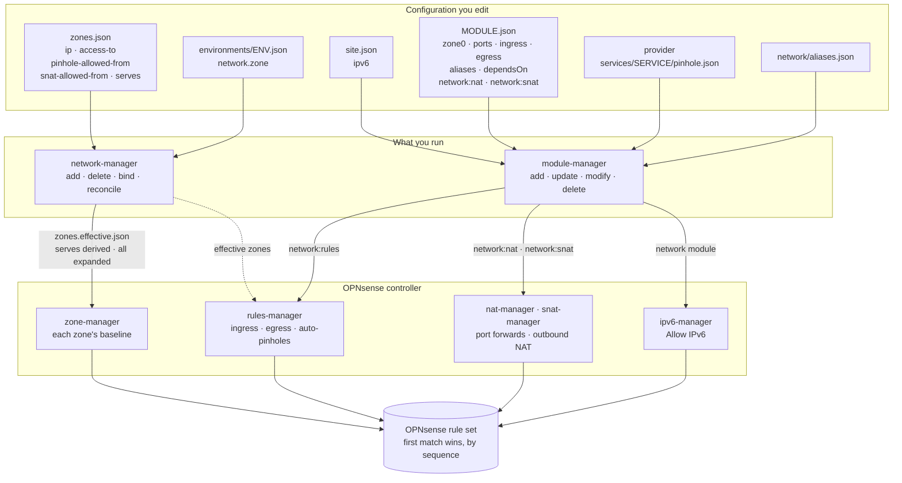

# Firewall Rules in TAPPaaS

How the zones a site declares, and the modules installed in them, become the rule set on the
OPNsense firewall: who writes which rules, in what order the firewall evaluates them, and what
each kind of rule is for. [ZONES.md](ZONES.md) describes the zones themselves — what a zone is,
the trust model it is meant to express, and the zone lifecycle. This page is the other half:
what the firewall actually does with them.

It describes the system as it is built. Where the rules do less than the zone model
describes, the difference is listed under [Current limitations](#current-limitations).

## In one paragraph

Every rule TAPPaaS writes is a **pass or block on the interface where traffic arrives**, marked
`quick` — the first rule that matches decides. The order is set by a **sequence number**, and
TAPPaaS keeps its rules in fixed bands: a zone's protective blocks first, then the per-module
pinholes, then each zone's own baseline (its gateway, the zones it may reach, a block on every
other private network, and the internet). Zone rules come from `zones.json`; module rules come
from each module's `network:rules` and its service dependencies. Everything not passed is
dropped by OPNsense's default deny.

## What the rules are made from

Everything the firewall enforces comes from five places in the configuration. Nothing is
written into the firewall by hand.

**1. A zone** — `config/zones.json` ([ZONES.md](ZONES.md) has every field). The fields the
firewall reads:

```jsonc
"home": {
    "state": "Active",                 // only Active and Mandatory zones get rules
    "ip": "10.3.10.0/24",              // the zone's subnet: source of its rules
    "access-to": ["internet"],         // zones it may reach, whole subnet, every port
    "pinhole-allowed-from": [],        // zones whose modules may open a pinhole into it
    "snat-allowed-from": [],           // zones whose traffic may be masqueraded into it
    "serves": "warmelo"                // adds the environment's service zone (derived)
}
```

`tier` and `isolated` are in the same object, but they feed the checks, not the rules.

**2. A module's own traffic** — in `config/<module>.json`, for a module whose `dependsOn`
lists `network:rules`. The ports it offers, who may reach them, and what it may reach beyond
its zone's `access-to`:

```jsonc
"zone0": "warmelo",                    // the zone the module runs in
"ports":   [{ "port": 3478, "protocol": "UDP" }],
"ingress": [{ "from": "home", "ports": [3478], "protocol": "UDP",
              "description": "Talk clients relay through coturn" }],
"egress":  [{ "to": "internet", "ports": [443], "protocol": "TCP",
              "description": "why this is needed" }]
```

`from` / `to` is a zone, another module, `internet`, or `alias:<name>` (an alias the module
declares under `aliases`, or one from the site-wide `network/aliases.json`). Schema and a
worked example: [network/DESIGN.md](../../../network/DESIGN.md#per-module-firewall-rules).

**3. A service pinhole** — a provider module ships `services/<service>/pinhole.json`
listing the ports of a service it offers; a consumer opens it by naming the service in its
`dependsOn` or `integratesWith` (`litellm:models`). No rule is declared by either side: the
pinhole follows from the dependency, if the zones allow it.

```jsonc
{ "ports": [{ "port": 4000, "protocol": "TCP", "description": "model web service" }] }
```

**4. A port forward or source NAT** — in the module's `config`, for a module that depends on
`network:nat` or `network:snat`:

```jsonc
"config": {
    "network:nat":  { "natRules": [{ "externalPort": 2022, "internalPort": 22,
                                     "protocol": "TCP", "description": "Git over SSH" }] },
    "network:snat": { "snatFrom": ["home"], "snatReason": "the device only answers its own subnet" }
}
```

**5. The site** — `config/site.json` `ipv6` (default `false`): whether the firewall allows
IPv6 at all ([Address family](#address-family)).

## How the rules get written

An administrator works with two managers:

- **`network-manager`** — the zones: `add`, `delete`, `bind`, `reconcile`.
- **`module-manager`** — the modules: `add`, `update`, `modify`, `delete`.

Neither writes to OPNsense itself. Both change the rules **through the OPNsense controller**,
which has one procedure for each kind of rule:

| OPNsense controller procedure | Called by | Writes |
|---|---|---|
| `zone-manager` | `network-manager reconcile` (which `add`, `delete` and `bind` run too) | each zone's baseline: `Zone <zone> …` |
| `rules-manager` | `module-manager`, through the module's `network:rules` service | module ingress and egress, auto-pinholes: `tappaas-module:<vm>:…`, `tappaas-svcdep:<consumer>:…` |
| `nat-manager` | `module-manager`, through the module's `network:nat` service | port forwards |
| `snat-manager` | `module-manager`, through the module's `network:snat` service | outbound NAT |
| `ipv6-manager` | `module-manager`, when it updates the `network` module | the firewall's *Allow IPv6* |

The [diagram below](#from-the-configuration-to-the-rule-set) shows the whole path, from the
configuration through the two managers and the controller to the rule set. The procedures are
the controller's internals: an administrator changes the configuration and runs a manager,
never a procedure directly (a few have read-only listings, under [Checking it](#checking-it)).

`network-manager reconcile --only opnsense` without `--apply` shows what would change and
changes nothing. A module's **install adds** its rules; its **update reconciles** them (adds
what is missing, removes what the module no longer declares); its **delete removes** them.
Each writer touches only rules carrying its own names, so a rule an operator adds in the
OPNsense GUI under any other description is left alone. A TAPPaaS rule changed on the firewall
— disabled, or with another protocol, port, address family or order — is put back as declared
at the next reconcile, and the rules of a zone that is removed or renamed are removed with it.

A few modules write their own rules as part of their install — the admin VPN, the satellite,
the backup buddy and Caddy ([below](#rules-written-by-other-modules)).

## From the configuration to the rule set



1. **Effective zones.** `network-manager reconcile` adds the edges `serves` derives — a Client
   or Guest zone that serves an environment reaches that environment's service zone; an IoT
   zone accepts pinholes from it — and writes `config/zones.effective.json`. Only the zone that
   declares `serves` changes ([ZONES.md](ZONES.md#serves--linking-a-client-or-iot-zone-to-an-environment)).
2. **`all`.** Where `mgmt` says `all`, it is read as `internet` plus every zone that is not
   `Disabled`, an `Overlay` or the `WAN` hand-off.
3. **Zone rules.** `zone-manager` writes the baseline of every `Active` or `Mandatory` zone with
   a non-empty `access-to`, removes the rules of disabled and deleted zones, and applies once.
4. **Module rules.** `rules-manager` turns each module's ingress, egress and service
   dependencies into rules and host aliases, checks them against the effective zones, and
   applies them. Port forwards and source NAT are written by their own tools, and source NAT
   only into a zone whose `snat-allowed-from` names the source.
5. **IPv6.** Updating the `network` module runs `ipv6-manager`, which sets the firewall's *Allow IPv6* from `site.json`.

## Evaluation order

All rules are `quick`: the **lowest sequence number that matches decides**. On a zone's
interface the order is:

| Order | Sequence | Rules | Written by |
|---|---|---|---|
| 1 | OPNsense | anti-lockout, DHCP, bogons and system rules | OPNsense |
| 2 | 970 | **anti-spoofing** — drop any source outside the zone's subnet | zone-manager |
| 3 | 980, 981 | **admin guard** — block TCP 8443 (GUI) and 22 (SSH) to every firewall address | zone-manager |
| 4 | 990, 991 | **caddy-reach** — pass TCP 443 and 80 to the DMZ gateway (`/32`), where Caddy listens | zone-manager |
| 5 | 10000–19999 | **module ingress** and **auto-pinholes** | rules-manager |
| 6 | 20000–29999 | **module egress** | rules-manager |
| 7 | 30000–39999 | the **zone baseline** (table below) | zone-manager |
| 8 | — | rules created without a sequence (other components, the GUI) | various |
| 9 | — | **default deny** | OPNsense |

Within the module bands each module has 100 slots, picked by a stable hash of its `vmname`;
within band 7 each zone has 100 slots by a hash of its name. The bands are why a pinhole
works: it is evaluated before the destination's private-network block that would otherwise
drop it.

## Zone rules

For each `Active`/`Mandatory` zone with a non-empty `access-to`, on the zone's own interface
(`base` = the zone's slot in band 7):

| Sequence | Rule | Action |
|---|---|---|
| 970 | `Zone Z block spoofed source` | block, source not in the zone's subnet |
| 980 / 981 | `Zone Z block firewall webgui` / `ssh` | block TCP 8443 / 22 to the firewall itself |
| 990 / 991 | `Zone Z -> caddy https` / `http` | pass TCP 443 / 80 to the DMZ gateway |
| base+0 | `Zone Z -> gateway dns` | pass TCP/UDP 53 to the zone's own gateway |
| base+1 … +85 | `Zone Z -> <zone>` | pass any, to each zone in `access-to` (whole subnet, every port) |
| base+86 / 87 / 88 | `Zone Z -> gateway ntp` / `dhcp` / `icmp` | pass UDP 123 / UDP 67 / ICMP to the gateway |
| base+90 … 92 | `Zone Z block rfc1918-10` / `172` / `192` | block every other private network (only when `internet` is in `access-to`) |
| base+99 | `Zone Z -> internet` | pass any (only when `internet` is in `access-to`) |

**What a zone may ask of the firewall.** Its gateway serves it DNS, NTP, DHCP and ICMP, and
nothing else: the admin GUI and SSH are blocked from every zone on every firewall address,
because an `access-to` edge grants a whole subnet and every zone's gateway *is* the
firewall. Fragments need no rule — OPNsense reassembles them before filtering.

**Caddy-reach.** Split-horizon DNS answers every published name with the DMZ gateway, where
Caddy listens, and no zone may hold `access-to: dmz` (invariant I5). So a
zone reaches Caddy by its own rule at 990/991 — ahead of its private-network block — on two
ports, to one address. It is reachability only: Caddy's `proxyAllowedZones` and the identity
gate decide who gets in. Candidates are a zone with `internet` (or `all`) in `access-to`, an
`Overlay` with a non-empty `access-to` (the admin VPN), and `dmz` itself.

**Manual zones get no zone rules.** `mgmt` reaches everything through the firewall's own LAN
rules and OPNsense's anti-lockout; the overlays (admin VPN, NetBird, edge) through the rules
their own components write. `mgmt`'s `all` is therefore a statement for the checks and for
SNAT, not a rule.

## Module rules

How `rules-manager` turns a module's declarations ([input 2 and 3](#what-the-rules-are-made-from))
into rules:

- **Ingress** — who may reach this module, on which ports. From a zone: the rule is on that
  zone's interface and admits the **whole source zone**. From another module: only that
  module's addresses (its `tm_<module>` alias). From `alias:X` or `internet`: on the LAN or WAN.
  The source zone must be in the destination zone's `pinhole-allowed-from`.
- **Egress** — what this module may reach beyond its zone's `access-to`: a zone, a module, an
  alias, or `internet`. A target outside `access-to` is allowed and warned about.
- **Auto-pinholes** — when a module depends on another module's service (`dependsOn`,
  `integratesWith`), `rules-manager` opens the provider's ports from the consumer's address to
  the provider's, on the consumer's interface — if the provider's zone allows the consumer's
  zone in `pinhole-allowed-from`, and the consumer's `access-to` does not already cover it.
- **Aliases** — a module peer is an OPNsense host alias holding the peer's DNS name
  (`<vm>.<zone>.internal`), so a changed DHCP address needs no rule change.

Rule names carry their identity: `tappaas-module:<vm>:ingress:<peer>:<port>`,
`tappaas-svcdep:<consumer>:<service>:<provider>:<port>`, each followed by a human description.

## Address family

TAPPaaS rules are **IPv4 only**, and no zone has an IPv6 address. Whether the site supports
IPv6 at all is `site.json` `ipv6` (default `false`). When it is false, the firewall drops all
inbound and forwarded IPv6 ahead of every TAPPaaS rule, and DNS resolves over IPv4 only.
After changing it, `module-manager update network` applies it.

## Rules written by other modules

These modules write their own rules when they are installed or reconfigured, by description, without a sequence number — not through `network-manager` or `network:rules`:

| Component | Rules |
|---|---|
| Admin VPN (`network-manager/wgvpn`) | `tappaas-admin admin->mgmt` (the VPN's peers reach `mgmt`), `tappaas-admin WAN :<port>` |
| Satellite | `tappaas-satellite edge->caddy`, `edge->admin-wg`, `edge->home-pbs`, `mgmt->pbs <name>` |
| Backup buddy | `buddy-<n> serve wg` (WAN), `buddy-<n> pull` (mgmt) |
| Caddy setup | `TAPPaaS: Allow HTTP/HTTPS to Caddy` (WAN) |

No component writes NetBird rules: on a site that runs NetBird, they are set by hand in the
OPNsense GUI.

## Checking it

The managers' own views, and the OPNsense controller's read-only listings — safe to run at
any time, they change nothing:

```bash
network-manager reconcile --only opnsense   # what a zone reconcile would change (no --apply)
network-manager validate --effective     # the zone model: references, tiers, invariants
zone-manager --summary                   # zones, their interfaces, pinhole policy warnings
rules-manager verify-rules <module>      # a module's declared rules vs what OPNsense holds
rules-manager expected-pinholes <module> # which auto-pinholes it should carry, and why any are not
rules-manager list-rules --orphans       # TAPPaaS rules nothing declares any more
ssh root@firewall.mgmt.internal 'pfctl -sr'   # the rules pf actually evaluates, in order
```

## Current limitations

Where the rules do less than the zone model describes:

- **The trust model is checked, not enforced, for module rules.** Module egress is not checked
  against an `isolated` target or the target's `pinhole-allowed-from`; ingress from another
  module, an alias or the internet is not checked against the zones; port forwards are not
  limited by zone.
- **A zone with an empty `access-to` gets no rules.** A zone without egress, such as
  `iotLocal`, has no anti-spoofing rule and no rules for gateway DNS or NTP. An `isolated` zone
  with internet egress gets the full set.
- **The private-network block covers RFC 1918 only.** 100.64.0.0/10 (carrier-grade NAT) and
  169.254.0.0/16 are reachable from every zone with internet access.
- **The caddy-reach source is `10.0.0.0/8`**, not the zone's subnet. On a VLAN, anti-spoofing
  narrows it to the zone; on the WireGuard interface group, which has no anti-spoofing, it
  admits every tunnel.
