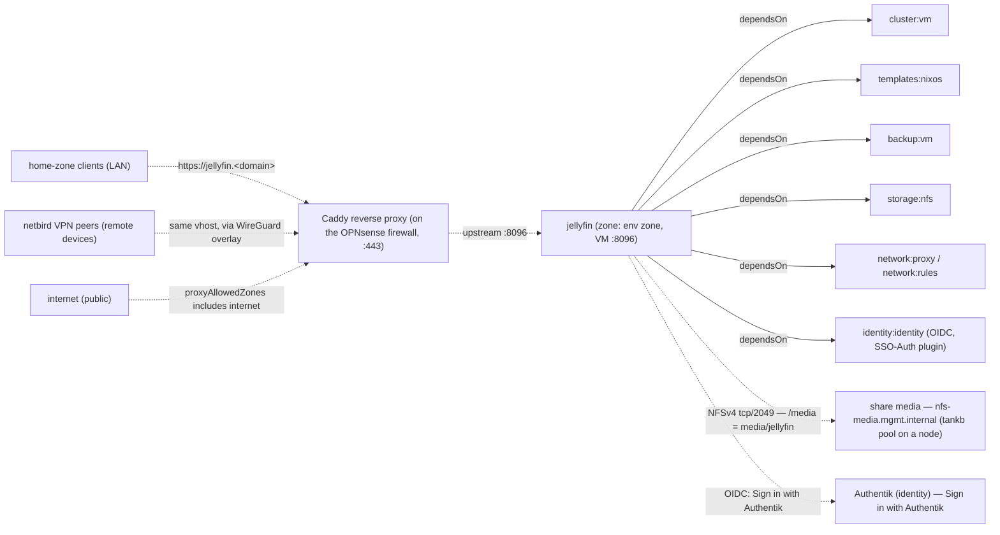

# Jellyfin

Open-source media server for personal movie, TV, music, and photo libraries.

Status: Testing — installed and live-tested on the reference site with its media on an NFS share (ADR-029). See
[INSTALL.md](INSTALL.md) for installation and for the media share a site's
server declares — before or after Jellyfin is installed.

## Overview

| Field | Value |
|---|---|
| VM name | `jellyfin` |
| Zone | the environment's zone (`zone0` from `config/environments/<env>.json`) |
| Port | 8096 |
| VM ID | 360 |
| App version | 12.2 |
| VM disk | 32G on `tanka1` — OS and Jellyfin's own data (`/var/lib/jellyfin`, metadata, cache) |
| Media | `/media` — subdir `jellyfin` of the NFS share `media` (`storage:nfs`); a local directory while the share is pending |

## Storage

The media library is **not** in the VM. `/media` is the subdirectory `jellyfin`
of the NFS share named **`media`**, served by a cluster node from its `tankb`
pool through `storage:nfs`
([ADR-029](../../../docs/ADR/ADR-029%20-%20NFS%20Service.md) v0.9):

- **Jellyfin names the share, not a machine.** `jellyfin.json` mounts
  `share: "media"`, `subdir: "jellyfin"` at `/media`, `rw` — the same file on
  every site. The guest mounts `nfs-media.mgmt.internal:/tappaas-nfs/media/jellyfin`;
  the alias follows the share, so moving it to another node or pool changes
  nothing here.
- **The operator declares the share** with `storage-manager` (kept in
  `config/shares.json`): name `media`, server node, pool, quota, backup policy,
  and a grant to `jellyfin`. A consumer never creates a share.
- **The service joins them:** it shares the dataset to Jellyfin's address only,
  opens the one firewall path (Jellyfin → the share, tcp/2049) and writes the
  mount into the guest (`/etc/nixos/tappaas-nfs.nix`, imported by the
  baseline). The mount is `nofail` + automount: Jellyfin starts even while the
  server is down.

**No share yet?** Jellyfin installs and works anyway, but the media then lives
in `/media` **on the VM's own 32G disk** (on `tanka1`) — a stopgap, not a home
for a library. Declare the `media` share for real use. When it arrives, the next
update **moves** what `/media` holds into it — copied while Jellyfin runs,
`jellyfin.service` stopped for the final pass, the old directory kept as
`/media.pre-nfs` until the next healthy update — and mounts it. The module ships
with `rebootOk: true`, so that happens without anyone present; Jellyfin is down
for the final copy only.

Why: media is large and can be re-ripped or re-downloaded. It does not belong on
the replicated `tanka` tier or in the VM's backup, and it should outlive the VM
— deleting or rebuilding Jellyfin leaves the library where it is. For the same
reason Jellyfin is deliberately **not** HA (no `cluster:ha`).

Every request is squashed to the share's owner (ADR-029 D7), so the `jellyfin`
user reads and writes the share although the files on the server belong to one
reserved uid.

## Media Folders

`update.sh` creates the library folders — on the share, or on the VM's disk while
the share is pending:

```
/media/
  Movies/           Jellyfin library: Movies
  TV/               Jellyfin library: Shows
  Music/            Jellyfin library: Music
  Photos/           Jellyfin library: Photos
  Audiobooks/       Jellyfin library: Books/Audiobooks
```

Another module that needs the library — a download client writing new media,
say — gets its own grant on the share `media` and mounts it itself. It never
goes through Jellyfin. `subdir` is organisation, not isolation: every consumer
granted `media` can reach all of it (ADR-029 D15).

## Module dependencies & traffic flow



Solid arrows are declared `dependsOn` edges (install-order dependencies). Dashed
arrows are traffic: `network:proxy` creates the `jellyfin.<domain>` vhost on the
Caddy reverse proxy, and `proxyAllowedZones` (`home`, `netbird`, `internet`)
controls which source zones that vhost accepts. There is no Authentik gate in
front: Jellyfin's apps log in to its own API, and they must work for friends and
family away from the site. Who gets in is decided at Jellyfin's login (below).
The NFS path to the share is the one rule `network:rules` derives
from the mount (none while it is pending).

## Access: Jellyfin's own login, for the web and the apps

`https://jellyfin.<domain>` answers Jellyfin itself, from home, from netbird and
from the internet alike (home clients resolve the same name to Caddy, ADR-021).
Jellyfin's apps on TVs, phones and computers can therefore reach it from
anywhere — the point: friends and family use them from their own homes.

- **Web:** **Sign in with Authentik** on Jellyfin's login page (the SSO-Auth plugin).
  Only members of the Authentik groups `users` and `jellyfin-admins` get in; give a
  friend an Authentik account in `users`. The Jellyfin tile in Authentik's app list
  goes straight there (`/sso/OID/start/authentik`).
- **Apps and TVs:** **Quick Connect.** The app shows a code; the person enters it
  under their profile → Quick Connect in a browser where they are signed in. An
  account made by Sign in with Authentik has a random password, so this is how it
  reaches an app. Apps without Quick Connect (Kodi, Infuse) cannot sign in with
  such an account.
- **Accounts:** the first Authentik sign-in creates the Jellyfin account, named
  after the Authentik username, with access to every library.
- **Admins:** members of the Authentik group `jellyfin-admins` become Jellyfin
  administrators, and that is re-checked at every sign-in.
- **Local accounts:** `admin`, `stream` and `local` (from the install) keep their
  passwords. `admin`, the break-glass account, signs in **from the site only**;
  `local` too; `stream` from anywhere.
- **Name collisions:** the plugin links an Authentik user to an EXISTING Jellyfin
  account of the same name. Don't give an Authentik user the name `admin`,
  `stream` or `local`, or it gets that local account.
- **Plugin version:** K0lin/jellyfin-plugin-sso 5.1.1, pinned in `jellyfin.nix`:
  the maintained continuation of the archived 9p4 plugin, for Jellyfin 12. It
  gives every account it creates or links a random password, so an SSO account
  can't be signed into with an empty one. It's a store path of its own
  (`jellyfin-plugin-sso-5.1.1`), so the security scan lists it.

### What protects it on the internet

- **Jellyfin sees each client's own address.** The firewall is a known proxy
  (`network.xml` KnownProxies), so the per-account "from the site only" rule acts
  on the client, not on the firewall.
- **Password guessing is banned at the firewall.** Jellyfin's accounts have no
  lockout (so wrong passwords cannot lock a friend out); CrowdSec on the firewall
  bans a client after six failed sign-ins in about three minutes, for four hours,
  from every published name (see the network module's README).
- **Admin and diagnostic paths are closed from outside:** `/metrics`, `/Startup/*`,
  `/System/Restart`, `/System/Shutdown`, `/System/Logs`, `/Packages`,
  `/Repositories`, `/ScheduledTasks` and `/Auth/Keys` answer only the `home` and
  `netbird` zones (a `proxyAccess` rule in `jellyfin.json`).
- **It is kept current:** Jellyfin follows its releases (12.x, from a pinned
  nixos-unstable), so a security fix is an update, not a wait for the next NixOS
  release.
- **The TAPPaaS API key:** the VM adds one Jellyfin API key, named `TAPPaaS`, kept
  root-only in `/var/lib/jellyfin-tappaas/api-key`; `jellyfin-tappaas-policy`
  uses it to keep `admin` to the site.
- **Removing someone ends their sessions:** when `identity-manager` takes a person
  out of Authentik or out of a group, it runs `revoke-sessions.sh`, which deletes
  that person's Jellyfin devices — their apps and TVs are signed out at once, not
  just refused at the next sign-in.

## Quick Start

```bash
# installs with or without a media share — see INSTALL.md → Media share
cd "${TAPPAAS_REPO:-/home/tappaas/TAPPaaS}"/src/home/jellyfin
install-module.sh jellyfin
```

See [INSTALL.md](INSTALL.md) for full instructions.
