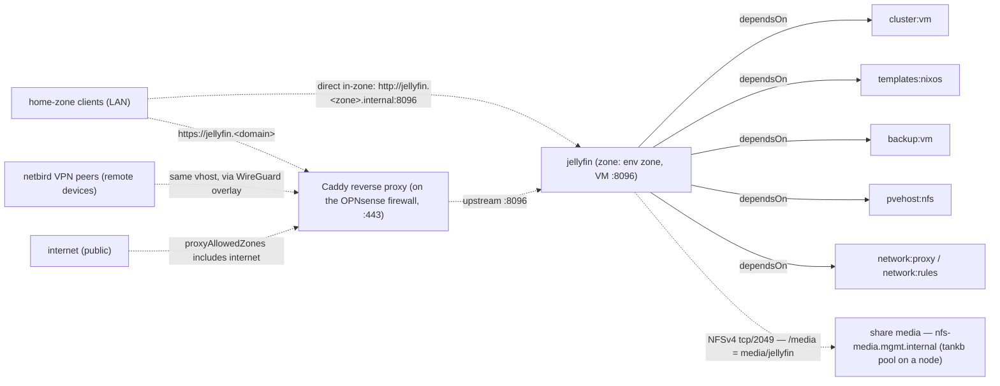

# Jellyfin

Open-source media server for personal movie, TV, music, and photo libraries.

This module is under active development (status: Development). See
[INSTALL.md](INSTALL.md) for installation and for the media share a site's
server declares — before or after Jellyfin is installed.

## Overview

| Field | Value |
|---|---|
| VM name | `jellyfin` |
| Zone | the environment's zone (`zone0` from `config/environments/<env>.json`) |
| Port | 8096 |
| VM ID | 360 |
| App version | 10.10.7 |
| VM disk | 32G on `tanka1` — OS and Jellyfin's own data (`/var/lib/jellyfin`, metadata, cache) |
| Media | `/media` — subdir `jellyfin` of the NFS share `media` (`pvehost:nfs`); a local directory while the share is pending |

## Storage

The media library is **not** in the VM. `/media` is the subdirectory `jellyfin`
of the NFS share named **`media`**, served by a cluster node from its `tankb`
pool through `pvehost:nfs`
([ADR-029](../../../docs/ADR/ADR-029%20-%20NFS%20Service.md) v0.8):

- **Jellyfin names the share, not a machine.** `jellyfin.json` mounts
  `share: "media"`, `subdir: "jellyfin"` at `/media`, `rw` — the same file on
  every site. The guest mounts `nfs-media.mgmt.internal:/tappaas-nfs/media/jellyfin`;
  the alias follows the share, so moving it to another node or pool changes
  nothing here.
- **The site's server declares the share** in its own config
  (`config/<node>.json`): name `media`, pool, quota, backup policy, and a grant
  to `jellyfin`. A consumer never creates a share.
- **The service joins them:** it shares the dataset to Jellyfin's address only,
  opens the one firewall path (Jellyfin → the share, tcp/2049) and writes the
  mount into the guest (`/etc/nixos/tappaas-nfs.nix`, imported by the
  baseline). The mount is `nofail` + automount: Jellyfin starts even while the
  server is down.

**No share yet?** Jellyfin installs and works anyway, but the media then lives
in `/media` **on the VM's own 32G disk** (on `tanka1`) — a stopgap, not a home
for a library. Declare the `media` share for real use. When it arrives, the next
update **moves** what `/media` holds into it — copied while Jellyfin runs,
`jellyfin.service` stopped for the final pass, the old directory kept as
`/media.pre-nfs` until the next healthy update — and mounts it. The module ships
with `rebootOk: true`, so that happens without anyone present; Jellyfin is down
for the final copy only.

Why: media is large and can be re-ripped or re-downloaded. It does not belong on
the replicated `tanka` tier or in the VM's backup, and it should outlive the VM
— deleting or rebuilding Jellyfin leaves the library where it is. For the same
reason Jellyfin is deliberately **not** HA (no `cluster:ha`).

Every request is squashed to the share's owner (ADR-029 D7), so the `jellyfin`
user reads and writes the share although the files on the server belong to one
reserved uid.

## Media Folders

`update.sh` creates the library folders — on the share, or on the VM's disk while
the share is pending:

```
/media/
  Movies/           Jellyfin library: Movies
  TV/               Jellyfin library: Shows
  Music/            Jellyfin library: Music
  Photos/           Jellyfin library: Photos
  Audiobooks/       Jellyfin library: Books/Audiobooks
```

Another module that needs the library — a download client writing new media,
say — gets its own grant on the share `media` and mounts it itself. It never
goes through Jellyfin. `subdir` is organisation, not isolation: every consumer
granted `media` can reach all of it (ADR-029 D15).

## Module dependencies & traffic flow



Solid arrows are declared `dependsOn` edges (install-order dependencies). Dashed
arrows are traffic: `network:proxy` creates the `jellyfin.<domain>` vhost on the
Caddy reverse proxy, and `proxyAllowedZones` (`home`, `netbird`, `internet`)
controls which source zones that vhost accepts. Home-zone clients can also reach
the VM directly in-zone. The NFS path to the share is the one rule
`network:rules` derives from the mount (none while it is pending).

## Quick Start

```bash
# installs with or without a media share — see INSTALL.md → Media share
cd "${TAPPAAS_REPO:-/home/tappaas/TAPPaaS}"/src/home/jellyfin
install-module.sh jellyfin
```

See [INSTALL.md](INSTALL.md) for full instructions.
