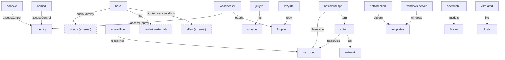

# TAPPaaS Module Dependency Model

Computed from every module's `<module>.json` (`dependsOn: "provider:service"`).
Three views: the platform plumbing every module uses, the application topology
worth drawing, and the complete per-module reference.

_Generated: 2026-11-09 by generate-module-dependencies.sh from 31 modules / 132 dependencies — do not edit by hand._

## 1. Platform plumbing

These foundation services are consumed near-universally; drawing them would
bury the interesting structure. A module uses them unless its entry in the
reference below says otherwise.

| Service | Consumers (of 31 modules) |
|---------|----------|
| `cluster:vm` | 22 |
| `network:proxy` | 21 |
| `backup:vm` | 20 |
| `templates:nixos` | 17 |
| `network:rules` | 17 |
| `identity:identity` | 8 |
| `cluster:ha` | 6 |

## 2. Application topology

Everything that is *not* plumbing — the dependencies that shape the platform.
Multiple services between the same pair are merged into one labeled edge;
providers marked `(external)` have no module in this repo yet.

## 3. Complete reference

Every dependency of every module, verbatim from the json contracts.

| Module | Depends on |
|--------|------------|
| **backup** | — |
| **cluster** | — |
| **console** | `network:proxy` `network:rules` `identity:accessControl`  |
| **coturn** | `backup:vm` `cluster:vm` `network:nat` `network:rules` `nextcloud:fileservice` `templates:nixos`  |
| **debianhost** | — |
| **deconz** | `cluster:vm` `templates:nixos` `backup:vm` `network:proxy` `network:rules`  |
| **euro-office** | `cluster:vm` `templates:nixos` `backup:vm` `network:proxy` `network:rules` `nextcloud:fileservice`  |
| **forgejo** | `cluster:vm` `templates:nixos` `backup:vm` `network:proxy` `network:rules` `identity:identity`  |
| **hass** | `cluster:vm` `backup:vm` `network:proxy` `network:rules` `alfen:ui` `alfen:discovery` `alfen:modbus` `sonos:audio` `sonos:airplay` `reolink:rtsp`  |
| **identity** | `cluster:vm` `cluster:ha` `templates:nixos` `backup:vm` `network:proxy`  |
| **immich** | `cluster:vm` `cluster:ha` `templates:nixos` `backup:vm` `network:proxy` `network:rules` `identity:identity`  |
| **jellyfin** | `cluster:vm` `backup:vm` `network:proxy` `network:rules` `storage:nfs` `templates:nixos` `identity:identity`  |
| **karakeep** | `cluster:vm` `templates:nixos` `backup:vm` `network:proxy` `network:rules` `identity:identity`  |
| **lazysite** | `cluster:vm` `templates:nixos` `network:proxy` `network:rules` `forgejo:repo`  |
| **litellm** | `cluster:vm` `templates:nixos` `backup:vm` `network:proxy` `network:rules` `identity:identity`  |
| **logging** | `cluster:vm` `templates:nixos` `backup:vm` `network:proxy`  |
| **netbird-client** | `cluster:vm` `cluster:ha` `templates:debian` `backup:vm` `identity:identity` `network:proxy`  |
| **network** | `cluster:vm` `cluster:ha` `network:proxy`  |
| **nextcloud** | `cluster:vm` `templates:nixos` `backup:vm` `network:proxy` `network:rules` `identity:identity`  |
| **nextcloud-hpb** | `backup:vm` `cluster:vm` `coturn:turn` `network:proxy` `network:rules` `nextcloud:fileservice` `templates:nixos`  |
| **nomad** | `cluster:vm` `templates:nixos` `backup:vm` `network:proxy` `network:rules` `identity:accessControl`  |
| **openwebui** | `cluster:vm` `templates:nixos` `backup:vm` `network:proxy` `litellm:models` `network:rules` `identity:identity`  |
| **pvehost** | — |
| **satellite** | — |
| **storage** | — |
| **tappaas-cicd** | `cluster:vm` `cluster:ha`  |
| **templates** | — |
| **vaultwarden** | `cluster:vm` `cluster:ha` `templates:nixos` `backup:vm` `network:proxy` `network:rules`  |
| **vllm-amd** | `cluster:lxc` `backup:vm`  |
| **windows-server** | `cluster:vm` `templates:windows` `backup:vm` `network:proxy`  |
| **woodpecker** | `cluster:vm` `templates:nixos` `backup:vm` `network:proxy` `identity:accessControl` `network:rules` `forgejo:oauth`  |
